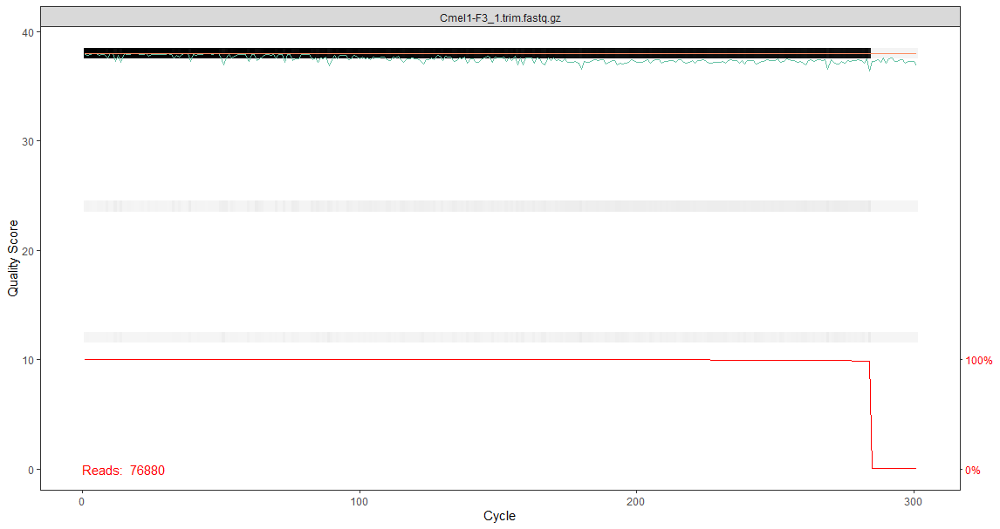
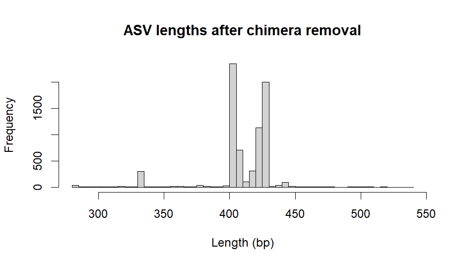
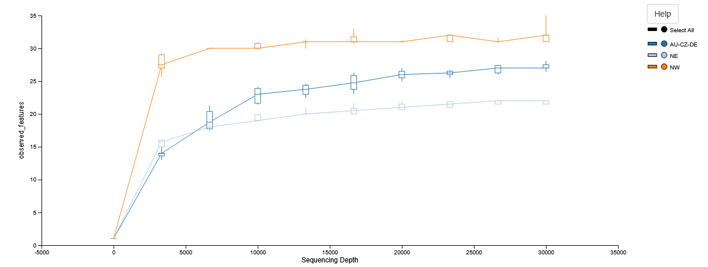
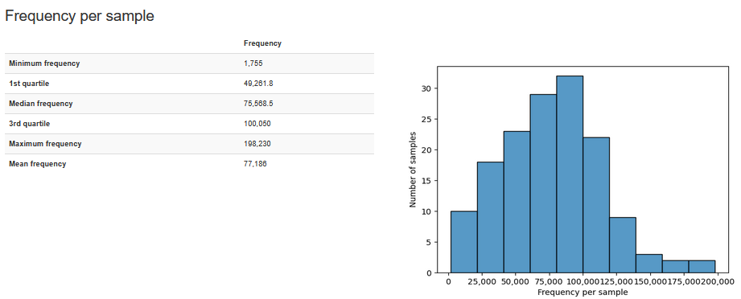
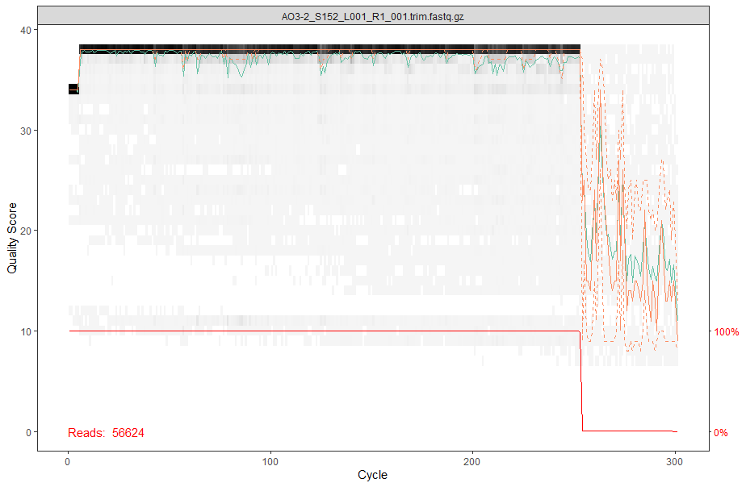
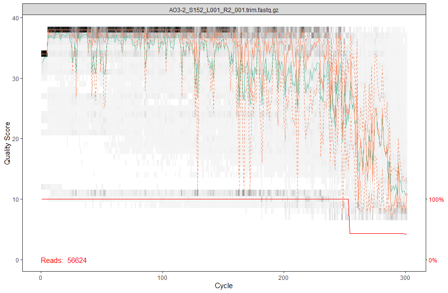
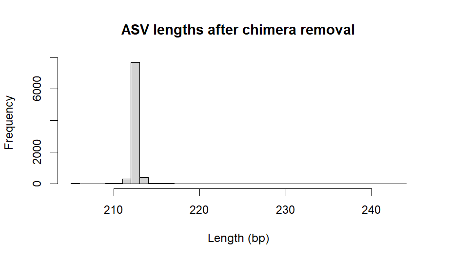

# Analysis of <i> Cacopsylla melanoneura </i> microbiome data

## Contents

1. [Collecting Data](#2)
2. [Quality Control and ASV Inference](#3)
  2.1 [FastQC](#4)
  2.2 [Cutadapt](#5)
  2.3 [Fastp](#6)
  2.4 [DADA2](#7)
  2.5 [Minimum-abundance / prevalence filtering](#8)
3. [Taxonomy Assignment](#9)
  3.1 [IDTAXA](#10)
  3.2 [QIIME](#11)
  3.3 [BLASTN](#12)
  3.4 [Curate](#14)
4. [Reanalyse Maja data](#13)

## Collecting data <a name="2"></a>
Raw sequencing reads were retreived from the archive folder \\share.unibz.it\AppliedMolecularEntomologyLab\cacopsylla_species\Cmelanoneura\amplicon_sequencing16S\macrogen2025 and uploaded to the HPC:
```bash
ls /data/users/theaven/C_melanoneura_microbiome/raw_data

for file in $(ls /data/users/theaven/C_melanoneura_microbiome/raw_data/*.fastq.gz); do
ID=$(basename $file | rev | cut -d '_' -f2- | rev)
mkdir $(dirname $file)/$ID
mv $file $(dirname $file)/$ID/.
done
```
Sample metadata is here: "\\share.unibz.it\AppliedMolecularEntomologyLab\cacopsylla_species\cacopsylla_sequencing_list.xlsx"

## Quality Control and ASV Inference <a name="3"></a>

### FastQC  <a name="4"></a>
The raw sequence reads were subjected to a quality control check using FastQC.
```bash
for ReadDir in /data/users/theaven/C_melanoneura_microbiome/raw_data/*; do
    ID=$(basename "$ReadDir")
    echo "$ID"
    zcat "$ReadDir"/*1.fastq.gz | wc -l | awk '{print $1/4}'
    zcat "$ReadDir"/*2.fastq.gz | wc -l | awk '{print $1/4}'
done

screen -S melanoneura
for ReadDir in $(ls -d /data/users/theaven/C_melanoneura_microbiome/raw_data/*); do
	Task=FastQC
	ID=$(echo "$ReadDir" | cut -d '/' -f7 | sed 's@/@_@g')
    Reads=("$ReadDir"/*.fastq.gz)
	OutDir="$ReadDir"/"$Task"
	ExpectedOutput="$OutDir"/$(basename "${Reads[0]}" | sed 's@.fastq.gz@@g')_fastqc.html

	Jobs=$(squeue -h -u theaven -n "$Task" | wc -l)
	while [ "$Jobs" -gt 9 ]; do
		sleep 5s
		printf "."
		Jobs=$(squeue -h -u theaven -n "$Task" | wc -l)
	done

	if [ ! -s "$ExpectedOutput" ]; then
		jobid=$(sbatch --job-name="$Task" --parsable ~/git_repos/Wrappers/unibz/run_fastqc.sh "$OutDir" "${Reads[@]}")
		printf "%s\t%s\t "$Task" \t%s\n" "$(date -Iseconds)" "$ID" "$jobid" >> /home/clusterusers/theaven/slurm_log.tsv
	else
		echo "For $ID found: $ExpectedOutput" 
	fi
done

conda activate seqkit-2.10
seqkit stats /data/users/theaven/C_melanoneura_microbiome/raw_data/*/*fastq.gz

```
### Cutadapt  <a name="5"></a>
Primers were removed from the reads where present using Cutadapt. Primers used by Macrogen for the 16S V3-V4 region are given at https://www.macrogen-europe.com/service/metagenome-sequencing

NOTE:The reads are a mix of paired and single end samples.
```bash
screen -r melanoneura
for ReadDir in $(ls -d /data/users/theaven/C_melanoneura_microbiome/raw_data/*); do
	Task=CutAdapt
	ID=$(echo "$ReadDir" | cut -d '/' -f7 | sed 's@/@_@g')
    Reads=("$ReadDir"/*.fastq.gz)
	OutDir="$(echo "$ReadDir" | sed 's@raw_data@qc_data@g')/"$Task""
	Forward_Primer=CCTACGGGNGGCWGCAG
	Reverse_Primer=GACTACHVGGGTATCTAATCC
	ExpectedOutput="$OutDir"/$(basename "${Reads[0]}" | sed 's@.fastq.gz@.trim.fastq.gz@g')

	Jobs=$(squeue -h -u theaven -n "$Task" | wc -l)
	while [ "$Jobs" -gt 9 ]; do
		sleep 5s
		printf "."
		Jobs=$(squeue -h -u theaven -n "$Task" | wc -l)
	done

	if [ ! -s "$ExpectedOutput" ]; then
		jobid=$(sbatch --job-name="$Task" --parsable ~/git_repos/Wrappers/unibz/run_cutadapt.sh "$OutDir" "$Forward_Primer" "$Reverse_Primer" "${Reads[@]}")
		printf "%s\t%s\t "$Task" \t%s\n" "$(date -Iseconds)" "$ID" "$jobid" >> /home/clusterusers/theaven/slurm_log.tsv
	else
		echo "For $ID found: $ExpectedOutput" 
	fi
done

for ReadDir in /data/users/theaven/C_melanoneura_microbiome/qc_data/*/CutAdapt; do
    ID=$(echo "$ReadDir" | cut -d '/' -f7 | sed 's@/@_@g')
    echo "$ID"
    zcat "$ReadDir"/*1.trim.fastq.gz | wc -l | awk '{print $1/4}'
    zcat "$ReadDir"/*2.trim.fastq.gz | wc -l | awk '{print $1/4}'
done
```
### Fastp  <a name="6"></a>

Reads were filtered with Fastp, reads/pairs shorter than 100bp or with >40% of bases below phred 20 were discarded.
```bash
screen -r melanoneura
for ReadDir in $(ls -d /data/users/theaven/C_melanoneura_microbiome/qc_data/*/CutAdapt); do
	Task=Fastp

	ID=$(echo "$ReadDir" | cut -d '/' -f7 | sed 's@/@_@g')
    Reads=("$ReadDir"/*.fastq.gz)
	OutDir="$(dirname "$ReadDir")/"$Task""
	ExpectedOutput="$OutDir"/$(basename "${Reads[0]}" | sed 's@.fastq.gz@.trimmed.fastq.gz@g')

	Jobs=$(squeue -h -u theaven -n "$Task" | wc -l)
	while [ "$Jobs" -gt 9 ]; do
		sleep 60s
		printf "."
		Jobs=$(squeue -h -u theaven -n "$Task" | wc -l)
	done

	if [ ! -s "$ExpectedOutput" ]; then
		jobid=$(sbatch --job-name="$Task" --parsable ~/git_repos/Wrappers/unibz/run_fastp.sh "$OutDir" "${Reads[@]}")
		printf "%s\t%s\t "$Task" \t%s\n" "$(date -Iseconds)" "$ID" "$jobid" >> /home/clusterusers/theaven/slurm_log.tsv
	else
		echo "For $ID found: $ExpectedOutput" 
	fi
done

for ReadDir in /data/users/theaven/C_melanoneura_microbiome/qc_data/*/Fastp; do
    ID=$(echo "$ReadDir" | cut -d '/' -f7 | sed 's@/@_@g')
    echo "$ID"
    zcat "$ReadDir"/*1.trim.trimmed.fastq.gz | wc -l | awk '{print $1/4}'
    zcat "$ReadDir"/*2.trim.trimmed.fastq.gz | wc -l | awk '{print $1/4}'
done

#Many reads are lost here, fastp quality filtering is optional and not standard for amplicon investigations, therefore will proceed with trimmed reads and use DADA2 for quality filtering.
```
### DADA2  <a name="7"></a>
The denoiser tool DADA2 was run to model and remove error patterns from the Illumina data: read ends where quality drops were trimmed, reads with high expected error (EE), or above a max EE threshold, or with any ambiguous bases (N) were discarded. DADA2’s removeBimeraDenovo function was also used to remove chimera from the ASV table. For paired reads DADA2 also merges forward and reverse reads in the overlapping region. When F and R disagree, the merge algorithm uses quality scores to pick the most likely base or discards the read. The output of DADA2 is an Alternative Sequence Variant (ASV) table as well as filtered denoised read fastq files.

DADA2 is an R package, the relavent files were downloaded:
```bash
for Dir in $(ls -d /data/users/theaven/C_melanoneura_microbiome/qc_data/*/CutAdapt); do
    if ls "$Dir"/*_1.trim.fastq.gz 1> /dev/null 2>&1 && ls "$Dir"/*_2.trim.fastq.gz 1> /dev/null 2>&1; then
        Out=/data/users/theaven/download_20260319/paired/$(echo "$Dir" | cut -d '/' -f7)
        mkdir -p "$Out"
        cp "$Dir"/*.fastq.gz "$Out"/.
    else
        Out=/data/users/theaven/download_20260319/single/$(echo "$Dir" | cut -d '/' -f7)
        mkdir -p "$Out"
        cp "$Dir"/*.fastq.gz "$Out"/.
    fi
done
```
"/data/users/theaven/download_20260319" was subseqeuntly downloaded to "C:\Users\THeaven\OneDrive - Scientific Network South Tyrol\R"

**Plot reads and select appropriate truncation lengths:**

DADA2 filter settings will truncate reads, a parameter is required below which length the read is discarded entirely. Plots of read quality help to determine a reasonable cuttoff, ie. before major dropoff in quality of many reads, or the median read quality is < Q25-30, or the lower percentile < Q20, mean and median should also be similar. However, shorter, more permissive lengths are prefered as other filter settings should act as a safety net to remove problem reads. However, for paired reads the truncated forward and reverse reads must still be long enough to overlap (at least 20bp) given the amplicon size or the reads cannot be merged.

```R
if (!require("BiocManager", quietly = TRUE))
    install.packages("BiocManager")
BiocManager::install(c("dada2","ShortRead", "Biostrings"))
install.packages("dplyr")

library(dada2)
library(ShortRead)
library(Biostrings)
library(dplyr)

setwd("C:/Users/THeaven/OneDrive - Scientific Network South Tyrol/R")
set.seed(1)

#Example reads plotted:
plotQualityProfile("download_20260319/paired/AO1_F7/AO1_F7_1.trim.fastq.gz") 
plotQualityProfile("download_20260319/paired/AO1_F7/AO1_F7_2.trim.fastq.gz") 

plotQualityProfile("download_20260319/paired/AT13-1_F3/AT13-1_F3_1.trim.fastq.gz") 
plotQualityProfile("download_20260319/paired/AT13-1_F3/AT13-1_F3_2.trim.fastq.gz") 

plotQualityProfile("download_20260319/paired/Cmel1-F3/Cmel1-F3_1.trim.fastq.gz") 
plotQualityProfile("download_20260319/paired/Cmel1-F3/Cmel1-F3_2.trim.fastq.gz") 

plotQualityProfile("download_20260319/paired/CZ_F7/CZ_F7_1.trim.fastq.gz") 
plotQualityProfile("download_20260319/paired/CZ_F7/CZ_F7_2.trim.fastq.gz") 

plotQualityProfile("download_20260319/paired/DE19_F14/DE19_F14_1.trim.fastq.gz") 
plotQualityProfile("download_20260319/paired/DE19_F14/DE19_F14_2.trim.fastq.gz") 

plotQualityProfile("download_20260319/paired/L2_F7/L2_F7_1.trim.fastq.gz") 
plotQualityProfile("download_20260319/paired/L2_F7/L2_F7_2.trim.fastq.gz") 

plotQualityProfile("download_20260319/paired/V1_M9/V1_M9_1.trim.fastq.gz") 
plotQualityProfile("download_20260319/paired/V1_M9/V1_M9_2.trim.fastq.gz")

####

plotQualityProfile("download_20260319/paired/CZ2_M6/CZ2_M6_1.trim.fastq.gz") 
plotQualityProfile("download_20260319/paired/CZ2_M6/CZ2_M6_2.trim.fastq.gz") 

plotQualityProfile("download_20260319/paired/CZ2_M8/CZ2_M8_1.trim.fastq.gz") 
plotQualityProfile("download_20260319/paired/CZ2_M8/CZ2_M8_2.trim.fastq.gz")  
```
DADA2 quality profile plots summarise per-cycle base quality scores across reads. The solid orange line is median quality score at each base position, the solid turquoise line is mean quality score at each position, orange dashed lines show 10th and 90th percentiles. Q20 = ~1% error rate. Q30 = ~ 0.1% error rate.

Both mean (turquoise) and median (orange) are well above Q30 at all positions for every example plotted. The mean of reverse reads is slightly lower than forward reads, reverse reads are expected to be lower quality than forward reads. Reverse reads are also slightly shorter than forward reads. For sample Cmel1-F3 reverse reads the 10th percentile reads drop below Q30 at one position, however both meadian and mean read quality remain good.




**Collect inputs to run DADA2:**
```R
paired <- list.files(path = "download_20260319/paired", full.names = TRUE, recursive = TRUE)

paired_1 <- paired[grepl("\\_1\\.trim.fastq.gz$", paired)]
paired_2 <- paired[grepl("\\_2\\.trim.fastq.gz$", paired)]

get_samplename <- function(x) basename(dirname(x))

snF <- vapply(paired_1, get_samplename, character(1))
snR <- vapply(paired_2, get_samplename, character(1))
paired_samples <- intersect(snF, snR)
paired_lookup_table <- data.frame(
  sample = paired_samples,
  fnF = paired_1[match(paired_samples, snF)],
  fnR = paired_2[match(paired_samples, snR)],
  stringsAsFactors = FALSE
)
```
**Run DADA2:**
As the reads appear to have very good quality strict settings can be used, truncLen was set to approximate read length post trimming.
```R
#Parameters
truncLen <- c(280, 270)  #Truncate reads to this length, then remove entirely
truncQ <- 20     #Truncate at first base with quality <= truncQ (higher = more conservative | lower = more permissive)
maxEE <- c(1,2)  #Maximum expected errors (4 for the reverse reads as these are known/expected to be lower quality)
maxN <- 0        #Maximum allowed N bases
rm.phix <- TRUE  #Remove PhiX reads (bacteriophage used as control in Illumina sequencing runs)
pool <- FALSE    #Pool samples for error rate estimation (FALSE = error model is learned per sample, this is more conservative and faster/less memory | pseudo = max sensitivity)
threads <- TRUE  #Use multithreading
outdir <- "download_20260319/results/dada2_output2"
in_df <- paired_lookup_table

#Create output directory
dir.create(outdir, showWarnings = FALSE, recursive = TRUE)

#Filter and trim reads (paired)
filtFs <- file.path(outdir, paste0(in_df$sample, "_F_filt.fastq.gz"))
filtRs <- file.path(outdir, paste0(in_df$sample, "_R_filt.fastq.gz"))
out2 <- filterAndTrim(fwd = in_df$fnF, filt = filtFs, rev = in_df$fnR, filt.rev = filtRs, truncLen = truncLen, maxN = maxN, maxEE = maxEE, truncQ = truncQ, rm.phix = rm.phix, compress = TRUE, multithread = threads)

#Learn error rates, dereplicate, run DADA2 algorithm, and merge pairs
#Learn errors separately for F and R
errF <- learnErrors(filtFs, nbases = 5e10, multithread = threads)
errR <- learnErrors(filtRs, nbases = 5e10, multithread = threads)

#3661454720 total bases in 13076624 reads from 150 samples will be used for learning the error rates.
#3530688480 total bases in 13076624 reads from 150 samples will be used for learning the error rates.

#Derep separately
derepF <- derepFastq(filtFs, verbose = TRUE)
derepR <- derepFastq(filtRs, verbose = TRUE)
names(derepF) <- in_df$sample
names(derepR) <- in_df$sample
#Denoise separately
dadaF <- dada(derepF, err = errF, pool = pool, multithread = threads)
dadaR <- dada(derepR, err = errR, pool = pool, multithread = threads)
#Merge pairs
mergers <- mergePairs(dadaF, derepF, dadaR, derepR, verbose = TRUE)

#Make ASV table and remove chimeras
seqtab <- makeSequenceTable(mergers)
seqtab.nochim <- removeBimeraDenovo(seqtab, method = "consensus", multithread = threads, verbose = TRUE)
nonchim_reads <- rowSums(seqtab.nochim)
chim_reads    <- rowSums(seqtab) - nonchim_reads
chim_track <- cbind(nonchim = nonchim_reads, chimera = chim_reads, chimera_fraction = chim_reads / rowSums(seqtab))

#Plot merged read lengths after chimera removal:
asv_lengths <- nchar(colnames(seqtab.nochim))
summary(asv_lengths)
hist(asv_lengths, breaks=50, main="ASV lengths after chimera removal", xlab="Length (bp)")

# Save results
saveRDS(seqtab.nochim, file = file.path(outdir, "seqtab.nochim.rds"))
write.table(seqtab.nochim, file.path(outdir, "seqtab.nochim.tsv"), sep="\t", quote=FALSE, col.names=NA)

getN <- function(x) sum(getUniques(x))
track <- cbind(input    = out[, "reads.in"], filtered = out[, "reads.out"], denoisedF = sapply(dadaF, getN), denoisedR = sapply(dadaR, getN), merged = sapply(mergers, function(x) sum(x$abundance)))
rownames(track) <- in_df$sample
write.table(track, file.path(outdir, "read_tracking.tsv"), sep="\t", quote=FALSE, col.names=NA)

write.table(chim_track, file.path(outdir, "chimera_tracking.tsv"), sep="\t", quote=FALSE, col.names=NA)
```


#### QIIME - plot
Plot rarefaction curve with qiime

Prepare inputs DADA2(R) -> QIIME2(HPC):
```bash
module load apptainer/1.4.1-gcc-13.3.0-3coysxn

ASV_dir=/data/users/theaven/C_melanoneura_microbiome/asvs/ASVs

apptainer exec --bind /data:/data --bind /home/clusterusers/theaven:/home/clusterusers/theaven ~/git_repos/Containers/python3.sif python ~/git_repos/Scripts/unibz/make_qiime2_inputs.py \
  --counts "$ASV_dir"/ASV_asv.tsv \
  --map "$ASV_dir"/ASV_id_map.csv \
  --out-dir "$ASV_dir"/qiime_inputs \
  --out-prefix qiime_inputs

apptainer exec ~/git_repos/Containers/qiime2-amplicon-2025.7.sif qiime tools import \
  --type 'FeatureData[Sequence]' \
  --input-path "$ASV_dir"/ASVs.fasta \
  --output-path "$ASV_dir"/rep-seqs.qza

#Input metadata:
echo -e "#SampleID" > "$ASV_dir"/sample-metadata.tsv
head -n 1 "$ASV_dir"/qiime_inputs/qiime_inputsASV_table.tsv | cut -f2- | tr '\t' '\n' >> "$ASV_dir"/sample-metadata.tsv
#Download, input metadata, upload

apptainer exec ~/git_repos/Containers/qiime2-amplicon-2025.7.sif qiime tools export \
  --input-path "$ASV_dir"/rep-seqs.qza \
  --output-path "$ASV_dir"/rep-seqs-fasta
```
Plot

```bash
#Build tree
srun -p bioagri  -c 4 --mem 64G --pty bash
module load apptainer/1.4.1-gcc-13.3.0-3coysxn
ASV_dir=/data/users/theaven/C_melanoneura_microbiome/asvs/ASVs
mkdir -p "$ASV_dir"/tmp
TMPDIR="$ASV_dir"/tmp \
apptainer exec ~/git_repos/Containers/qiime2-amplicon-2025.7.sif \
qiime alignment mafft \
  --i-sequences "$ASV_dir"/rep-seqs.qza \
  --o-alignment "$ASV_dir"/aligned-rep-seqs.qza \
  --p-n-threads 4

apptainer exec ~/git_repos/Containers/qiime2-amplicon-2025.7.sif qiime alignment mask \
  --i-alignment "$ASV_dir"/aligned-rep-seqs.qza \
  --o-masked-alignment "$ASV_dir"/masked-aligned-rep-seqs.qza 

apptainer exec ~/git_repos/Containers/qiime2-amplicon-2025.7.sif qiime phylogeny fasttree \
  --i-alignment "$ASV_dir"/masked-aligned-rep-seqs.qza \
  --o-tree "$ASV_dir"/unrooted-tree.qza

apptainer exec ~/git_repos/Containers/qiime2-amplicon-2025.7.sif qiime phylogeny midpoint-root \
  --i-tree "$ASV_dir"/unrooted-tree.qza \
  --o-rooted-tree "$ASV_dir"/rooted-tree.qza

#Plot rarefaction curve
awk 'NR>1 {for(i=2;i<=NF;i++) if($i>max) max=$i} END{print max}' "$ASV_dir"/ASV_asv.tsv #178692
awk 'NR==1 {next} {sum=0; for(i=2;i<=NF;i++) sum+=$i; print $1, sum}' "$ASV_dir"/ASV_asv.tsv | sort -k2 -n | sort -k2 -n | sort -k2 -n | head -3 #AO1_F8 1834 \ Cmel1-M2 33843 \ Cmel58-I2 33888
awk 'NR==1 {next} {sum=0; for(i=2;i<=NF;i++) sum+=$i; print $1, sum}' "$ASV_dir"/ASV_asv.tsv | sort -k2 -n | sort -k2 -n | sort -k2 -n | tail -1 #198770
apptainer exec ~/git_repos/Containers/qiime2-amplicon-2025.7.sif qiime diversity alpha-rarefaction \
  --i-table "$ASV_dir"/qiime_inputs/table.qza \
  --i-phylogeny rooted-tree.qza \
  --p-max-depth 30000 \
  --m-metadata-file "$ASV_dir"/sample-metadata.tsv \
  --o-visualization "$ASV_dir"/alpha-rarefaction.qzv 

apptainer exec ~/git_repos/Containers/qiime2-amplicon-2025.7.sif qiime diversity alpha-rarefaction \
  --i-table "$ASV_dir"/qiime_inputs/table.qza \
  --i-phylogeny rooted-tree.qza \
  --p-max-depth 100000 \
  --m-metadata-file "$ASV_dir"/sample-metadata.tsv \
  --o-visualization "$ASV_dir"/alpha-rarefaction-100000.qzv 
```


### Minimum-abundance / prevalence filtering  <a name="8"></a>

Remove ASV if is not at least 1% of reads in a sample or 0.1% of reads in multiple samples. (Sequencing errors and tag-jumps almost always show up in one sample only)
```R
ASV <- readRDS("download_20260319/results/dada2_output2/seqtab.nochim.rds")

prune_single_sample_low_abundance <- function(seqtab, min_rel = 0.01) {
  prevalence <- colSums(seqtab > 0) #count how many samples each ASV appears in
  sample_totals <- rowSums(seqtab) #find total reads per sample
  rel_abund <- sweep(seqtab, 1, sample_totals, "/") #ASV_reads / total_reads_in_sample
  rel_abund[is.na(rel_abund)] <- 0 #Set relative abundance to 0 where undefined
  max_rel <- apply(rel_abund, 2, max) #Finds the highest relative abundance ASV ever reaches (for single sample ASVs there is only 1 value)
  keep <- (max_rel >= 0.01) | (prevalence >= 2 & max_rel >= 0.001) #remove ASV if is not at least 1% of reads in a sample or 0.1% of reads in multiple samples
  seqtab[, keep, drop = FALSE]
}

ASV_pruned <- prune_single_sample_low_abundance(ASV, min_rel = 0.01)

ncol(ASV) #7350
ncol(ASV_pruned) #864
mean(rowSums(ASV_pruned > 0)) #31.8

dir.create("download_20260319/ASVs", showWarnings = FALSE, recursive = TRUE)

saveRDS(ASV_pruned, file = file.path("download_20260319/ASVs/ASV_asv.rds"))
write.table(ASV_pruned, file.path("download_20260319/ASVs/ASV_asv.tsv"), sep="\t", quote=FALSE, col.names=NA)

# seqtab_filt: samples x ASVs
asv_seqs <- colnames(ASV_pruned)
asv_headers <- paste0("ASV", seq_along(asv_seqs))
dna <- Biostrings::DNAStringSet(asv_seqs)
names(dna) <- asv_headers
Biostrings::writeXStringSet(dna, "download_20260319/ASVs/ASVs.fasta")
write.csv(data.frame(ASV=asv_headers, Sequence=asv_seqs), "download_20260319/ASVs/ASV_id_map.csv", row.names = FALSE)
```
## Taxonomy Assignment <a name="9"></a>

A ready-made IDTAXA training set is publically available for SILVA SSU and was downloaded from https://www2.decipher.codes/Downloads.html - Accessed 07/01/2026

### IDTAXA <a name="10"></a>

IDTAXA (DECIPHER package in R) - probabilistic sequence classification, model-based learning - usually more accurate and conservative than BLAST or naive Bayes. IDTAXA does not require trimming and handles full-length sequences correctly. IDTAXA is slower than QIIME2 NB, but usually much more accurate. If trained on full-length, IDTAXA often backs off to a safer rank rather than confidently guessing too deep.

NOTE: the 'species' data in SILVA can be questionable as users list host organism in this field or write things like 'metagenome'. We will need to be carefull when interpreting the Assignment results at the species level. Also, for some entries species is given but not all the higher level taxa, this can cause problems because IDTAXA likes unique species to have only one taxonomic path. Other entries like Incertae Sedis also had to be made unambiguous. I have therefore changed every column to give the full ':' seperated taxonomic path to that level in order to bypass this problem, this tranformation will presumably need to be reversed in the outputs of IDTAXA in order to make them readable. 

```R
if (!require("BiocManager", quietly = TRUE))
    install.packages("BiocManager")
BiocManager::install(c("DECIPHER","stringr", "Biostrings"))

library(DECIPHER)
library(Biostrings)
library(stringr)

setwd("C:/Users/THeaven/OneDrive - Scientific Network South Tyrol/R")

load("SILVA_SSU_r138_2_2024.RData")

SSU_trainingSet <- trainingSet

SSU_ASVs <- readDNAStringSet("download_20260319/ASVs/ASVs.fasta")

SSU_tax_idtaxa <- IdTaxa(
  SSU_ASVs,
  SSU_trainingSet,
  strand = "both",
  bootstraps = 100 , #default - maximum number of bootstrap replicates to perform for each sequence
  processors = NULL, #Use all available cores
  threshold = 60 ,  #% of bootstraps supporting assignment, raise to 70–80 for fewer false positives
  verbose = TRUE 
)

# Convert to table
target_ranks <- c("root","domain","phylum","class","order","family","genus","species")

extract_tax <- function(x) {
  out <- setNames(rep(NA_character_, length(target_ranks)), target_ranks)
  if (!is.null(x$rank) && length(x$rank)) {
    idx <- match(tolower(x$rank), target_ranks)
    keep <- !is.na(idx)
    out[idx[keep]] <- x$taxon[keep]
  }
  out
}

SSU_tax_tab <- t(vapply(SSU_tax_idtaxa, extract_tax,
                    FUN.VALUE = setNames(rep(NA_character_, length(target_ranks)), target_ranks)))
SSU_tax_tab <- as.data.frame(SSU_tax_tab, stringsAsFactors = FALSE)
rownames(SSU_tax_tab) <- names(SSU_ASVs)
write.table(SSU_tax_tab, file = "download_20260319/ASVs/SSU_tax_tab_corrected.tsv", sep = "\t", row.names = TRUE, quote = FALSE, na = "NA")

#convert to qiime format for plotting
tax_df <- data.frame(
  Feature.ID = names(SSU_tax_idtaxa),
  Taxon = sapply(SSU_tax_idtaxa, function(x) {
    # Skip the first rank (root)
    ranks <- c("k__", "p__", "c__", "o__", "f__", "g__", "s__")
    paste0(ranks, x$taxon[-1])[1:length(ranks)] |> paste(collapse = "; ")
  }),
  Confidence = sapply(SSU_tax_idtaxa, function(x) {
    min(x$confidence, na.rm = TRUE) / 100
  })
)

write.table(
  tax_df,
  "download_20260319/ASVs/idtaxa_taxonomy.tsv",
  sep = "\t",
  quote = FALSE,
  row.names = FALSE
)
```
Curate the taxonomy file: replace g_endosymbionts with g_unclassified_f, replace Incertae Sedis entries with x_unclassified_x, propogate x_unclassified_x entries down ranks. ->  idtaxa_taxonomy2.tsv

Upload and plot with qiime
```bash
apptainer exec ~/git_repos/Containers/qiime2-amplicon-2025.7.sif qiime tools import \
  --type 'FeatureData[Taxonomy]' \
  --input-path "$ASV_dir"/idtaxa_taxonomy.tsv \
  --output-path "$ASV_dir"/idtaxa_taxonomy.qza \
  --input-format HeaderlessTSVTaxonomyFormat

apptainer exec ~/git_repos/Containers/qiime2-amplicon-2025.7.sif qiime taxa barplot \
  --i-table "$ASV_dir"/qiime_inputs/table.qza \
  --i-taxonomy "$ASV_dir"/idtaxa_taxonomy.qza \
  --m-metadata-file "$ASV_dir"/sample-metadata.tsv \
  --o-visualization "$ASV_dir"/idtaxa-barplot.qzv

apptainer exec ~/git_repos/Containers/qiime2-amplicon-2025.7.sif qiime tools import \
  --type 'FeatureData[Taxonomy]' \
  --input-path "$ASV_dir"/idtaxa_taxonomy2.tsv \
  --output-path "$ASV_dir"/idtaxa_taxonomy2.qza \
  --input-format HeaderlessTSVTaxonomyFormat

apptainer exec ~/git_repos/Containers/qiime2-amplicon-2025.7.sif qiime taxa barplot \
  --i-table "$ASV_dir"/qiime_inputs/table.qza \
  --i-taxonomy "$ASV_dir"/idtaxa_taxonomy2.qza \
  --m-metadata-file "$ASV_dir"/sample-metadata.tsv \
  --o-visualization "$ASV_dir"/idtaxa-barplot2.qzv
```


### QIIME2 <a name="11"></a>

For high-throughput classification the most commonly used appraoch in the literature appears to be QIIME2 classifier + SILVA database. QIIME2 is a naive Bayes classifier that learns k-mer frequency patterns, it handles short, conserved sequences better than BLAST and is better for assigning ambiguous reads, handling subtle variations in conserved regions, and avoiding overconfident species matches. The output is probability-based taxonomic assignments. 

Pre-trained QIIME2 classifiers for SSU regions are available from SILVA. However, these are prepared on the full length region, V4 region, and V4-5 region, we have the V3-4 region. For high-level taxonomy (domain, phylum, maybe class) this should be fine to use. For genus- or species-level resolution accuracy will likely be low.

Prepare inputs DADA2(R) -> QIIME2(HPC):
```bash
module load apptainer/1.4.1-gcc-13.3.0-3coysxn

ASV_dir=/data/users/theaven/C_melanoneura_microbiome/asvs/ASVs

apptainer exec --bind /data:/data --bind /home/clusterusers/theaven:/home/clusterusers/theaven ~/git_repos/Containers/python3.sif python ~/git_repos/Scripts/unibz/make_qiime2_inputs.py \
  --counts "$ASV_dir"/ASV_asv.tsv \
  --map "$ASV_dir"/ASV_id_map.csv \
  --out-dir "$ASV_dir"/qiime_inputs \
  --out-prefix qiime_inputs

apptainer exec ~/git_repos/Containers/qiime2-amplicon-2025.7.sif qiime tools import \
  --type 'FeatureData[Sequence]' \
  --input-path "$ASV_dir"/ASVs.fasta \
  --output-path "$ASV_dir"/rep-seqs.qza
```
Visualise data with QIIME:
```bash
apptainer exec docker://quay.io/qiime2/amplicon:2025.7 qiime --version
apptainer pull ~/git_repos/Containers/qiime2-amplicon-2025.7.sif docker://quay.io/qiime2/amplicon:2025.7

#Visualise inputs:
apptainer exec ~/git_repos/Containers/qiime2-amplicon-2025.7.sif biom convert \
  -i "$ASV_dir"/qiime_inputs/qiime_inputsASV_table.tsv \
  -o "$ASV_dir"/qiime_inputs/ASV_table.biom \
  --table-type="OTU table" \
  --to-hdf5

apptainer exec ~/git_repos/Containers/qiime2-amplicon-2025.7.sif qiime tools import \
  --type 'FeatureTable[Frequency]' \
  --input-path "$ASV_dir"/qiime_inputs/ASV_table.biom \
  --output-path "$ASV_dir"/qiime_inputs/table.qza

apptainer exec ~/git_repos/Containers/qiime2-amplicon-2025.7.sif qiime feature-table summarize \
  --i-table "$ASV_dir"/qiime_inputs/table.qza \
  --o-visualization "$ASV_dir"/qiime_inputs/table.qzv

apptainer exec ~/git_repos/Containers/qiime2-amplicon-2025.7.sif qiime feature-table tabulate-seqs \
  --i-data "$ASV_dir"/rep-seqs.qza \
  --o-visualization "$ASV_dir"/rep-seqs.qzv
```
QIIME2 Naïve Bayes ideally needs a database trimmed to your exact primer region. For ASVs < ~500 bp (typical amplicons) region-specific training is usually worth it. It is therefore advised to train a classifier on SILVA trimmed to our primer region to hopefully get a per-ASV taxonomy up to genus/species (if present in the DB). As only successfully merged forward and reverse reads were retained all should represent the full amplicon region, therefore the full region between primer hits in the database will be kept.

A new classifier was trained for the 16S V3-4 ASVs generated from Forward_Primer (341F) (CCTACGGGNGGCWGCAG) and Reverse_Primer (785R) (GACTACHVGGGTATCTAATCC):

```bash
#Import SILVA SSU reference files into QIIME2
apptainer exec ~/git_repos/Containers/qiime2-amplicon-2025.7.sif qiime tools import \
  --type 'FeatureData[RNASequence]' \
  --input-path ~/db/SILVA/ssu_138.2/SILVA_138.2_SSURef_NR99_tax_silva.fasta \
  --output-path ~/db/SILVA/ssu_138.2/silva-138.2-ssu-nr99-seqs.qza

apptainer exec ~/git_repos/Containers/qiime2-amplicon-2025.7.sif qiime tools import \
  --type 'FeatureData[SILVATaxidMap]' \
  --input-path ~/db/SILVA/ssu_138.2/taxmap_slv_ssu_ref_nr_138.2.txt \
  --output-path ~/db/SILVA/ssu_138.2/taxmap-silva-138.2-ssu-nr99.qza

apptainer exec ~/git_repos/Containers/qiime2-amplicon-2025.7.sif qiime tools import \
  --type 'FeatureData[SILVATaxonomy]' \
  --input-path ~/db/SILVA/ssu_138.2/tax_slv_ssu_138.2.txt \
  --output-path ~/db/SILVA/ssu_138.2/taxranks-silva-138.2-ssu-nr99.qza

apptainer exec ~/git_repos/Containers/qiime2-amplicon-2025.7.sif qiime tools import \
  --type 'Phylogeny[Rooted]' \
  --input-path ~/db/SILVA/ssu_138.2/tax_slv_ssu_138.2.tre \
  --output-path ~/db/SILVA/ssu_138.2/taxtree-silva-138.2-nr99.qza

#Generate a fixed‑rank taxonomy with RESCRIPt
apptainer exec ~/git_repos/Containers/qiime2-amplicon-2025.7.sif qiime rescript parse-silva-taxonomy \
  --i-taxonomy-tree ~/db/SILVA/ssu_138.2/taxtree-silva-138.2-nr99.qza \
  --i-taxonomy-map ~/db/SILVA/ssu_138.2/taxmap-silva-138.2-ssu-nr99.qza \
  --i-taxonomy-ranks ~/db/SILVA/ssu_138.2/taxranks-silva-138.2-ssu-nr99.qza \
  --p-ranks domain kingdom phylum class order family genus \
  --p-include-species-labels \
  --p-no-rank-propagation \
  --o-taxonomy ~/db/SILVA/ssu_138.2/silva-138.2-ssu-nr99-taxonomy.qza

#Export
apptainer exec ~/git_repos/Containers/qiime2-amplicon-2025.7.sif qiime tools export \
  --input-path ~/db/SILVA/ssu_138.2/silva-138.2-ssu-nr99-taxonomy.qza \
  --output-path ~/db/SILVA/ssu_138.2/silva-138.2-ssu-nr99-taxonomy

apptainer exec ~/git_repos/Containers/qiime2-amplicon-2025.7.sif qiime tools export \
  --input-path ~/db/SILVA/ssu_138.2/silva-138.2-ssu-nr99-seqs.qza \
  --output-path ~/db/SILVA/ssu_138.2/silva-138.2-ssu-nr99-seqs

#Convert to DNA
apptainer exec ~/git_repos/Containers/qiime2-amplicon-2025.7.sif qiime rescript reverse-transcribe \
  --i-rna-sequences ~/db/SILVA/ssu_138.2/silva-138.2-ssu-nr99-seqs.qza \
  --o-dna-sequences ~/db/SILVA/ssu_138.2/silva-138.2-ssu-nr99-seqs-dna.qza

#Filter for amplicon region
apptainer exec ~/git_repos/Containers/qiime2-amplicon-2025.7.sif \
qiime feature-classifier extract-reads \
  --i-sequences ~/db/SILVA/ssu_138.2/silva-138.2-ssu-nr99-seqs-dna.qza \
  --p-f-primer CCTACGGGNGGCWGCAG \
  --p-r-primer GACTACHVGGGTATCTAATCC \
  --p-read-orientation both \
  --o-reads ~/db/SILVA/ssu_138.2/V3V4-341f-785r-amplicon.qza

apptainer exec ~/git_repos/Containers/qiime2-amplicon-2025.7.sif qiime feature-table tabulate-seqs \
  --i-data ~/db/SILVA/ssu_138.2/V3V4-341f-785r-amplicon.qza \
  --o-visualization ~/db/SILVA/ssu_138.2/V3V4-341f-785r-amplicon.qzv
#463,032 sequences, 2% percentile = length 384, 98% percentile = length 565, mean length 420.77

#Train classifier
screen -S melanoneura
srun -p bioagri  -c 1 --mem 32G --pty bash
module load apptainer/1.4.1-gcc-13.3.0-3coysxn
apptainer exec ~/git_repos/Containers/qiime2-amplicon-2025.7.sif qiime feature-classifier fit-classifier-naive-bayes \
  --i-reference-reads ~/db/SILVA/ssu_138.2/V3V4-341f-785r-amplicon.qza \
  --i-reference-taxonomy ~/db/SILVA/ssu_138.2/silva-138.2-ssu-nr99-taxonomy.qza \
  --o-classifier ~/db/SILVA/ssu_138.2/V3V4-341f-785r-amplicon-classifier.qza
```
Run QIIME2 classification
```bash
#Classify
screen -S melanoneura
srun -p bioagri  -c 4 --mem 64G --pty bash
module load apptainer/1.4.1-gcc-13.3.0-3coysxn
ASV_dir=/data/users/theaven/C_melanoneura_microbiome/asvs/ASVs
apptainer exec ~/git_repos/Containers/qiime2-amplicon-2025.7.sif qiime feature-classifier classify-sklearn \
  --i-classifier ~/db/SILVA/ssu_138.2/V3V4-341f-785r-amplicon-classifier.qza \
  --i-reads "$ASV_dir"/rep-seqs.qza \
  --o-classification "$ASV_dir"/V3V4-341f-785r-taxonomy.qza \
  --p-n-jobs 4

#Export
apptainer exec ~/git_repos/Containers/qiime2-amplicon-2025.7.sif qiime tools export \
  --input-path "$ASV_dir"/V3V4-341f-785r-taxonomy.qza \
  --output-path "$ASV_dir"/qiime_V3V4-341f-785r_taxonomy

#Input metadata:
echo -e "#SampleID" > "$ASV_dir"/sample-metadata.tsv
head -n 1 "$ASV_dir"/qiime_inputs/qiime_inputsASV_table.tsv | cut -f2- | tr '\t' '\n' >> "$ASV_dir"/sample-metadata.tsv
#Download, input metadata, upload

#Visualise:
apptainer exec ~/git_repos/Containers/qiime2-amplicon-2025.7.sif qiime taxa barplot \
  --i-table "$ASV_dir"/qiime_inputs/table.qza \
  --i-taxonomy "$ASV_dir"/V3V4-341f-785r-taxonomy.qza \
  --m-metadata-file "$ASV_dir"/sample-metadata.tsv \
  --o-visualization "$ASV_dir"/V3V4-341f-785r-taxa-barplot.qzv
```
Run QIIME2 classification - compare to prebuilt V4 classifier
```bash
##Uniform:
#Classify
screen -S melanoneura
srun -p bioagri  -c 4 --mem 64G --pty bash
module load apptainer/1.4.1-gcc-13.3.0-3coysxn
ASV_dir=/data/users/theaven/C_melanoneura_microbiome/asvs/ASVs
apptainer exec ~/git_repos/Containers/qiime2-amplicon-2025.7.sif qiime feature-classifier classify-sklearn \
  --i-classifier ~/db/SILVA/ssu_138.2/SILVA138.2_SSURef_NR99_uniform_classifier_V4-515f-806r.qza \
  --i-reads "$ASV_dir"/rep-seqs.qza \
  --o-classification "$ASV_dir"/V4-515f-806r-taxonomy.qza \
  --p-n-jobs 4

#Export
apptainer exec ~/git_repos/Containers/qiime2-amplicon-2025.7.sif qiime tools export \
  --input-path "$ASV_dir"/V4-515f-806r-taxonomy.qza \
  --output-path "$ASV_dir"/qiime_V4-515f-806r_taxonomy

#Visualise:
apptainer exec ~/git_repos/Containers/qiime2-amplicon-2025.7.sif qiime taxa barplot \
  --i-table "$ASV_dir"/qiime_inputs/table.qza \
  --i-taxonomy "$ASV_dir"/V4-515f-806r-taxonomy.qza \
  --m-metadata-file "$ASV_dir"/sample-metadata.tsv \
  --o-visualization "$ASV_dir"/V4-515f-806r-taxa-barplot.qzv

##average weighted:
#Classify
screen -S melanoneura
srun -p bioagri  -c 4 --mem 64G --pty bash
module load apptainer/1.4.1-gcc-13.3.0-3coysxn
ASV_dir=/data/users/theaven/C_melanoneura_microbiome/asvs/ASVs
apptainer exec ~/git_repos/Containers/qiime2-amplicon-2025.7.sif qiime feature-classifier classify-sklearn \
  --i-classifier ~/db/SILVA/ssu_138.2/SILVA138.2_SSURef_NR99_weighted_classifier_V4-515f-806r_average.qza \
  --i-reads "$ASV_dir"/rep-seqs.qza \
  --o-classification "$ASV_dir"/V4-515f-806r-average-taxonomy.qza \
  --p-n-jobs 4

#Export
apptainer exec ~/git_repos/Containers/qiime2-amplicon-2025.7.sif qiime tools export \
  --input-path "$ASV_dir"/V4-515f-806r-average-taxonomy.qza \
  --output-path "$ASV_dir"/qiime_V4-515f-806r-average_taxonomy

#Visualise:
apptainer exec ~/git_repos/Containers/qiime2-amplicon-2025.7.sif qiime taxa barplot \
  --i-table "$ASV_dir"/qiime_inputs/table.qza \
  --i-taxonomy "$ASV_dir"/V4-515f-806r-average-taxonomy.qza \
  --m-metadata-file "$ASV_dir"/sample-metadata.tsv \
  --o-visualization "$ASV_dir"/V4-515f-806r-average-taxa-barplot.qzv

##distal gut weighted:
#Classify
screen -S melanoneura
srun -p bioagri  -c 4 --mem 64G --pty bash
module load apptainer/1.4.1-gcc-13.3.0-3coysxn
ASV_dir=/data/users/theaven/C_melanoneura_microbiome/asvs/ASVs
apptainer exec ~/git_repos/Containers/qiime2-amplicon-2025.7.sif qiime feature-classifier classify-sklearn \
  --i-classifier ~/db/SILVA/ssu_138.2/SILVA138.2_SSURef_NR99_weighted_classifier_V4-515f-806r_animal-distal-gut.qza \
  --i-reads "$ASV_dir"/rep-seqs.qza \
  --o-classification "$ASV_dir"/V4-515f-806r-nimal-distal-gut-taxonomy.qza \
  --p-n-jobs 4

#Export
apptainer exec ~/git_repos/Containers/qiime2-amplicon-2025.7.sif qiime tools export \
  --input-path "$ASV_dir"/V4-515f-806r-nimal-distal-gut-taxonomy.qza \
  --output-path "$ASV_dir"/qiime_V4-515f-806r-nimal-distal-gut_taxonomy

#Visualise:
apptainer exec ~/git_repos/Containers/qiime2-amplicon-2025.7.sif qiime taxa barplot \
  --i-table "$ASV_dir"/qiime_inputs/table.qza \
  --i-taxonomy "$ASV_dir"/V4-515f-806r-nimal-distal-gut-taxonomy.qza \
  --m-metadata-file "$ASV_dir"/sample-metadata.tsv \
  --o-visualization "$ASV_dir"/V4-515f-806r-nimal-distal-gut-taxa-barplot.qzv

apptainer exec ~/git_repos/Containers/qiime2-amplicon-2025.7.sif qiime tools view "$ASV_dir"/V4-515f-806r-nimal-distal-gut-taxa-barplot.qzv
```

### BLASTN <a name="12"></a>

BLAST is alignment based, limited by 'best hit' interpretation, and prone to misidentifying short or conserved seqeunces. For eDNA/metabarcoding, BLAST is often too literal — it finds the closest sequence, even if it’s wrong. However, the NCBI nt database is far larger than any dedicated database, including SILVA.

BLASTN vs NCBI nt database:
```bash
#Run BLAST with many hits
for ASV in $(find /data/users/theaven/C_melanoneura_microbiome/asvs/ASVs -name 'ASVs.fasta' -type f); do
	Task=blast
	Database=/data/blobtoolkit/nt/nt
	Max_target=9999
	OutPrefix=$(dirname $ASV | rev | cut -d '/' -f1 | rev)
	OutDir="$(dirname $ASV)"/"$Task"
	mkdir -p $OutDir
	ExpectedOutput="$OutDir"/${OutPrefix}.vs."$(basename $Database)".mts"$Max_target".hsp1.1e25.megablast.out

	if [ ! -s "$ExpectedOutput" ]; then
		jobid=$(sbatch --job-name="$Task" --parsable ~/git_repos/Wrappers/unibz/run_blastn.sh "$ASV" "$Database" "$OutDir" "$OutPrefix" "$Max_target")
		printf "%s\t%s\t "$Task" \t%s\n" "$(date -Iseconds)" "$ID" "$jobid" >> /home/clusterusers/theaven/slurm_log.tsv
	else
		echo "For $ID found: $ExpectedOutput" 
	fi
done

#Run BLAST for just the top hits
for ASV in $(find /data/users/theaven/C_melanoneura_microbiome/asvs/ASVs -name 'ASVs.fasta' -type f); do
	Task=blast
	Database=/data/blobtoolkit/nt/nt
	Max_target=1
	OutPrefix=$(dirname $ASV | rev | cut -d '/' -f1 | rev)
	OutDir="$(dirname $ASV)"/"$Task"
	mkdir -p $OutDir
	ExpectedOutput="$OutDir"/${OutPrefix}.vs."$(basename $Database)".mts"$Max_target".hsp1.1e25.megablast.out

	if [ ! -s "$ExpectedOutput" ]; then
		jobid=$(sbatch --job-name="$Task" --parsable ~/git_repos/Wrappers/unibz/run_blastn.sh "$ASV" "$Database" "$OutDir" "$OutPrefix" "$Max_target")
		printf "%s\t%s\t "$Task" \t%s\n" "$(date -Iseconds)" "$ID" "$jobid" >> /home/clusterusers/theaven/slurm_log.tsv
	else
		echo "For $ID found: $ExpectedOutput" 
	fi
done

#Get taxonomy information for hits
module load anaconda3
conda activate taxonkit
wget -c https://ftp.ncbi.nih.gov/pub/taxonomy/taxdump.tar.gz 
tar -zxvf taxdump.tar.gz
mkdir -p $HOME/.taxonkit
cp names.dmp nodes.dmp delnodes.dmp merged.dmp $HOME/.taxonkit

#Tophit:
cut -f 2 /data/users/theaven/C_melanoneura_microbiome/asvs/ASVs/blast/ASVs.vs.nt.mts1.hsp1.1e25.megablast.out > taxonomy_ids.txt
taxonkit lineage taxonomy_ids.txt | taxonkit reformat -F -f "{k}\t{p}\t{c}\t{o}\t{f}\t{g}\t{s}" > taxonomic_paths.tsv
awk -F'\t' -v OFS='\t' 'NR==FNR{gsub(/\r/,"",$0);tax[$1]=$2 OFS $3 OFS $4 OFS $5 OFS $6 OFS $7 OFS $8;next}{gsub(/\r/,"",$0)}FNR==1{print $0,"k","p","c","o","f","g","s";next}{tid=$2;if(tid~/;/)print $0,"","","","","","","";else if(tid in tax)print $0,tax[tid];else print $0,"","","","","","",""}' taxonomic_paths.tsv /data/users/theaven/C_melanoneura_microbiome/asvs/ASVs/blast/ASVs.vs.nt.mts1.hsp1.1e25.megablast.out > /data/users/theaven/C_melanoneura_microbiome/asvs/ASVs/blast/ASV_16S.megablast.tophit.with_taxonomy.tsv

#Many hits:
cut -f 2 /data/users/theaven/C_melanoneura_microbiome/asvs/ASVs/blast/ASVs.vs.nt.mts9999.hsp1.1e25.megablast.out > taxonomy_ids.txt
taxonkit lineage taxonomy_ids.txt | taxonkit reformat -F -f "{k}\t{p}\t{c}\t{o}\t{f}\t{g}\t{s}" > taxonomic_paths.tsv
awk -F'\t' -v OFS='\t' 'NR==FNR{gsub(/\r/,"",$0);tax[$1]=$2 OFS $3 OFS $4 OFS $5 OFS $6 OFS $7 OFS $8;next}{gsub(/\r/,"",$0)}FNR==1{print $0,"k","p","c","o","f","g","s";next}{tid=$2;if(tid~/;/)print $0,"","","","","","","";else if(tid in tax)print $0,tax[tid];else print $0,"","","","","","",""}' taxonomic_paths.tsv /data/users/theaven/C_melanoneura_microbiome/asvs/ASVs/blast/ASVs.vs.nt.mts9999.hsp1.1e25.megablast.out > /data/users/theaven/C_melanoneura_microbiome/asvs/ASVs/blast/ASV_16S.megablast.9999hits.with_taxonomy.tsv

awk -F'\t' -v OFS='\t' '
NR==FNR{
    gsub(/\r/,"",$0);
    n=split($2, t, ";")    # split taxonomy path by ;
    for(i=1;i<=8;i++){
        tax[$1,i] = (i<=n?t[i]:"")   # fill missing with ""
    }
    next
}
{
    gsub(/\r/,"",$0)
}
FNR==1{
    print $0,"k","p","c","o","f","g","s"; next
}
{
    tid=$2
    if(tid~/;/){
        print $0,"","","","","","",""
    } else if(tid in tax){
        out=""
        for(i=1;i<=8;i++){
            out = out OFS tax[tid,i]
        }
        print $0, out
    } else {
        print $0,"","","","","","",""
    }
}' taxonomic_paths.tsv /data/users/theaven/C_melanoneura_microbiome/asvs/ASVs/blast/ASVs.vs.nt.mts1.hsp1.1e25.megablast.out > /data/users/theaven/C_melanoneura_microbiome/asvs/ASVs/blast/ASV_16S.megablast.tophit.with_taxonomy2.tsv
```
### Curate <a name="14"></a>
Manually edit taxonomy to select the best supported classification accross IDTAXA, QIIME, and BLAST
```bash
#re-import
apptainer exec ~/git_repos/Containers/qiime2-amplicon-2025.7.sif qiime tools import \
  --type 'FeatureData[Taxonomy]' \
  --input-path /data/users/theaven/C_melanoneura_microbiome/asvs/ASVs/ASV_16S.megablast.tophit.with_taxonomy2_edited.tsv.txt \
  --output-path  /data/users/theaven/C_melanoneura_microbiome/asvs/ASVs/reimported.qza \
  --input-format TSVTaxonomyFormat

#remove organelle hits
apptainer exec ~/git_repos/Containers/qiime2-amplicon-2025.7.sif qiime taxa filter-table \
  --i-table /data/users/theaven/C_melanoneura_microbiome/asvs/ASVs/qiime_inputs/table.qza \
  --i-taxonomy /data/users/theaven/C_melanoneura_microbiome/asvs/ASVs/reimported.qza \
  --p-exclude mitochondria,chloroplast \
  --o-filtered-table /data/users/theaven/C_melanoneura_microbiome/asvs/ASVs/table-no-mitochondria-chloroplast.qza

#Visualise:
apptainer exec ~/git_repos/Containers/qiime2-amplicon-2025.7.sif qiime taxa barplot \
  --i-table /data/users/theaven/C_melanoneura_microbiome/asvs/ASVs/table-no-mitochondria-chloroplast.qza \
  --i-taxonomy /data/users/theaven/C_melanoneura_microbiome/asvs/ASVs/reimported.qza \
  --m-metadata-file /data/users/theaven/C_melanoneura_microbiome/asvs/ASVs/sample-metadata.tsv \
  --o-visualization /data/users/theaven/C_melanoneura_microbiome/asvs/ASVs/taxa-barplot-no-organelle.qzv

apptainer exec ~/git_repos/Containers/qiime2-amplicon-2025.7.sif qiime feature-table summarize \
  --i-table /data/users/theaven/C_melanoneura_microbiome/asvs/ASVs/table-no-mitochondria-chloroplast.qza \
  --o-visualization asv-summary.qzv

apptainer exec ~/git_repos/Containers/qiime2-amplicon-2025.7.sif qiime tools export \
  --input-path /data/users/theaven/C_melanoneura_microbiome/asvs/ASVs/table-no-mitochondria-chloroplast.qza \
  --output-path exported_table

apptainer exec ~/git_repos/Containers/qiime2-amplicon-2025.7.sif biom convert \
  -i exported_table/feature-table.biom \
  -o feature-table.tsv \
  --to-tsv
```
```python
import pandas as pd
from scipy import stats

df = pd.read_csv("feature-table.tsv", sep="\t", skiprows=1, index_col=0)

# ASVs per sample (richness)
asvs_per_sample = (df > 0).sum(axis=0)

mean = asvs_per_sample.mean()
median = asvs_per_sample.median()
mode = stats.mode(asvs_per_sample, keepdims=True).mode[0]
minimum = asvs_per_sample.min()
maximum = asvs_per_sample.max()

print("Mean ASVs per sample:", mean)
print("Median ASVs per sample:", median)
print("Mode ASVs per sample:", mode)
print("Min ASVs per sample:", minimum)
print("Max ASVs per sample:", maximum)
```
Total: 751
Mean: 28.16
Median: 22.5
Mode: 7
Min ASVs per sample: 5
Max ASVs per sample: 139

Collapse to genus/family level:
```bash
apptainer exec ~/git_repos/Containers/qiime2-amplicon-2025.7.sif qiime taxa collapse \
  --i-table /data/users/theaven/C_melanoneura_microbiome/asvs/ASVs/table-no-mitochondria-chloroplast.qza \
  --i-taxonomy /data/users/theaven/C_melanoneura_microbiome/asvs/ASVs/reimported.qza \
  --p-level 6 \
  --o-collapsed-table genus-table.qza

apptainer exec ~/git_repos/Containers/qiime2-amplicon-2025.7.sif qiime tools export \
  --input-path genus-table.qza \
  --output-path genus_export

apptainer exec ~/git_repos/Containers/qiime2-amplicon-2025.7.sif biom convert \
  -i genus_export/feature-table.biom \
  -o genus-table.tsv \
  --to-tsv

apptainer exec ~/git_repos/Containers/qiime2-amplicon-2025.7.sif qiime taxa collapse \
  --i-table /data/users/theaven/C_melanoneura_microbiome/asvs/ASVs/table-no-mitochondria-chloroplast.qza \
  --i-taxonomy /data/users/theaven/C_melanoneura_microbiome/asvs/ASVs/reimported.qza \
  --p-level 5 \
  --o-collapsed-table family-table.qza

apptainer exec ~/git_repos/Containers/qiime2-amplicon-2025.7.sif qiime tools export \
  --input-path family-table.qza \
  --output-path family_export

apptainer exec ~/git_repos/Containers/qiime2-amplicon-2025.7.sif biom convert \
  -i family_export/feature-table.biom \
  -o family-table.tsv \
  --to-tsv
```

```bash
#Build phylogeny
screen -S melanoneura
srun -p bioagri  -c 64 --mem 64G --pty bash
module load apptainer/1.4.1-gcc-13.3.0-3coysxn
ASV_dir=/data/users/theaven/C_melanoneura_microbiome/asvs/ASVs
apptainer exec ~/git_repos/Containers/qiime2-amplicon-2025.7.sif qiime phylogeny align-to-tree-mafft-iqtree \
  --i-sequences "$ASV_dir"/rep-seqs.qza \
  --o-alignment "$ASV_dir"/aligned-rep-seqs.qza \
  --o-masked-alignment "$ASV_dir"/masked-aligned-rep-seqs.qza \
  --o-tree "$ASV_dir"/unrooted-tree.qza \
  --o-rooted-tree "$ASV_dir"/rooted-tree.qza \
  --p-n-threads 64

#Find sequencing depth cuttoff
apptainer exec ~/git_repos/Containers/qiime2-amplicon-2025.7.sif qiime feature-table summarize \
  --i-table /data/users/theaven/C_melanoneura_microbiome/asvs/ASVs/table-no-mitochondria-chloroplast.qza \
  --o-visualization /data/users/theaven/C_melanoneura_microbiome/asvs/ASVs/table-no-mitochondria-chloroplast-summary.qzv \
  --m-sample-metadata-file /data/users/theaven/C_melanoneura_microbiome/asvs/ASVs/sample-metadata.tsv
#2 samples are below 10,000 depth
#9 samples are below 20,000
#14 below 30,000
#27 below 40,000

#re-plot rarefaction
apptainer exec --bind /data ~/git_repos/Containers/qiime2-amplicon-2025.7.sif qiime diversity alpha-rarefaction \
  --i-table "/data/users/theaven/C_melanoneura_microbiome/asvs/ASVs/table-no-mitochondria-chloroplast.qza" \
  --i-phylogeny "$ASV_dir"/rooted-tree.qza \
  --p-max-depth 100000 \
  --m-metadata-file /data/users/theaven/C_melanoneura_microbiome/asvs/ASVs/sample-metadata.tsv \
  --o-visualization "$ASV_dir"/core-metrics-results/alpha-rarefaction.qzv
#Alpha rarefaction curves plateaued at approximately 20,000–30,000 reads per sample. A rarefaction depth of 30,000 was selected to balance diversity capture while retaining the majority of samples.

#Run diversity analyses
apptainer exec --bind /data ~/git_repos/Containers/qiime2-amplicon-2025.7.sif qiime diversity core-metrics-phylogenetic \
  --i-phylogeny "$ASV_dir"/rooted-tree.qza  \
  --i-table "/data/users/theaven/C_melanoneura_microbiome/asvs/ASVs/table-no-mitochondria-chloroplast.qza" \
  --p-sampling-depth 30000 \
  --m-metadata-file /data/users/theaven/C_melanoneura_microbiome/asvs/ASVs/sample-metadata.tsv \
  --output-dir "$ASV_dir"/core-metrics-results

Rareified_table=$ASV_dir/core-metrics-results/rarefied_table.qza

#calculate simpson
apptainer exec --bind /data ~/git_repos/Containers/qiime2-amplicon-2025.7.sif qiime diversity alpha \
  --i-table "$Rareified_table" \
  --p-metric simpson \
  --o-alpha-diversity "$ASV_dir"/core-metrics-results/simpson.qza

#calculate chao1
apptainer exec --bind /data ~/git_repos/Containers/qiime2-amplicon-2025.7.sif \
qiime diversity alpha \
  --i-table "$Rareified_table" \
  --p-metric chao1 \
  --o-alpha-diversity "$ASV_dir"/core-metrics-results/chao1.qza

#plot shannon
apptainer exec --bind /data ~/git_repos/Containers/qiime2-amplicon-2025.7.sif qiime diversity alpha-group-significance \
  --i-alpha-diversity "$ASV_dir"/core-metrics-results/shannon_vector.qza \
  --m-metadata-file /data/users/theaven/C_melanoneura_microbiome/asvs/ASVs/sample-metadata.tsv \
  --o-visualization "$ASV_dir"/core-metrics-results/shannon-significance.qzv

#plot simpson 
apptainer exec --bind /data ~/git_repos/Containers/qiime2-amplicon-2025.7.sif qiime diversity alpha-group-significance \
  --i-alpha-diversity "$ASV_dir"/core-metrics-results/simpson.qza \
  --m-metadata-file /data/users/theaven/C_melanoneura_microbiome/asvs/ASVs/sample-metadata.tsv \
  --o-visualization "$ASV_dir"/core-metrics-results/simpson-group.qzv

#plot chao1
apptainer exec --bind /data ~/git_repos/Containers/qiime2-amplicon-2025.7.sif qiime diversity alpha-group-significance \
  --i-alpha-diversity "$ASV_dir"/core-metrics-results/chao1.qza \
  --m-metadata-file /data/users/theaven/C_melanoneura_microbiome/asvs/ASVs/sample-metadata.tsv \
  --o-visualization "$ASV_dir"/core-metrics-results/chao1-group.qzv

#plot pielou evenness
apptainer exec --bind /data ~/git_repos/Containers/qiime2-amplicon-2025.7.sif qiime diversity alpha-group-significance \
  --i-alpha-diversity "$ASV_dir"/core-metrics-results/evenness_vector.qza \
  --m-metadata-file /data/users/theaven/C_melanoneura_microbiome/asvs/ASVs/sample-metadata.tsv \
  --o-visualization "$ASV_dir"/core-metrics-results/evenness.qzv

#plot observed features
apptainer exec --bind /data ~/git_repos/Containers/qiime2-amplicon-2025.7.sif qiime diversity alpha-group-significance \
  --i-alpha-diversity "$ASV_dir"/core-metrics-results/observed_features_vector.qza \
  --m-metadata-file /data/users/theaven/C_melanoneura_microbiome/asvs/ASVs/sample-metadata.tsv \
  --o-visualization "$ASV_dir"/core-metrics-results/observed-features.qzv

#plot faith pd
apptainer exec --bind /data ~/git_repos/Containers/qiime2-amplicon-2025.7.sif qiime diversity alpha-group-significance \
  --i-alpha-diversity "$ASV_dir"/core-metrics-results/faith_pd_vector.qza \
  --m-metadata-file /data/users/theaven/C_melanoneura_microbiome/asvs/ASVs/sample-metadata.tsv \
  --o-visualization "$ASV_dir"/core-metrics-results/faith-pd.qzv


#Alpha diversity group comparison:
  qiime diversity alpha-group-significance \
  --i-alpha-diversity core-metrics-results/shannon_vector.qza \
  --m-metadata-file sample-metadata.tsv \
  --o-visualization shannon-group-significance.qzv
#Beta diversity significance (PERMANOVA):
  qiime diversity beta-group-significance \
  --i-distance-matrix core-metrics-results/bray_curtis_distance_matrix.qza \
  --m-metadata-file sample-metadata.tsv \
  --m-metadata-column Treatment \
  --p-method permanova \
  --o-visualization bray-curtis-permanova.qzv


  "$ASV_dir"/core-metrics-results/rarefied_table.qza
```
Shanon index
Simpson index
Bray-Curtis
Unifrac
Bray-Curtis -PCoA
Unifrac - PCoA



### Plot

```bash
ASV_dir=/data/users/theaven/C_melanoneura_microbiome/asvs/ASVs
down_dir=/data/users/theaven/C_melanoneura_microbiome/down_20260427
module load apptainer/1.4.1-gcc-13.3.0-3coysxn

#export feature table
apptainer exec --bind /data ~/git_repos/Containers/qiime2-amplicon-2025.7.sif qiime tools export \
  --input-path "$ASV_dir"/table-no-mitochondria-chloroplast.qza \
  --output-path "$ASV_dir"/exported-feature-table

apptainer exec --bind /data ~/git_repos/Containers/qiime2-amplicon-2025.7.sif biom convert \
  -i "$ASV_dir"/exported-feature-table/feature-table.biom \
  -o "$down_dir"/feature-table.tsv \
  --to-tsv

apptainer exec --bind /data ~/git_repos/Containers/qiime2-amplicon-2025.7.sif qiime tools export \
  --input-path "$ASV_dir"/reimported.qza \
  --output-path "$down_dir"/exported-taxonomy

cp /data/users/theaven/C_melanoneura_microbiome/asvs/ASVs/sample-metadata.tsv "$down_dir"/
```
```R
install.packages(c("tidyverse"))
install.packages("BiocManager")
install.packages("ggrepel")
BiocManager::install("phyloseq")
BiocManager::install("microbiome")
install.packages("ComplexUpset")
install.packages("pheatmap")
library(ComplexUpset)
library(phyloseq)
library(tidyverse)
library(readr)
library(tibble)
library(ggplot2)
library(tidyr)
library(RColorBrewer)
library(ggrepel)
library(pheatmap)

setwd("C:/Users/THeaven/OneDrive - Scientific Network South Tyrol/R")
set.seed(1)

# Load table
otu <- read.table("down_20260427/feature-table.tsv", header=TRUE, row.names=1, sep="\t", comment.char="")
otu <- as.matrix(otu)
colnames(otu) <- gsub("\\.", "-", colnames(otu))

# Load metadata
meta <- read_tsv(
  "down_20260427/sample-metadata.tsv",
  comment = "",  
  show_col_types = FALSE
)
meta <- column_to_rownames(meta, var = "#SampleID")

tax1 <- read.table("down_20260427/exported-taxonomy/taxonomy.tsv", 
                  header = TRUE, 
                  sep = "\t", 
                  row.names = 1)
tax_split <- tax1 %>%
  separate(Taxon, 
           into = c("Kingdom","Phylum","Class","Order","Family","Genus","Species"), 
           sep = ";", 
           fill = "right")

# Create objects
OTU <- otu_table(otu, taxa_are_rows=TRUE)
SAM <- sample_data(meta)
TAX <- tax_table(as.matrix(tax_split))
ps <- phyloseq(OTU, SAM, TAX)

tax_table(ps) <- apply(tax_table(ps), 2, trimws)
tax_table(ps)[, "Genus"] <- gsub("^s__", "g__", tax_table(ps)[, "Genus"])


ps_genus <- tax_glom(ps, taxrank = "Genus")

ps_rel <- transform_sample_counts(ps_genus, function(x) x / sum(x))

df <- psmelt(ps_rel)

taxa_abund <- tapply(df$Abundance, df$Genus, sum)

top10 <- names(sort(taxa_abund, decreasing = TRUE))[1:10]

keep_extra <- c("g__Candidatus_Sulcia", "g__Candidatus_Carsonella")

fixed_cols <- c(
  "g__Candidatus_Sulcia" = "#FF00FF",
  "g__Candidatus_Carsonella" = "#000000"
)

keep_taxa <- unique(c(top10, keep_extra))

df$Genus <- as.character(df$Genus)

df$Genus[!df$Genus %in% keep_taxa] <- "Other"

all_taxa <- unique(df$Genus)

fixed_taxa <- names(fixed_cols)

auto_taxa <- setdiff(all_taxa, fixed_taxa)
auto_taxa <- setdiff(auto_taxa, "Other")

auto_cols <- setNames(
  colorRampPalette(brewer.pal(8, "Set3"))(length(auto_taxa)),
  auto_taxa
)

other_col <- c("Other" = "grey80")

final_cols <- c(auto_cols, fixed_cols, other_col)

df$Genus <- factor(df$Genus, levels = names(final_cols))

ggplot(df, aes(x = Sample, y = Abundance, fill = Genus)) +
  geom_bar(stat = "identity") +
  scale_fill_manual(values = final_cols) +
  theme(axis.text.x = element_text(angle = 90, hjust = 1))

######################################################################################

get_alpha <- function(ps_obj, meta_obj) {
  alpha <- estimate_richness(ps_obj,
                             measures = c("Shannon", "Simpson", "Chao1", "Observed"))
  rownames(alpha) <- gsub("\\.", "-", rownames(alpha))
  alpha$Sample <- rownames(alpha)
  meta_obj$Sample <- rownames(meta_obj)
  df <- merge(alpha, meta_obj, by = "Sample")
  return(df)
}

######################################################################################
#Field only, Apple vs hawthorn but keep the country of origin
df_sub <- subset(df, Field_Lab2 == "field")

df_sub$host <- as.character(df_sub$host)
df_sub$country <- as.character(df_sub$country)
df_sub$Sample <- as.character(df_sub$Sample)

# create hierarchical grouping key
df_sub$Group <- paste(df_sub$host, df_sub$country, sep = "_")
df_sub$Label <- paste(df_sub$country, df_sub$host, df_sub$Sample)

df_sub$Group <- factor(df_sub$Group, levels = unique(df_sub$Group))
df_sub$Label <- factor(df_sub$Label, levels = unique(df_sub$Label))

df_sub <- df_sub[order(df_sub$country, df_sub$host, df_sub$Sample), ]
df_sub$Label <- factor(df_sub$Label, levels = unique(df_sub$Label))

ggplot(df_sub, aes(x = Label, y = Abundance, fill = Genus)) +
  geom_bar(stat = "identity") +
  scale_fill_manual(values = final_cols) +
  scale_x_discrete(drop = FALSE) +
  theme(
    axis.text.x = element_text(angle = 90, hjust = 1)
  )

meta_f <- meta[meta$Field_Lab2 == "field", ]
ps_f <- prune_samples(rownames(meta_f), ps)

alpha_df <- get_alpha(ps_f, meta_f)

ggplot(alpha_df, aes(x = host, y = Shannon, fill = host)) +
  geom_boxplot(outlier.shape = NA, alpha = 0.3, width = 0.6) +
  geom_jitter(aes(color = host),
              width = 0.15,
              alpha = 0.7,
              size = 2) +
  facet_wrap(~ country) +
  theme_classic() +
  guides(color = "none")

bray <- phyloseq::distance(ps_f, method = "bray")
ord <- ordinate(ps_f, method = "PCoA", distance = bray)
pcoa_df <- as.data.frame(ord$vectors[, 1:2])
colnames(pcoa_df) <- c("PC1", "PC2")
pcoa_df$Sample <- rownames(pcoa_df)
meta_f$Sample <- rownames(meta_f)
pcoa_df <- merge(pcoa_df, meta_f, by = "Sample")

ggplot(pcoa_df, aes(PC1, PC2, color = host)) +
  geom_point(size = 3) +
  facet_wrap(~ country) +
  theme_classic()

ps_simple <- phyloseq::phyloseq(
  phyloseq::otu_table(ps_f),
  phyloseq::sample_data(ps_f)
)
ps_pa <- transform_sample_counts(ps_simple, function(x) as.numeric(x > 0))
jaccard <- phyloseq::distance(ps_pa, method = "jaccard")
ord <- ordinate(ps_f, method = "PCoA", distance = jaccard)
pcoa_df <- as.data.frame(ord$vectors[, 1:2])
colnames(pcoa_df) <- c("PC1", "PC2")
pcoa_df$Sample <- rownames(pcoa_df)
meta_f$Sample <- rownames(meta_f)
pcoa_df <- merge(pcoa_df, meta_f, by = "Sample")

ggplot(pcoa_df, aes(PC1, PC2, color = host)) +
  geom_point(size = 3) +
  facet_wrap(~ country) +
  theme_classic()

ps_f_genus <- tax_glom(ps_f, taxrank = "Genus")
mat <- as(otu_table(ps_f_genus), "matrix")

if (taxa_are_rows(ps_f_genus)) {
  mat <- t(mat)
}

pa_mat <- (mat > 0) * 1

meta_mat <- meta_f[match(rownames(mat), rownames(meta_f)), , drop = FALSE]

group <- meta_mat$host
group_levels <- unique(group)

pvals <- apply(pa_mat, 2, function(x) {
  tab <- table(x, group)

  if (length(unique(x)) < 2) return(NA)

  fisher.test(tab)$p.value
})

p_adj <- p.adjust(pvals, method = "BH")

sig_taxa <- names(p_adj)[p_adj < 0.05 & !is.na(p_adj)]

pa_sig <- pa_mat[, sig_taxa, drop = FALSE]

prev_list <- list()
count_list <- list()

for (g in group_levels) {
  sub <- pa_sig[group == g, , drop = FALSE]

  prev_list[[g]] <- colMeans(sub)
  count_list[[g]] <- colSums(sub)
}

tax <- as.data.frame(tax_table(ps_f_genus))

tax_labels <- tax$Genus
names(tax_labels) <- rownames(tax)

df2 <- data.frame(
  Taxon = colnames(pa_sig),
  Label = tax_labels[colnames(pa_sig)]
)

for (g in group_levels) {
  df2[[paste0(g, "_prev")]] <- prev_list[[g]]
  df2[[paste0(g, "_n")]]    <- count_list[[g]]
}

df2$diff <- df2[[paste0(group_levels[1], "_prev")]] -
            df2[[paste0(group_levels[2], "_prev")]]

df2 <- df2[order(df2$diff, decreasing = TRUE), ]
tax_levels <- df2$Label

df2_prev_long <- pivot_longer(
  df2,
  cols = ends_with("_prev"),
  names_to = "Group",
  values_to = "Prevalence"
)

df2_count_long <- pivot_longer(
  df2,
  cols = ends_with("_n"),
  names_to = "Group_n",
  values_to = "Count"
)

df2_prev_long$Group <- gsub("_prev", "", df2_prev_long$Group)
df2_count_long$Group_n <- gsub("_n", "", df2_count_long$Group_n)

df2_long <- df2_prev_long
df2_long$Count <- df2_count_long$Count

df2_long$Label[is.na(df2_long$Label)] <- df2_long$Taxon

df2_long$Label <- factor(df2_long$Label, levels = tax_levels)

df2_long$Count_label <- ifelse(df2_long$Count > 0, df2_long$Count, "")

ggplot(df2_long, aes(
  x = Group,
  y = Label,
  size = Prevalence,
  color = Group
)) +
  geom_point(alpha = 0.85) +
  
  geom_text(aes(label = Count_label),
            size = 2,
            color = "black") +
  
  scale_size(range = c(2, 10)) +
  theme_classic(base_size = 14) +
  labs(
    x = NULL,
    y = "Taxonomy (Genus)",
    size = "Prevalence",
    color = "Group",
    title = "Significant taxa (FDR < 0.05)\nBubble size = prevalence, numbers = sample counts"
  )
######################################################################################
#Field only, Females vs males but keep the country of origin and host
df_sub <- subset(df, Field_Lab2 == "field")

df_sub$sex <- as.character(df_sub$sex)
df_sub$host <- as.character(df_sub$host)
df_sub$country <- as.character(df_sub$country)
df_sub$Sample <- as.character(df_sub$Sample)

# create hierarchical grouping key
df_sub$Group <- paste(df_sub$sex, df_sub$host, df_sub$country, sep = "_")
df_sub$Label <- paste(df_sub$host, df_sub$country, df_sub$sex, df_sub$Sample)

df_sub$Group <- factor(df_sub$Group, levels = unique(df_sub$Group))
df_sub$Label <- factor(df_sub$Label, levels = unique(df_sub$Label))

df_sub <- df_sub[order(df_sub$host, df_sub$country, df_sub$sex, df_sub$Sample), ]
df_sub$Label <- factor(df_sub$Label, levels = unique(df_sub$Label))

ggplot(df_sub, aes(x = Label, y = Abundance, fill = Genus)) +
  geom_bar(stat = "identity") +
  scale_fill_manual(values = final_cols) +
  scale_x_discrete(drop = FALSE) +
  theme(
    axis.text.x = element_text(angle = 90, hjust = 1)
  )

meta_f <- meta[meta$Field_Lab2 == "field", ]
ps_f <- prune_samples(rownames(meta_f), ps)

alpha_df <- get_alpha(ps_f, meta_f)

ggplot(alpha_df, aes(x = sex, y = Shannon, fill = sex)) +
  geom_boxplot(outlier.shape = NA, alpha = 0.3, width = 0.6) +
  geom_jitter(aes(color = sex),
              width = 0.15,
              alpha = 0.7,
              size = 2) +
  facet_wrap(country ~ host) +
  theme_classic() +
  guides(color = "none")

bray <- phyloseq::distance(ps_f, method = "bray")
ord <- ordinate(ps_f, method = "PCoA", distance = bray)
pcoa_df <- as.data.frame(ord$vectors[, 1:2])
colnames(pcoa_df) <- c("PC1", "PC2")
pcoa_df$Sample <- rownames(pcoa_df)
meta_f$Sample <- rownames(meta_f)
pcoa_df <- merge(pcoa_df, meta_f, by = "Sample")

ggplot(pcoa_df, aes(PC1, PC2, color = sex)) +
  geom_point(size = 3) +
  facet_grid(host ~ country, scales = "fixed") +
  coord_fixed() +
  theme_classic() +
  theme(
    panel.spacing = unit(1, "lines")
  )

ps_simple <- phyloseq::phyloseq(
  phyloseq::otu_table(ps_f),
  phyloseq::sample_data(ps_f)
)
ps_pa <- transform_sample_counts(ps_simple, function(x) as.numeric(x > 0))
jaccard <- phyloseq::distance(ps_pa, method = "jaccard")
ord <- ordinate(ps_f, method = "PCoA", distance = jaccard)
pcoa_df <- as.data.frame(ord$vectors[, 1:2])
colnames(pcoa_df) <- c("PC1", "PC2")
pcoa_df$Sample <- rownames(pcoa_df)
meta_f$Sample <- rownames(meta_f)
pcoa_df <- merge(pcoa_df, meta_f, by = "Sample")

ggplot(pcoa_df, aes(PC1, PC2, color = sex)) +
  geom_point(size = 3) +
  facet_grid(host ~ country, scales = "fixed") +
  coord_fixed() +
  theme_classic() +
  theme(
    panel.spacing = unit(1, "lines")
  )

ps_f_genus <- tax_glom(ps_f, taxrank = "Genus")
mat <- as(otu_table(ps_f_genus), "matrix")

if (taxa_are_rows(ps_f_genus)) {
  mat <- t(mat)
}

pa_mat <- (mat > 0) * 1

meta_mat <- meta_f[match(rownames(mat), rownames(meta_f)), , drop = FALSE]

group <- meta_mat$sex
group_levels <- unique(group)

pvals <- apply(pa_mat, 2, function(x) {
  tab <- table(x, group)

  if (length(unique(x)) < 2) return(NA)

  fisher.test(tab)$p.value
})

p_adj <- p.adjust(pvals, method = "BH")

sig_taxa <- names(p_adj)[p_adj < 0.05 & !is.na(p_adj)]

pa_sig <- pa_mat[, sig_taxa, drop = FALSE]

prev_list <- list()
count_list <- list()

for (g in group_levels) {
  sub <- pa_sig[group == g, , drop = FALSE]

  prev_list[[g]] <- colMeans(sub)
  count_list[[g]] <- colSums(sub)
}

tax <- as.data.frame(tax_table(ps_f_genus))

tax_labels <- tax$Genus
names(tax_labels) <- rownames(tax)

df2 <- data.frame(
  Taxon = colnames(pa_sig),
  Label = tax_labels[colnames(pa_sig)]
)

for (g in group_levels) {
  df2[[paste0(g, "_prev")]] <- prev_list[[g]]
  df2[[paste0(g, "_n")]]    <- count_list[[g]]
}

df2$diff <- df2[[paste0(group_levels[1], "_prev")]] -
            df2[[paste0(group_levels[2], "_prev")]]

df2 <- df2[order(df2$diff, decreasing = TRUE), ]
tax_levels <- df2$Label

df2_prev_long <- pivot_longer(
  df2,
  cols = ends_with("_prev"),
  names_to = "Group",
  values_to = "Prevalence"
)

df2_count_long <- pivot_longer(
  df2,
  cols = ends_with("_n"),
  names_to = "Group_n",
  values_to = "Count"
)

df2_prev_long$Group <- gsub("_prev", "", df2_prev_long$Group)
df2_count_long$Group_n <- gsub("_n", "", df2_count_long$Group_n)

df2_long <- df2_prev_long
df2_long$Count <- df2_count_long$Count

df2_long$Label[is.na(df2_long$Label)] <- df2_long$Taxon

df2_long$Label <- factor(df2_long$Label, levels = tax_levels)

df2_long$Count_label <- ifelse(df2_long$Count > 0, df2_long$Count, "")

ggplot(df2_long, aes(
  x = Group,
  y = Label,
  size = Prevalence,
  color = Group
)) +
  geom_point(alpha = 0.85) +
  
  geom_text(aes(label = Count_label),
            size = 2,
            color = "black") +
  
  scale_size(range = c(2, 10)) +
  theme_classic(base_size = 14) +
  labs(
    x = NULL,
    y = "Taxonomy (Genus)",
    size = "Prevalence",
    color = "Group",
    title = "Significant taxa (FDR < 0.05)\nBubble size = prevalence, numbers = sample counts"
  )
################################################################################
#Lab vs field for each locality

df_sub <- subset(df, host == "apple" & Region %in% c("NW", "NE"))

df_sub$Region <- as.character(df_sub$Region)
df_sub$Field_Lab2 <- as.character(df_sub$Field_Lab2)
df_sub$Population <- as.character(df_sub$Population)
df_sub$Sample <- as.character(df_sub$Sample)

# create hierarchical grouping key
df_sub$Group <- paste(df_sub$Region, df_sub$Field_Lab2, df_sub$Population, sep = "_")
df_sub$Label <- paste(df_sub$Region, df_sub$Field_Lab2, df_sub$Population, df_sub$Sample)

df_sub$Group <- factor(df_sub$Group, levels = unique(df_sub$Group))
df_sub$Label <- factor(df_sub$Label, levels = unique(df_sub$Label))

df_sub <- df_sub[order(df_sub$Region, df_sub$Field_Lab2, df_sub$Population, df_sub$Sample), ]
df_sub$Label <- factor(df_sub$Label, levels = unique(df_sub$Label))

#####
taxa_abund <- tapply(df_sub$Abundance, df_sub$Genus, sum)

top10 <- names(sort(taxa_abund, decreasing = TRUE))[1:10]

keep_extra <- c("g__Candidatus_Sulcia", "g__Candidatus_Carsonella")

fixed_cols <- c(
  "g__Candidatus_Sulcia" = "#FF00FF",
  "g__Candidatus_Carsonella" = "#000000"
)

keep_taxa <- unique(c(top10, keep_extra))

df_sub$Genus <- as.character(df_sub$Genus)

df_sub$Genus[!df_sub$Genus %in% keep_taxa] <- "Other"

all_taxa <- unique(df_sub$Genus)

fixed_taxa <- names(fixed_cols)

auto_taxa <- setdiff(all_taxa, fixed_taxa)
auto_taxa <- setdiff(auto_taxa, "Other")

auto_cols <- setNames(c(
  "aquamarine3",  "yellow2", "red3", "palegreen2",
  "deeppink4",  "skyblue3",
  "sienna2", "maroon3", "wheat3", "royalblue3"
), auto_taxa)

other_col <- c("Other" = "grey80")

final_cols <- c(auto_cols, fixed_cols, other_col)

df_sub$Genus <- factor(df_sub$Genus, levels = names(final_cols))

ggplot(df_sub, aes(x = Label, y = Abundance, fill = Genus)) +
  geom_bar(stat = "identity") +
  scale_fill_manual(values = final_cols) +
  scale_x_discrete(drop = FALSE) +
  theme(
    axis.text.x = element_text(angle = 90, hjust = 1)
  )

####

meta_f <- meta[meta$host == "apple" & meta$Region %in% c("NW", "NE"), ]
ps_f <- prune_samples(rownames(meta_f), ps)

alpha_df <- get_alpha(ps_f, meta_f)

ggplot(alpha_df, aes(x = Field_Lab2, y = Shannon, fill = Field_Lab2)) +
  geom_boxplot(outlier.shape = NA, alpha = 0.3, width = 0.6) +
  geom_jitter(aes(color = Field_Lab2),
              width = 0.15,
              alpha = 0.7,
              size = 2) +
  facet_wrap(~ Region) +
  theme_classic() +
  guides(color = "none")

####

bray <- phyloseq::distance(ps_f, method = "bray")
ord <- ordinate(ps_f, method = "PCoA", distance = bray)
pcoa_df <- as.data.frame(ord$vectors[, 1:2])
colnames(pcoa_df) <- c("PC1", "PC2")
pcoa_df$Sample <- rownames(pcoa_df)
meta_f$Sample <- rownames(meta_f)
pcoa_df <- merge(pcoa_df, meta_f, by = "Sample")

ggplot(pcoa_df, aes(PC1, PC2, color = Field_Lab2)) +
  geom_point(size = 3) +
  facet_wrap(~ Region) +
  theme_classic()

####

ps_simple <- phyloseq::phyloseq(
  phyloseq::otu_table(ps_f),
  phyloseq::sample_data(ps_f)
)
ps_pa <- transform_sample_counts(ps_simple, function(x) as.numeric(x > 0))
jaccard <- phyloseq::distance(ps_pa, method = "jaccard")
ord <- ordinate(ps_f, method = "PCoA", distance = jaccard)
pcoa_df <- as.data.frame(ord$vectors[, 1:2])
colnames(pcoa_df) <- c("PC1", "PC2")
pcoa_df$Sample <- rownames(pcoa_df)
meta_f$Sample <- rownames(meta_f)
pcoa_df <- merge(pcoa_df, meta_f, by = "Sample")

ggplot(pcoa_df, aes(PC1, PC2, color = Field_Lab2)) +
  geom_point(size = 3) +
  facet_wrap(~ Region) +
  theme_classic()

####

mat <- as(otu_table(ps_genus), "matrix")
 
if (taxa_are_rows(ps_genus)) {
     mat <- t(mat)
 }

meta_mat <- meta[rownames(mat), ]
group <- meta_mat$Field_Lab2

pa_mat <- (mat > 0) * 1

#statistical test per ASV (Fisher’s exact test)
pvals <- apply(pa_mat, 2, function(x) {
  tab <- table(x, group)
  if (nrow(tab) < 2 || ncol(tab) < 2) return(NA)
  fisher.test(tab)$p.value
})
p_adj <- p.adjust(pvals, method = "BH")

sig_asvs <- names(p_adj)[which(p_adj < 0.05)]

pa_sig <- pa_mat[, sig_asvs, drop = FALSE]
pa_df <- as.data.frame(pa_sig)
pa_df$Group <- group
pa_df$Group <- as.factor(pa_df$Group)

#prev <- colSums(pa_df) / nrow(pa_df)
#pa_df <- pa_df[, prev > 0.1]   # present in >10% samples

upset(
  pa_df,
  intersect = colnames(pa_df)[colnames(pa_df) != "Group"],
  name = "ASV intersections",
  sort_intersections_by = "degree",
  base_annotations = list(
    'Intersection size' = intersection_size(aes(fill = Group))
  )
)

upset(
  pa_df,
  intersect = colnames(pa_df)[colnames(pa_df) != "Group"],
  name = "ASV intersections",
  base_annotations = list(
    'Intersection size' = intersection_size(aes(fill = Group))
  )
)

####

# ----------------------------
# 1. OTU matrix → presence/absence
# ----------------------------
ps_f_genus <- tax_glom(ps_f, taxrank = "Genus")
mat <- as(otu_table(ps_f_genus), "matrix")

if (taxa_are_rows(ps_f_genus)) {
  mat <- t(mat)
}

pa_mat <- (mat > 0) * 1


# ----------------------------
# 2. Metadata alignment
# ----------------------------
meta_mat <- meta_f[match(rownames(mat), rownames(meta_f)), , drop = FALSE]

group <- meta_mat$Field_Lab2
group_levels <- unique(group)


# ----------------------------
# 3. Fisher’s exact test per taxon
# ----------------------------
pvals <- apply(pa_mat, 2, function(x) {
  tab <- table(x, group)

  if (length(unique(x)) < 2) return(NA)

  fisher.test(tab)$p.value
})

p_adj <- p.adjust(pvals, method = "BH")


# ----------------------------
# 4. Keep only significant taxa
# ----------------------------
sig_taxa <- names(p_adj)[p_adj < 0.05 & !is.na(p_adj)]

pa_sig <- pa_mat[, sig_taxa, drop = FALSE]


# ----------------------------
# 5. Prevalence + raw counts per group
# ----------------------------
prev_list <- list()
count_list <- list()

for (g in group_levels) {
  sub <- pa_sig[group == g, , drop = FALSE]

  prev_list[[g]] <- colMeans(sub)
  count_list[[g]] <- colSums(sub)
}


# ----------------------------
# 6. Taxonomy labels
# ----------------------------
tax <- as.data.frame(tax_table(ps_f_genus))

tax_labels <- tax$Genus
names(tax_labels) <- rownames(tax)


# ----------------------------
# 7. Build summary table (df2)
# ----------------------------
df2 <- data.frame(
  Taxon = colnames(pa_sig),
  Label = tax_labels[colnames(pa_sig)]
)

for (g in group_levels) {
  df2[[paste0(g, "_prev")]] <- prev_list[[g]]
  df2[[paste0(g, "_n")]]    <- count_list[[g]]
}


# ----------------------------
# 8. Effect size
# ----------------------------
df2$diff <- df2[[paste0(group_levels[1], "_prev")]] -
            df2[[paste0(group_levels[2], "_prev")]]


# ----------------------------
# 9. Order taxa by effect size
# ----------------------------
df2 <- df2[order(df2$diff, decreasing = TRUE), ]
tax_levels <- df2$Label

# ----------------------------
# 10. Long format
# ----------------------------
library(tidyr)

df2_prev_long <- pivot_longer(
  df2,
  cols = ends_with("_prev"),
  names_to = "Group",
  values_to = "Prevalence"
)

df2_count_long <- pivot_longer(
  df2,
  cols = ends_with("_n"),
  names_to = "Group_n",
  values_to = "Count"
)

df2_prev_long$Group <- gsub("_prev", "", df2_prev_long$Group)
df2_count_long$Group_n <- gsub("_n", "", df2_count_long$Group_n)

df2_long <- df2_prev_long
df2_long$Count <- df2_count_long$Count


# ----------------------------
# 11. Clean labels
# ----------------------------
df2_long$Label[is.na(df2_long$Label)] <- df2_long$Taxon


# ----------------------------
# 12. Enforce ordering
# ----------------------------
df2_long$Label <- factor(df2_long$Label, levels = tax_levels)


# ----------------------------
# 13. Hide zero counts
# ----------------------------
df2_long$Count_label <- ifelse(df2_long$Count > 0, df2_long$Count, "")


# ----------------------------
# 14. Plot
# ----------------------------
library(ggplot2)

ggplot(df2_long, aes(
  x = Group,
  y = Label,
  size = Prevalence,
  color = Group
)) +
  geom_point(alpha = 0.85) +
  
  geom_text(aes(label = Count_label),
            size = 2,
            color = "black") +
  
  scale_size(range = c(2, 10)) +
  theme_classic(base_size = 14) +
  labs(
    x = NULL,
    y = "Taxonomy (Genus)",
    size = "Prevalence",
    color = "Group",
    title = "Significant taxa (FDR < 0.05)\nBubble size = prevalence, numbers = sample counts"
  )

####
mat_asv <- mat
colnames(mat_asv) <- tax_labels[colnames(mat_asv)]
mat_genus_rel <- sweep(mat_asv, 1, rowSums(mat_asv), "/")
mat_genus_rel_log <- log10(mat_genus_rel + 1)
pheatmap(
  mat_genus_rel_log,
  color = colorRampPalette(c("white", "red"))(100),
  cluster_rows = TRUE,
  cluster_cols = TRUE
)

breaks <- seq(0, max(mat_genus_rel, na.rm = TRUE), length.out = 101)
col_fun <- colorRampPalette(c("white", "red"))(100)
colors <- c("white", col_fun)
breaks <- c(0, breaks)

pheatmap(
  mat_genus_rel,
  color = colors,
  breaks = breaks,
  cluster_rows = TRUE,
  cluster_cols = TRUE
)


######################################################################################
#Nymphs vs adults

df_sub <- subset(df, host == "apple" & Region %in% c("NW", "NE") & Field_Lab2 == "lab")

df_sub$Region <- as.character(df_sub$Region)
df_sub$life_stage <- as.character(df_sub$life_stage)
df_sub$Population <- as.character(df_sub$Population)
df_sub$Sample <- as.character(df_sub$Sample)


# create hierarchical grouping key
df_sub$Group <- paste(df_sub$Region, df_sub$life_stage, df_sub$Population, sep = "_")
df_sub$Label <- paste(df_sub$Region, df_sub$life_stage, df_sub$Population, df_sub$Sample)

df_sub$Group <- factor(df_sub$Group, levels = unique(df_sub$Group))
df_sub$Label <- factor(df_sub$Label, levels = unique(df_sub$Label))

df_sub <- df_sub[order(df_sub$Region, df_sub$life_stage, df_sub$Population, df_sub$Sample), ]
df_sub$Label <- factor(df_sub$Label, levels = unique(df_sub$Label))

ggplot(df_sub, aes(x = Label, y = Abundance, fill = Genus)) +
  geom_bar(stat = "identity") +
  scale_fill_manual(values = final_cols) +
  scale_x_discrete(drop = FALSE) +
  theme(
    axis.text.x = element_text(angle = 90, hjust = 1)
  )

meta_f <- meta[meta$host == "apple" & meta$Region %in% c("NW", "NE") & meta$Field_Lab2 == "lab", ]
ps_f <- prune_samples(rownames(meta_f), ps)

alpha_df <- get_alpha(ps_f, meta_f)

ggplot(alpha_df, aes(x = life_stage, y = Shannon, fill = life_stage)) +
  geom_boxplot(outlier.shape = NA, alpha = 0.3, width = 0.6) +
  geom_jitter(aes(color = life_stage),
              width = 0.15,
              alpha = 0.7,
              size = 2) +
  facet_wrap(~ Region) +
  theme_classic() +
  guides(color = "none")

bray <- phyloseq::distance(ps_f, method = "bray")
ord <- ordinate(ps_f, method = "PCoA", distance = bray)
pcoa_df <- as.data.frame(ord$vectors[, 1:2])
colnames(pcoa_df) <- c("PC1", "PC2")
pcoa_df$Sample <- rownames(pcoa_df)
meta_f$Sample <- rownames(meta_f)
pcoa_df <- merge(pcoa_df, meta_f, by = "Sample")

ggplot(pcoa_df, aes(PC1, PC2, color = life_stage)) +
  geom_point(size = 3) +
  facet_wrap(~ Region) +
  theme_classic()

ps_simple <- phyloseq::phyloseq(
  phyloseq::otu_table(ps_f),
  phyloseq::sample_data(ps_f)
)
ps_pa <- transform_sample_counts(ps_simple, function(x) as.numeric(x > 0))
jaccard <- phyloseq::distance(ps_pa, method = "jaccard")
ord <- ordinate(ps_f, method = "PCoA", distance = jaccard)
pcoa_df <- as.data.frame(ord$vectors[, 1:2])
colnames(pcoa_df) <- c("PC1", "PC2")
pcoa_df$Sample <- rownames(pcoa_df)
meta_f$Sample <- rownames(meta_f)
pcoa_df <- merge(pcoa_df, meta_f, by = "Sample")

ggplot(pcoa_df, aes(PC1, PC2, color = life_stage)) +
  geom_point(size = 3) +
  facet_wrap(~ Region) +
  theme_classic()

ps_f_genus <- tax_glom(ps_f, taxrank = "Genus")
mat <- as(otu_table(ps_f_genus), "matrix")

if (taxa_are_rows(ps_f_genus)) {
  mat <- t(mat)
}

pa_mat <- (mat > 0) * 1

meta_mat <- meta_f[match(rownames(mat), rownames(meta_f)), , drop = FALSE]

group <- meta_mat$life_stage
group_levels <- unique(group)

pvals <- apply(pa_mat, 2, function(x) {
  tab <- table(x, group)

  if (length(unique(x)) < 2) return(NA)

  fisher.test(tab)$p.value
})

p_adj <- p.adjust(pvals, method = "BH")

sig_taxa <- names(p_adj)[p_adj < 0.05 & !is.na(p_adj)]

pa_sig <- pa_mat[, sig_taxa, drop = FALSE]

prev_list <- list()
count_list <- list()

for (g in group_levels) {
  sub <- pa_sig[group == g, , drop = FALSE]

  prev_list[[g]] <- colMeans(sub)
  count_list[[g]] <- colSums(sub)
}

tax <- as.data.frame(tax_table(ps_f_genus))

tax_labels <- tax$Genus
names(tax_labels) <- rownames(tax)

df2 <- data.frame(
  Taxon = colnames(pa_sig),
  Label = tax_labels[colnames(pa_sig)]
)

for (g in group_levels) {
  df2[[paste0(g, "_prev")]] <- prev_list[[g]]
  df2[[paste0(g, "_n")]]    <- count_list[[g]]
}

df2$diff <- df2[[paste0(group_levels[1], "_prev")]] -
            df2[[paste0(group_levels[2], "_prev")]]

df2 <- df2[order(df2$diff, decreasing = TRUE), ]
tax_levels <- df2$Label

df2_prev_long <- pivot_longer(
  df2,
  cols = ends_with("_prev"),
  names_to = "Group",
  values_to = "Prevalence"
)

df2_count_long <- pivot_longer(
  df2,
  cols = ends_with("_n"),
  names_to = "Group_n",
  values_to = "Count"
)

df2_prev_long$Group <- gsub("_prev", "", df2_prev_long$Group)
df2_count_long$Group_n <- gsub("_n", "", df2_count_long$Group_n)

df2_long <- df2_prev_long
df2_long$Count <- df2_count_long$Count

df2_long$Label[is.na(df2_long$Label)] <- df2_long$Taxon

df2_long$Label <- factor(df2_long$Label, levels = tax_levels)

df2_long$Count_label <- ifelse(df2_long$Count > 0, df2_long$Count, "")

ggplot(df2_long, aes(
  x = Group,
  y = Label,
  size = Prevalence,
  color = Group
)) +
  geom_point(alpha = 0.85) +
  
  geom_text(aes(label = Count_label),
            size = 2,
            color = "black") +
  
  scale_size(range = c(2, 10)) +
  theme_classic(base_size = 14) +
  labs(
    x = NULL,
    y = "Taxonomy (Genus)",
    size = "Prevalence",
    color = "Group",
    title = "Significant taxa (FDR < 0.05)\nBubble size = prevalence, numbers = sample counts"
  )

######################################################################################
#Phytoplasma +ve vs -ve

df_sub <- subset(df, host == "apple" & Region %in% c("NW", "NE") & Field_Lab2 == "lab")

df_sub$Region <- as.character(df_sub$Region)
df_sub$Infectious_Status_Insect <- as.character(df_sub$Infectious_Status_Insect)
df_sub$Population <- as.character(df_sub$Population)
df_sub$Sample <- as.character(df_sub$Sample)


# create hierarchical grouping key
df_sub$Group <- paste(df_sub$Region, df_sub$Infectious_Status_Insect, df_sub$Population, sep = "_")
df_sub$Label <- paste(df_sub$Region, df_sub$Infectious_Status_Insect, df_sub$Population, df_sub$Sample)

df_sub$Group <- factor(df_sub$Group, levels = unique(df_sub$Group))
df_sub$Label <- factor(df_sub$Label, levels = unique(df_sub$Label))

df_sub <- df_sub[order(df_sub$Region, df_sub$Infectious_Status_Insect, df_sub$Population, df_sub$Sample), ]
df_sub$Label <- factor(df_sub$Label, levels = unique(df_sub$Label))

ggplot(df_sub, aes(x = Label, y = Abundance, fill = Genus)) +
  geom_bar(stat = "identity") +
  scale_fill_manual(values = final_cols) +
  scale_x_discrete(drop = FALSE) +
  theme(
    axis.text.x = element_text(angle = 90, hjust = 1)
  )

meta_f <- meta[meta$host == "apple" & meta$Region %in% c("NW", "NE") & meta$Field_Lab2 == "lab", ]
ps_f <- prune_samples(rownames(meta_f), ps)

alpha_df <- get_alpha(ps_f, meta_f)

ggplot(alpha_df, aes(x = Infectious_Status_Insect, y = Shannon, fill = Infectious_Status_Insect)) +
  geom_boxplot(outlier.shape = NA, alpha = 0.3, width = 0.6) +
  geom_jitter(aes(color = Infectious_Status_Insect),
              width = 0.15,
              alpha = 0.7,
              size = 2) +
  facet_wrap(~ Region) +
  theme_classic() +
  guides(color = "none")

bray <- phyloseq::distance(ps_f, method = "bray")
ord <- ordinate(ps_f, method = "PCoA", distance = bray)
pcoa_df <- as.data.frame(ord$vectors[, 1:2])
colnames(pcoa_df) <- c("PC1", "PC2")
pcoa_df$Sample <- rownames(pcoa_df)
meta_f$Sample <- rownames(meta_f)
pcoa_df <- merge(pcoa_df, meta_f, by = "Sample")

ggplot(pcoa_df, aes(PC1, PC2, color = Infectious_Status_Insect)) +
  geom_point(size = 3) +
  facet_wrap(~ Region) +
  theme_classic()

ggplot(pcoa_df, aes(PC1, PC2, color = Infectious_Status_Insect)) +
  geom_point(size = 3) +
  geom_text_repel(
    aes(label = Sample),
    size = 3,
    max.overlaps = Inf,
    force = 2
  ) +
  facet_wrap(~ Region) +
  coord_cartesian(clip = "off") +
  theme_classic() +
  theme(plot.margin = margin(5.5, 40, 5.5, 5.5))


ps_simple <- phyloseq::phyloseq(
  phyloseq::otu_table(ps_f),
  phyloseq::sample_data(ps_f)
)
ps_pa <- transform_sample_counts(ps_simple, function(x) as.numeric(x > 0))
jaccard <- phyloseq::distance(ps_pa, method = "jaccard")
ord <- ordinate(ps_f, method = "PCoA", distance = jaccard)
pcoa_df <- as.data.frame(ord$vectors[, 1:2])
colnames(pcoa_df) <- c("PC1", "PC2")
pcoa_df$Sample <- rownames(pcoa_df)
meta_f$Sample <- rownames(meta_f)
pcoa_df <- merge(pcoa_df, meta_f, by = "Sample")

ggplot(pcoa_df, aes(PC1, PC2, color = Infectious_Status_Insect)) +
  geom_point(size = 3) +
  facet_wrap(~ Region) +
  theme_classic()

ps_f_genus <- tax_glom(ps_f, taxrank = "Genus")
mat <- as(otu_table(ps_f_genus), "matrix")

if (taxa_are_rows(ps_f_genus)) {
  mat <- t(mat)
}

pa_mat <- (mat > 0) * 1

meta_mat <- meta_f[match(rownames(pa_mat), rownames(meta_f)), , drop = FALSE]

group <- meta_mat$Infectious_Status_Insect
group_levels <- unique(group)

pvals <- apply(pa_mat, 2, function(x) {
  tab <- table(x, group)

  if (length(unique(x)) < 2) return(NA)

  fisher.test(tab)$p.value
})

p_adj <- p.adjust(pvals, method = "BH")

sig_taxa <- names(p_adj)[p_adj < 0.05 & !is.na(p_adj)]

pa_sig <- pa_mat[, sig_taxa, drop = FALSE]

prev_list <- list()
count_list <- list()

for (g in group_levels) {
  sub <- pa_sig[group == g, , drop = FALSE]
  prev_list[[g]] <- colMeans(sub)
  count_list[[g]] <- colSums(sub)
}

tax <- as.data.frame(tax_table(ps_f_genus))

tax_labels <- tax$Genus
names(tax_labels) <- rownames(tax)

df2 <- data.frame(
  Taxon = colnames(pa_sig),
  Label = tax_labels[colnames(pa_sig)]
)

for (g in group_levels) {
  df2[[paste0(g, "_prev")]] <- prev_list[[g]]
  df2[[paste0(g, "_n")]]    <- count_list[[g]]
}

df2$diff <- df2[[paste0(group_levels[1], "_prev")]] -
            df2[[paste0(group_levels[2], "_prev")]]

df2 <- df2[order(df2$diff, decreasing = TRUE), ]
tax_levels <- df2$Label

df2_prev_long <- pivot_longer(
  df2,
  cols = ends_with("_prev"),
  names_to = "Group",
  values_to = "Prevalence"
)

df2_count_long <- pivot_longer(
  df2,
  cols = ends_with("_n"),
  names_to = "Group_n",
  values_to = "Count"
)

df2_prev_long$Group <- gsub("_prev", "", df2_prev_long$Group)
df2_count_long$Group_n <- gsub("_n", "", df2_count_long$Group_n)

df2_long <- df2_prev_long
df2_long$Count <- df2_count_long$Count

df2_long$Label[is.na(df2_long$Label)] <- df2_long$Taxon

df2_long$Label <- factor(df2_long$Label, levels = tax_levels)

df2_long$Count_label <- ifelse(df2_long$Count > 0, df2_long$Count, "")

ggplot(df2_long, aes(
  x = Group,
  y = Label,
  size = Prevalence,
  color = Group
)) +
  geom_point(alpha = 0.85) +
  
  geom_text(aes(label = Count_label),
            size = 2,
            color = "black") +
  
  scale_size(range = c(2, 10)) +
  theme_classic(base_size = 14) +
  labs(
    x = NULL,
    y = "Taxonomy (Genus)",
    size = "Prevalence",
    color = "Group",
    title = "Significant taxa (FDR < 0.05)\nBubble size = prevalence, numbers = sample counts"
  )

````

## Reanalyse Maja data <a name="13"></a>

Previous data was generated by starseq with 515F (5′-GTGYCAGCMGCCGCGGTAA-3′) and 806R (5′-GGACTACNVGGGTWTCTAAT-3′) primer pair targeting the V4 region only, 250bp paired reads.

```bash
#Raw sequencing reads were retreived from the archive folders \\share.unibz.it\AppliedMolecularEntomologyLab\cacopsylla_species\Cmelanoneura\amplicon_sequencing16S\Schuler_et_al_2022\OneDrive_1_30-07-2025\BaseCalls_Schuler_Run1 and \\share.unibz.it\AppliedMolecularEntomologyLab\cacopsylla_species\Cmelanoneura\amplicon_sequencing16S\starseq and uploaded to the HPC:

for file in $(ls /data/users/theaven/C_melanoneura_microbiome/raw_data_maja/*.fastq.gz); do
ID=$(basename $file | rev | cut -d '_' -f4,5 | rev)
mkdir $(dirname $file)/$ID
mv $file $(dirname $file)/$ID/.
done

#FASTQC
screen -S melanoneura
for ReadDir in $(ls -d /data/users/theaven/C_melanoneura_microbiome/raw_data_maja/*); do
	Task=FastQC
	ID=$(echo "$ReadDir" | cut -d '/' -f7 | sed 's@/@_@g')
    Reads=("$ReadDir"/*.fastq.gz)
	OutDir="$ReadDir"/"$Task"
	ExpectedOutput="$OutDir"/$(basename "${Reads[0]}" | sed 's@.fastq.gz@@g')_fastqc.html

	Jobs=$(squeue -h -u theaven -n "$Task" | wc -l)
	while [ "$Jobs" -gt 9 ]; do
		sleep 5s
		printf "."
		Jobs=$(squeue -h -u theaven -n "$Task" | wc -l)
	done

	if [ ! -s "$ExpectedOutput" ]; then
		jobid=$(sbatch --job-name="$Task" --parsable ~/git_repos/Wrappers/unibz/run_fastqc.sh "$OutDir" "${Reads[@]}")
		printf "%s\t%s\t "$Task" \t%s\n" "$(date -Iseconds)" "$ID" "$jobid" >> /home/clusterusers/theaven/slurm_log.tsv
	else
		echo "For $ID found: $ExpectedOutput" 
	fi
done

#CUTADAPT
for ReadDir in $(ls -d /data/users/theaven/C_melanoneura_microbiome/raw_data_maja/*); do
	Task=CutAdapt
	ID=$(echo "$ReadDir" | cut -d '/' -f7 | sed 's@/@_@g')
    Reads=("$ReadDir"/*.fastq.gz)
	OutDir="$(echo "$ReadDir" | sed 's@raw_data@qc_data@g')/"$Task""
	Forward_Primer=GTGCCAGCMGCCGCGGTAA
	Reverse_Primer=GGACTACHVGGGTWTCTAAT
	ExpectedOutput="$OutDir"/$(basename "${Reads[0]}" | sed 's@.fastq.gz@.trim.fastq.gz@g')

	Jobs=$(squeue -h -u theaven -n "$Task" | wc -l)
	while [ "$Jobs" -gt 9 ]; do
		sleep 5s
		printf "."
		Jobs=$(squeue -h -u theaven -n "$Task" | wc -l)
	done

	if [ ! -s "$ExpectedOutput" ]; then
		jobid=$(sbatch --job-name="$Task" --parsable ~/git_repos/Wrappers/unibz/run_cutadapt.sh "$OutDir" "$Forward_Primer" "$Reverse_Primer" "${Reads[@]}")
		printf "%s\t%s\t "$Task" \t%s\n" "$(date -Iseconds)" "$ID" "$jobid" >> /home/clusterusers/theaven/slurm_log.tsv
	else
		echo "For $ID found: $ExpectedOutput" 
	fi
done

#download files
for Dir in $(ls -d /data/users/theaven/C_melanoneura_microbiome/qc_data_maja/*/CutAdapt); do
        Out=/data/users/theaven/download_20260327/paired/$(echo "$Dir" | cut -d '/' -f7)
        mkdir -p "$Out"
        cp "$Dir"/*.fastq.gz "$Out"/.
done
```
```R
if (!require("BiocManager", quietly = TRUE))
    install.packages("BiocManager")
BiocManager::install(c("dada2","ShortRead", "Biostrings"))
install.packages("dplyr")

library(dada2)
library(ShortRead)
library(Biostrings)
library(dplyr)

setwd("C:/Users/THeaven/OneDrive - Scientific Network South Tyrol/R")
set.seed(1)

#Example reads plotted:
plotQualityProfile("download_20260327/paired/AO3-2_S152/AO3-2_S152_L001_R1_001.trim.fastq.gz") 
plotQualityProfile("download_20260327/paired/AO3-2_S152/AO3-2_S152_L001_R2_001.trim.fastq.gz") 

plotQualityProfile("download_20260327/paired/Cmel2-10_S188/Cmel2-10_S188_L001_R1_001.trim.fastq.gz") 
plotQualityProfile("download_20260327/paired/Cmel2-10_S188/Cmel2-10_S188_L001_R2_001.trim.fastq.gz") 

plotQualityProfile("download_20260327/paired/Cmel51-9_S140/Cmel51-9_S140_L001_R1_001.trim.fastq.gz") 
plotQualityProfile("download_20260327/paired/Cmel51-9_S140/Cmel51-9_S140_L001_R2_001.trim.fastq.gz") 

plotQualityProfile("download_20260327/paired/Cmel89-9_S171/Cmel89-9_S171_L001_R1_001.trim.fastq.gz") 
plotQualityProfile("download_20260327/paired/Cmel89-9_S171/Cmel89-9_S171_L001_R2_001.trim.fastq.gz") 

plotQualityProfile("download_20260327/paired/mel2-inf3_S42/mel2-inf3_S42_L001_R1_001.trim.fastq.gz") 
plotQualityProfile("download_20260327/paired/mel2-inf3_S42/mel2-inf3_S42_L001_R2_001.trim.fastq.gz") 

plotQualityProfile("download_20260327/paired/mel2-uninf5_S31/mel2-uninf5_S31_L001_R1_001.trim.fastq.gz") 
plotQualityProfile("download_20260327/paired/mel2-uninf5_S31/mel2-uninf5_S31_L001_R2_001.trim.fastq.gz") 
```
DADA2 quality profile plots summarise per-cycle base quality scores across reads. The solid orange line is median quality score at each base position, the solid turquoise line is mean quality score at each position, orange dashed lines show 10th and 90th percentiles. Q20 = ~1% error rate. Q30 = ~ 0.1% error rate.

Forward reads are of high quality dropping off only after ~250bp, reverse reads are poor with mean quality dropping below Q30 early. Also read trimming does not appear to have worked as there are distinct lower quality regions at the start of all representative samples plotted.




**Collect inputs to run DADA2:**
```R
paired <- list.files(path = "download_20260327/paired", full.names = TRUE, recursive = TRUE)

paired_1 <- paired[grepl("\\_R1\\_001.trim.fastq.gz$", paired)]
paired_2 <- paired[grepl("\\_R2\\_001.trim.fastq.gz$", paired)]

get_samplename <- function(x) basename(dirname(x))

snF <- vapply(paired_1, get_samplename, character(1))
snR <- vapply(paired_2, get_samplename, character(1))
paired_samples <- intersect(snF, snR)
paired_lookup_table <- data.frame(
  sample = paired_samples,
  fnF = paired_1[match(paired_samples, snF)],
  fnR = paired_2[match(paired_samples, snR)],
  stringsAsFactors = FALSE
)
```
**Run DADA2:**

The first 20bp were trimmed from all reads, truncLen set to 225 for forward and 110 for reverse.
```R
#Parameters
truncLen <- c(225, 110)  #Truncate reads to this length, then remove entirely
truncQ <- 20     #Truncate at first base with quality <= truncQ (higher = more conservative | lower = more permissive)
maxEE <- c(1,3)  #Maximum expected errors (4 for the reverse reads as these are known/expected to be lower quality)
maxN <- 0        #Maximum allowed N bases
rm.phix <- TRUE  #Remove PhiX reads (bacteriophage used as control in Illumina sequencing runs)
pool <- FALSE    #Pool samples for error rate estimation (FALSE = error model is learned per sample, this is more conservative and faster/less memory | pseudo = max sensitivity)
threads <- TRUE  #Use multithreading
outdir <- "download_20260327/results/dada_output"
in_df <- paired_lookup_table

#Create output directory
dir.create(outdir, showWarnings = FALSE, recursive = TRUE)

#Filter and trim reads (paired)
filtFs <- file.path(outdir, paste0(in_df$sample, "_F_filt.fastq.gz"))
filtRs <- file.path(outdir, paste0(in_df$sample, "_R_filt.fastq.gz"))
out <- filterAndTrim(fwd = in_df$fnF, filt = filtFs, rev = in_df$fnR, filt.rev = filtRs, trimLeft=c(20,20), truncLen = truncLen, maxN = maxN, maxEE = maxEE, truncQ = truncQ, rm.phix = rm.phix, compress = TRUE, multithread = threads)

#Learn error rates, dereplicate, run DADA2 algorithm, and merge pairs
#Learn errors separately for F and R
errF <- learnErrors(filtFs, nbases = 5e10, multithread = threads)
errR <- learnErrors(filtRs, nbases = 5e10, multithread = threads)

#309242705 total bases in 1508501 reads from 61 samples will be used for learning the error rates.
#135765090 total bases in 1508501 reads from 61 samples will be used for learning the error rates.

#Derep separately
derepF <- derepFastq(filtFs, verbose = TRUE)
derepR <- derepFastq(filtRs, verbose = TRUE)
names(derepF) <- in_df$sample
names(derepR) <- in_df$sample
#Denoise separately
dadaF <- dada(derepF, err = errF, pool = pool, multithread = threads)
dadaR <- dada(derepR, err = errR, pool = pool, multithread = threads)
#Merge pairs
mergers <- mergePairs(dadaF, derepF, dadaR, derepR, verbose = TRUE)

#Make ASV table and remove chimeras
seqtab <- makeSequenceTable(mergers)
seqtab.nochim <- removeBimeraDenovo(seqtab, method = "consensus", multithread = threads, verbose = TRUE)
nonchim_reads <- rowSums(seqtab.nochim)
chim_reads    <- rowSums(seqtab) - nonchim_reads
chim_track <- cbind(nonchim = nonchim_reads, chimera = chim_reads, chimera_fraction = chim_reads / rowSums(seqtab))

#Plot merged read lengths after chimera removal:
asv_lengths <- nchar(colnames(seqtab.nochim))
summary(asv_lengths)
hist(asv_lengths, breaks=50, main="ASV lengths after chimera removal", xlab="Length (bp)")

# Save results
saveRDS(seqtab.nochim, file = file.path(outdir, "seqtab.nochim.rds"))
write.table(seqtab.nochim, file.path(outdir, "seqtab.nochim.tsv"), sep="\t", quote=FALSE, col.names=NA)

getN <- function(x) sum(getUniques(x))
track <- cbind(input    = out[, "reads.in"], filtered = out[, "reads.out"], denoisedF = sapply(dadaF, getN), denoisedR = sapply(dadaR, getN), merged = sapply(mergers, function(x) sum(x$abundance)))
rownames(track) <- in_df$sample
write.table(track, file.path(outdir, "read_tracking.tsv"), sep="\t", quote=FALSE, col.names=NA)

write.table(chim_track, file.path(outdir, "chimera_tracking.tsv"), sep="\t", quote=FALSE, col.names=NA)
```


>70% of reads are lost at the filtering step, I will try with less stringent filter thresholds.

```R
#Parameters
truncLen <- c(0, 0)  #Truncate reads to this length, then remove entirely
truncQ <- 20     #Truncate at first base with quality <= truncQ (higher = more conservative | lower = more permissive)
maxEE <- c(2,4)  #Maximum expected errors (4 for the reverse reads as these are known/expected to be lower quality)
maxN <- 0        #Maximum allowed N bases
rm.phix <- TRUE  #Remove PhiX reads (bacteriophage used as control in Illumina sequencing runs)
pool <- FALSE    #Pool samples for error rate estimation (FALSE = error model is learned per sample, this is more conservative and faster/less memory | pseudo = max sensitivity)
threads <- TRUE  #Use multithreading
outdir <- "download_20260327/results/dada_output_maja2"
in_df <- paired_lookup_table

#Create output directory
dir.create(outdir, showWarnings = FALSE, recursive = TRUE)

#Filter and trim reads (paired)
filtFs <- file.path(outdir, paste0(in_df$sample, "_F_filt.fastq.gz"))
filtRs <- file.path(outdir, paste0(in_df$sample, "_R_filt.fastq.gz"))
out <- filterAndTrim(fwd = in_df$fnF, filt = filtFs, rev = in_df$fnR, filt.rev = filtRs, trimLeft=c(20,20), truncLen = truncLen, maxN = maxN, maxEE = maxEE, truncQ = truncQ, rm.phix = rm.phix, compress = TRUE, multithread = threads)

#Learn error rates, dereplicate, run DADA2 algorithm, and merge pairs
#Learn errors separately for F and R
errF <- learnErrors(filtFs, nbases = 5e10, multithread = threads)
errR <- learnErrors(filtRs, nbases = 5e10, multithread = threads)

#697694570 total bases in 3543665 reads from 61 samples will be used for learning the error rates.
#358334197 total bases in 3543665 reads from 61 samples will be used for learning the error rates.

#Derep separately
derepF <- derepFastq(filtFs, verbose = TRUE)
derepR <- derepFastq(filtRs, verbose = TRUE)
names(derepF) <- in_df$sample
names(derepR) <- in_df$sample
#Denoise separately
dadaF <- dada(derepF, err = errF, pool = pool, multithread = threads)
dadaR <- dada(derepR, err = errR, pool = pool, multithread = threads)
#Merge pairs
mergers <- mergePairs(dadaF, derepF, dadaR, derepR, verbose = TRUE)

#Make ASV table and remove chimeras
seqtab <- makeSequenceTable(mergers)
seqtab.nochim <- removeBimeraDenovo(seqtab, method = "consensus", multithread = threads, verbose = TRUE)
nonchim_reads <- rowSums(seqtab.nochim)
chim_reads    <- rowSums(seqtab) - nonchim_reads
chim_track <- cbind(nonchim = nonchim_reads, chimera = chim_reads, chimera_fraction = chim_reads / rowSums(seqtab))

#Plot merged read lengths after chimera removal:
asv_lengths <- nchar(colnames(seqtab.nochim))
summary(asv_lengths)
hist(asv_lengths, breaks=50, main="ASV lengths after chimera removal", xlab="Length (bp)")

# Save results
saveRDS(seqtab.nochim, file = file.path(outdir, "seqtab.nochim.rds"))
write.table(seqtab.nochim, file.path(outdir, "seqtab.nochim.tsv"), sep="\t", quote=FALSE, col.names=NA)

getN <- function(x) sum(getUniques(x))
track <- cbind(input    = out[, "reads.in"], filtered = out[, "reads.out"], denoisedF = sapply(dadaF, getN), denoisedR = sapply(dadaR, getN), merged = sapply(mergers, function(x) sum(x$abundance)))
rownames(track) <- in_df$sample
write.table(track, file.path(outdir, "read_tracking.tsv"), sep="\t", quote=FALSE, col.names=NA)

write.table(chim_track, file.path(outdir, "chimera_tracking.tsv"), sep="\t", quote=FALSE, col.names=NA)
```
30-40% or reads are dropped during filtering even with these settings. The ASV length appears to be ~230bp long, so we should be able to get away with low truncLen values, however I want some stringency...

There are 4,631 ASVs with the low quality threshold and 8,481 with the higher threshold...

Lenient filtering: truncLen=0,0 and maxEE=2,4 → more reads retained, but fewer ASVs
Stringent filtering: truncLen=225,110 and maxEE=1,3 → fewer reads, but more ASVs

Keeping more reads and full-length sequences can improve error correction, resulting in fewer, but more accurate ASVs? Stringent settings often leave just the very high-quality reads, these reads are fewer and DADA2 overfits rare errors as ASVs?

```R
#Parameters
truncLen <- c(200, 90)  #Truncate reads to this length, then remove entirely
truncQ <- 20     #Truncate at first base with quality <= truncQ (higher = more conservative | lower = more permissive)
maxEE <- c(1,3)  #Maximum expected errors (4 for the reverse reads as these are known/expected to be lower quality)
maxN <- 0        #Maximum allowed N bases
rm.phix <- TRUE  #Remove PhiX reads (bacteriophage used as control in Illumina sequencing runs)
pool <- FALSE    #Pool samples for error rate estimation (FALSE = error model is learned per sample, this is more conservative and faster/less memory | pseudo = max sensitivity)
threads <- TRUE  #Use multithreading
outdir <- "download_20260327/results/dada_output_maja3"
in_df <- paired_lookup_table

#Create output directory
dir.create(outdir, showWarnings = FALSE, recursive = TRUE)

#Filter and trim reads (paired)
filtFs <- file.path(outdir, paste0(in_df$sample, "_F_filt.fastq.gz"))
filtRs <- file.path(outdir, paste0(in_df$sample, "_R_filt.fastq.gz"))
out <- filterAndTrim(fwd = in_df$fnF, filt = filtFs, rev = in_df$fnR, filt.rev = filtRs, trimLeft=c(20,20), truncLen = truncLen, maxN = maxN, maxEE = maxEE, truncQ = truncQ, rm.phix = rm.phix, compress = TRUE, multithread = threads)

#Learn error rates, dereplicate, run DADA2 algorithm, and merge pairs
#Learn errors separately for F and R
errF <- learnErrors(filtFs, nbases = 5e10, multithread = threads)
errR <- learnErrors(filtRs, nbases = 5e10, multithread = threads)

#342740160 total bases in 1904112 reads from 61 samples will be used for learning the error rates.
#133287840 total bases in 1904112 reads from 61 samples will be used for learning the error rates.

#Derep separately
derepF <- derepFastq(filtFs, verbose = TRUE)
derepR <- derepFastq(filtRs, verbose = TRUE)
names(derepF) <- in_df$sample
names(derepR) <- in_df$sample
#Denoise separately
dadaF <- dada(derepF, err = errF, pool = pool, multithread = threads)
dadaR <- dada(derepR, err = errR, pool = pool, multithread = threads)
#Merge pairs
mergers <- mergePairs(dadaF, derepF, dadaR, derepR, verbose = TRUE)

#Make ASV table and remove chimeras
seqtab <- makeSequenceTable(mergers)
seqtab.nochim <- removeBimeraDenovo(seqtab, method = "consensus", multithread = threads, verbose = TRUE)
nonchim_reads <- rowSums(seqtab.nochim)
chim_reads    <- rowSums(seqtab) - nonchim_reads
chim_track <- cbind(nonchim = nonchim_reads, chimera = chim_reads, chimera_fraction = chim_reads / rowSums(seqtab))

#Plot merged read lengths after chimera removal:
asv_lengths <- nchar(colnames(seqtab.nochim))
summary(asv_lengths)
hist(asv_lengths, breaks=50, main="ASV lengths after chimera removal", xlab="Length (bp)")

# Save results
saveRDS(seqtab.nochim, file = file.path(outdir, "seqtab.nochim.rds"))
write.table(seqtab.nochim, file.path(outdir, "seqtab.nochim.tsv"), sep="\t", quote=FALSE, col.names=NA)

getN <- function(x) sum(getUniques(x))
track <- cbind(input    = out[, "reads.in"], filtered = out[, "reads.out"], denoisedF = sapply(dadaF, getN), denoisedR = sapply(dadaR, getN), merged = sapply(mergers, function(x) sum(x$abundance)))
rownames(track) <- in_df$sample
write.table(track, file.path(outdir, "read_tracking.tsv"), sep="\t", quote=FALSE, col.names=NA)

write.table(chim_track, file.path(outdir, "chimera_tracking.tsv"), sep="\t", quote=FALSE, col.names=NA)
```
60 - 70% of reads are lost at filtering step, 13,705 ASVs.

```R
#Parameters
truncLen <- c(0, 0)  #Truncate reads to this length, then remove entirely
truncQ <- 20     #Truncate at first base with quality <= truncQ (higher = more conservative | lower = more permissive)
maxEE <- c(1,3)  #Maximum expected errors (4 for the reverse reads as these are known/expected to be lower quality)
maxN <- 0        #Maximum allowed N bases
rm.phix <- TRUE  #Remove PhiX reads (bacteriophage used as control in Illumina sequencing runs)
pool <- FALSE    #Pool samples for error rate estimation (FALSE = error model is learned per sample, this is more conservative and faster/less memory | pseudo = max sensitivity)
threads <- TRUE  #Use multithreading
outdir <- "download_20260327/results/dada_output_maja4"
in_df <- paired_lookup_table

#Create output directory
dir.create(outdir, showWarnings = FALSE, recursive = TRUE)

#Filter and trim reads (paired)
filtFs <- file.path(outdir, paste0(in_df$sample, "_F_filt.fastq.gz"))
filtRs <- file.path(outdir, paste0(in_df$sample, "_R_filt.fastq.gz"))
out <- filterAndTrim(fwd = in_df$fnF, filt = filtFs, rev = in_df$fnR, filt.rev = filtRs, trimLeft=c(20,20), truncLen = truncLen, maxN = maxN, maxEE = maxEE, truncQ = truncQ, rm.phix = rm.phix, compress = TRUE, multithread = threads)

#Learn error rates, dereplicate, run DADA2 algorithm, and merge pairs
#Learn errors separately for F and R
errF <- learnErrors(filtFs, nbases = 5e10, multithread = threads)
errR <- learnErrors(filtRs, nbases = 5e10, multithread = threads)

#697694570 total bases in 3543665 reads from 61 samples will be used for learning the error rates.
#358334197 total bases in 3543665 reads from 61 samples will be used for learning the error rates.

#Derep separately
derepF <- derepFastq(filtFs, verbose = TRUE)
derepR <- derepFastq(filtRs, verbose = TRUE)
names(derepF) <- in_df$sample
names(derepR) <- in_df$sample
#Denoise separately
dadaF <- dada(derepF, err = errF, pool = pool, multithread = threads)
dadaR <- dada(derepR, err = errR, pool = pool, multithread = threads)
#Merge pairs
mergers <- mergePairs(dadaF, derepF, dadaR, derepR, verbose = TRUE)

#Make ASV table and remove chimeras
seqtab <- makeSequenceTable(mergers)
seqtab.nochim <- removeBimeraDenovo(seqtab, method = "consensus", multithread = threads, verbose = TRUE)
nonchim_reads <- rowSums(seqtab.nochim)
chim_reads    <- rowSums(seqtab) - nonchim_reads
chim_track <- cbind(nonchim = nonchim_reads, chimera = chim_reads, chimera_fraction = chim_reads / rowSums(seqtab))

#Plot merged read lengths after chimera removal:
asv_lengths <- nchar(colnames(seqtab.nochim))
summary(asv_lengths)
hist(asv_lengths, breaks=50, main="ASV lengths after chimera removal", xlab="Length (bp)")

# Save results
saveRDS(seqtab.nochim, file = file.path(outdir, "seqtab.nochim.rds"))
write.table(seqtab.nochim, file.path(outdir, "seqtab.nochim.tsv"), sep="\t", quote=FALSE, col.names=NA)

getN <- function(x) sum(getUniques(x))
track <- cbind(input    = out[, "reads.in"], filtered = out[, "reads.out"], denoisedF = sapply(dadaF, getN), denoisedR = sapply(dadaR, getN), merged = sapply(mergers, function(x) sum(x$abundance)))
rownames(track) <- in_df$sample
write.table(track, file.path(outdir, "read_tracking.tsv"), sep="\t", quote=FALSE, col.names=NA)

write.table(chim_track, file.path(outdir, "chimera_tracking.tsv"), sep="\t", quote=FALSE, col.names=NA)
```
35 - 50% of reads are lost at filtering step, 4,613 ASVs.

```R
#Parameters
truncLen <- c(240, 0)  #Truncate reads to this length, then remove entirely
truncQ <- 20     #Truncate at first base with quality <= truncQ (higher = more conservative | lower = more permissive)
maxEE <- c(1,3)  #Maximum expected errors (4 for the reverse reads as these are known/expected to be lower quality)
maxN <- 0        #Maximum allowed N bases
rm.phix <- TRUE  #Remove PhiX reads (bacteriophage used as control in Illumina sequencing runs)
pool <- FALSE    #Pool samples for error rate estimation (FALSE = error model is learned per sample, this is more conservative and faster/less memory | pseudo = max sensitivity)
threads <- TRUE  #Use multithreading
outdir <- "download_20260327/results/dada_output_maja5"
in_df <- paired_lookup_table

#Create output directory
dir.create(outdir, showWarnings = FALSE, recursive = TRUE)

#Filter and trim reads (paired)
filtFs <- file.path(outdir, paste0(in_df$sample, "_F_filt.fastq.gz"))
filtRs <- file.path(outdir, paste0(in_df$sample, "_R_filt.fastq.gz"))
out <- filterAndTrim(fwd = in_df$fnF, filt = filtFs, rev = in_df$fnR, filt.rev = filtRs, trimLeft=c(20,20), truncLen = truncLen, maxN = maxN, maxEE = maxEE, truncQ = truncQ, rm.phix = rm.phix, compress = TRUE, multithread = threads)

#Learn error rates, dereplicate, run DADA2 algorithm, and merge pairs
#Learn errors separately for F and R
errF <- learnErrors(filtFs, nbases = 5e10, multithread = threads)
errR <- learnErrors(filtRs, nbases = 5e10, multithread = threads)

#523711100 total bases in 2380505 reads from 61 samples will be used for learning the error rates.
#266032635 total bases in 2380505 reads from 61 samples will be used for learning the error rates.

#Derep separately
derepF <- derepFastq(filtFs, verbose = TRUE)
derepR <- derepFastq(filtRs, verbose = TRUE)
names(derepF) <- in_df$sample
names(derepR) <- in_df$sample
#Denoise separately
dadaF <- dada(derepF, err = errF, pool = pool, multithread = threads)
dadaR <- dada(derepR, err = errR, pool = pool, multithread = threads)
#Merge pairs
mergers <- mergePairs(dadaF, derepF, dadaR, derepR, verbose = TRUE)

#Make ASV table and remove chimeras
seqtab <- makeSequenceTable(mergers)
seqtab.nochim <- removeBimeraDenovo(seqtab, method = "consensus", multithread = threads, verbose = TRUE)
nonchim_reads <- rowSums(seqtab.nochim)
chim_reads    <- rowSums(seqtab) - nonchim_reads
chim_track <- cbind(nonchim = nonchim_reads, chimera = chim_reads, chimera_fraction = chim_reads / rowSums(seqtab))

#Plot merged read lengths after chimera removal:
asv_lengths <- nchar(colnames(seqtab.nochim))
summary(asv_lengths)
hist(asv_lengths, breaks=50, main="ASV lengths after chimera removal", xlab="Length (bp)")

# Save results
saveRDS(seqtab.nochim, file = file.path(outdir, "seqtab.nochim.rds"))
write.table(seqtab.nochim, file.path(outdir, "seqtab.nochim.tsv"), sep="\t", quote=FALSE, col.names=NA)

getN <- function(x) sum(getUniques(x))
track <- cbind(input    = out[, "reads.in"], filtered = out[, "reads.out"], denoisedF = sapply(dadaF, getN), denoisedR = sapply(dadaR, getN), merged = sapply(mergers, function(x) sum(x$abundance)))
rownames(track) <- in_df$sample
write.table(track, file.path(outdir, "read_tracking.tsv"), sep="\t", quote=FALSE, col.names=NA)

write.table(chim_track, file.path(outdir, "chimera_tracking.tsv"), sep="\t", quote=FALSE, col.names=NA)
```
~60% of reads are lost at filtering step, 4,072 ASVs.

#### Minimum-abundance / prevalence filtering  

Remove ASV if is not at least 1% of reads in a sample or 0.1% of reads in multiple samples. (Sequencing errors and tag-jumps almost always show up in one sample only)
```R
ASV <- readRDS("download_20260327/results/dada_output/seqtab.nochim.rds") #_maja1
ASV <- readRDS("download_20260327/results/dada_output_maja/seqtab.nochim.rds")
ASV <- readRDS("download_20260327/results/dada_output_maja2/seqtab.nochim.rds")
ASV <- readRDS("download_20260327/results/dada_output_maja3/seqtab.nochim.rds")#
ASV <- readRDS("download_20260327/results/dada_output_maja4/seqtab.nochim.rds")
ASV <- readRDS("download_20260327/results/dada_output_maja5/seqtab.nochim.rds") #_maja

prune_single_sample_low_abundance <- function(seqtab, min_rel = 0.01) {
  prevalence <- colSums(seqtab > 0) #count how many samples each ASV appears in
  sample_totals <- rowSums(seqtab) #find total reads per sample
  rel_abund <- sweep(seqtab, 1, sample_totals, "/") #ASV_reads / total_reads_in_sample
  rel_abund[is.na(rel_abund)] <- 0 #Set relative abundance to 0 where undefined
  max_rel <- apply(rel_abund, 2, max) #Finds the highest relative abundance ASV ever reaches (for single sample ASVs there is only 1 value)
  keep <- (max_rel >= 0.01) | (prevalence >= 2 & max_rel >= 0.001) #remove ASV if is not at least 1% of reads in a sample or 0.1% of reads in multiple samples
  seqtab[, keep, drop = FALSE]
}

ASV_pruned <- prune_single_sample_low_abundance(ASV, min_rel = 0.01)

ncol(ASV) #8480,8480,4612,13703,4612,4072
ncol(ASV_pruned) #1231,1231,795,1329,795,768
mean(rowSums(ASV_pruned > 0)) #144.082,144.082,81.90164,172,81.90164,77.06557

dir.create("download_20260327/ASVs", showWarnings = FALSE, recursive = TRUE)

saveRDS(ASV_pruned, file = file.path("download_20260327/ASVs/ASV_asv.rds"))
write.table(ASV_pruned, file.path("download_20260327/ASVs/ASV_asv.tsv"), sep="\t", quote=FALSE, col.names=NA)

# seqtab_filt: samples x ASVs
asv_seqs <- colnames(ASV_pruned)
asv_headers <- paste0("ASV", seq_along(asv_seqs))
dna <- Biostrings::DNAStringSet(asv_seqs)
names(dna) <- asv_headers
Biostrings::writeXStringSet(dna, "download_20260327/ASVs/ASVs.fasta")
write.csv(data.frame(ASV=asv_headers, Sequence=asv_seqs), "download_20260327/ASVs/ASV_id_map.csv", row.names = FALSE)
```
#### IDTAXA

```R
if (!require("BiocManager", quietly = TRUE))
    install.packages("BiocManager")
BiocManager::install(c("DECIPHER","stringr", "Biostrings"))

library(DECIPHER)
library(Biostrings)
library(stringr)

setwd("C:/Users/THeaven/OneDrive - Scientific Network South Tyrol/R")

load("SILVA_SSU_r138_2_2024.RData")

SSU_trainingSet <- trainingSet

SSU_ASVs <- readDNAStringSet("download_20260327/ASVs/ASVs.fasta")

SSU_tax_idtaxa <- IdTaxa(
  SSU_ASVs,
  SSU_trainingSet,
  strand = "both",
  bootstraps = 100 , #default - maximum number of bootstrap replicates to perform for each sequence
  processors = NULL, #Use all available cores
  threshold = 60 ,  #% of bootstraps supporting assignment, raise to 70–80 for fewer false positives
  verbose = TRUE 
)

# Convert to table
target_ranks <- c("root","domain","phylum","class","order","family","genus","species")

extract_tax <- function(x) {
  out <- setNames(rep(NA_character_, length(target_ranks)), target_ranks)
  if (!is.null(x$rank) && length(x$rank)) {
    idx <- match(tolower(x$rank), target_ranks)
    keep <- !is.na(idx)
    out[idx[keep]] <- x$taxon[keep]
  }
  out
}

SSU_tax_tab <- t(vapply(SSU_tax_idtaxa, extract_tax,
                    FUN.VALUE = setNames(rep(NA_character_, length(target_ranks)), target_ranks)))
SSU_tax_tab <- as.data.frame(SSU_tax_tab, stringsAsFactors = FALSE)
rownames(SSU_tax_tab) <- names(SSU_ASVs)
write.table(SSU_tax_tab, file = "download_20260327/ASVs/SSU_tax_tab_corrected.tsv", sep = "\t", row.names = TRUE, quote = FALSE, na = "NA")

#convert to qiime format for plotting
tax_df <- data.frame(
  Feature.ID = names(SSU_tax_idtaxa),
  Taxon = sapply(SSU_tax_idtaxa, function(x) {
    # Skip the first rank (root)
    ranks <- c("k__", "p__", "c__", "o__", "f__", "g__", "s__")
    paste0(ranks, x$taxon[-1])[1:length(ranks)] |> paste(collapse = "; ")
  }),
  Confidence = sapply(SSU_tax_idtaxa, function(x) {
    min(x$confidence, na.rm = TRUE) / 100
  })
)

write.table(
  tax_df,
  "download_20260327/ASVs/idtaxa_taxonomy_maja.tsv",
  sep = "\t",
  quote = FALSE,
  row.names = FALSE
)
```
Curate the taxonomy file: replace g_endosymbionts with g_unclassified_f, replace Incertae Sedis entries with x_unclassified_x, propogate x_unclassified_x entries down ranks.
Upload and plot with qiime
```bash
ASV_dir=/data/users/theaven/C_melanoneura_microbiome/asvs/ASVs

apptainer exec --bind /data:/data --bind /home/clusterusers/theaven:/home/clusterusers/theaven ~/git_repos/Containers/python3.sif python ~/git_repos/Scripts/unibz/make_qiime2_inputs.py \
  --counts "$ASV_dir"/ASV_asv_maja.tsv \
  --map "$ASV_dir"/ASV_id_map_maja.csv \
  --out-dir "$ASV_dir"/qiime_inputs \
  --out-prefix qiime_inputs_maja

apptainer exec ~/git_repos/Containers/qiime2-amplicon-2025.7.sif biom convert \
  -i "$ASV_dir"/qiime_inputs/qiime_inputs_majaASV_table.tsv \
  -o "$ASV_dir"/qiime_inputs/ASV_table_maja.biom \
  --table-type="OTU table" \
  --to-hdf5

apptainer exec ~/git_repos/Containers/qiime2-amplicon-2025.7.sif qiime tools import \
  --type 'FeatureTable[Frequency]' \
  --input-path "$ASV_dir"/qiime_inputs/ASV_table_maja.biom \
  --output-path "$ASV_dir"/qiime_inputs/table_maja.qza

echo -e "#SampleID" > "$ASV_dir"/sample-metadata_maja.tsv
head -n 1 "$ASV_dir"/qiime_inputs/qiime_inputs_majaASV_table.tsv | cut -f2- | tr '\t' '\n' >> "$ASV_dir"/sample-metadata_maja.tsv
#Download, input metadata, upload

apptainer exec ~/git_repos/Containers/qiime2-amplicon-2025.7.sif qiime tools import \
  --type 'FeatureData[Taxonomy]' \
  --input-path "$ASV_dir"/idtaxa_taxonomy_maja.tsv \
  --output-path "$ASV_dir"/idtaxa_taxonomy_maja.qza \
  --input-format HeaderlessTSVTaxonomyFormat

apptainer exec ~/git_repos/Containers/qiime2-amplicon-2025.7.sif qiime taxa barplot \
  --i-table "$ASV_dir"/qiime_inputs/table_maja.qza \
  --i-taxonomy "$ASV_dir"/idtaxa_taxonomy_maja.qza \
  --m-metadata-file "$ASV_dir"/sample-metadata_maja.tsv \
  --o-visualization "$ASV_dir"/idtaxa_maja-barplot.qzv
```
#### QIIME2

```bash
apptainer exec ~/git_repos/Containers/qiime2-amplicon-2025.7.sif qiime tools import \
  --type 'FeatureData[Sequence]' \
  --input-path "$ASV_dir"/ASVs_maja.fasta \
  --output-path "$ASV_dir"/rep-seqs_maja.qza

srun -p bioagri  -c 4 --mem 64G --pty bash
module load apptainer/1.4.1-gcc-13.3.0-3coysxn
ASV_dir=/data/users/theaven/C_melanoneura_microbiome/asvs/ASVs
apptainer exec ~/git_repos/Containers/qiime2-amplicon-2025.7.sif qiime feature-classifier classify-sklearn \
  --i-classifier ~/db/SILVA/ssu_138.2/SILVA138.2_SSURef_NR99_weighted_classifier_V4-515f-806r_animal-distal-gut.qza \
  --i-reads "$ASV_dir"/rep-seqs_maja.qza \
  --o-classification "$ASV_dir"/V4-515f-806r-nimal-distal-gut-taxonomy_maja.qza \
  --p-n-jobs 4

#Export
apptainer exec ~/git_repos/Containers/qiime2-amplicon-2025.7.sif qiime tools export \
  --input-path "$ASV_dir"/V4-515f-806r-nimal-distal-gut-taxonomy_maja.qza \
  --output-path "$ASV_dir"/qiime_V4-515f-806r-nimal-distal-gut_taxonomy_maja

#Visualise:
apptainer exec ~/git_repos/Containers/qiime2-amplicon-2025.7.sif qiime taxa barplot \
  --i-table "$ASV_dir"/qiime_inputs/table_maja.qza \
  --i-taxonomy "$ASV_dir"/V4-515f-806r-nimal-distal-gut-taxonomy_maja.qza \
  --m-metadata-file "$ASV_dir"/sample-metadata_maja.tsv \
  --o-visualization "$ASV_dir"/V4-515f-806r-nimal-distal-gut-taxa-barplot_maja.qzv
```
https://view.qiime2.org/

***QIIME2 with stricter filtering:***
```bash
ASV_dir=/data/users/theaven/C_melanoneura_microbiome/asvs/ASVs
apptainer exec ~/git_repos/Containers/qiime2-amplicon-2025.7.sif qiime tools import \
  --type 'FeatureData[Sequence]' \
  --input-path "$ASV_dir"/ASVs_maja1.fasta \
  --output-path "$ASV_dir"/rep-seqs_maja1.qza

srun -p bioagri  -c 4 --mem 64G --pty bash
module load apptainer/1.4.1-gcc-13.3.0-3coysxn
ASV_dir=/data/users/theaven/C_melanoneura_microbiome/asvs/ASVs
apptainer exec ~/git_repos/Containers/qiime2-amplicon-2025.7.sif qiime feature-classifier classify-sklearn \
  --i-classifier ~/db/SILVA/ssu_138.2/SILVA138.2_SSURef_NR99_weighted_classifier_V4-515f-806r_animal-distal-gut.qza \
  --i-reads "$ASV_dir"/rep-seqs_maja1.qza \
  --o-classification "$ASV_dir"/V4-515f-806r-nimal-distal-gut-taxonomy_maja1.qza \
  --p-n-jobs 4

#Export
apptainer exec ~/git_repos/Containers/qiime2-amplicon-2025.7.sif qiime tools export \
  --input-path "$ASV_dir"/V4-515f-806r-nimal-distal-gut-taxonomy_maja1.qza \
  --output-path "$ASV_dir"/qiime_V4-515f-806r-nimal-distal-gut_taxonomy_maja1

apptainer exec --bind /data:/data --bind /home/clusterusers/theaven:/home/clusterusers/theaven ~/git_repos/Containers/python3.sif python ~/git_repos/Scripts/unibz/make_qiime2_inputs.py \
  --counts "$ASV_dir"/ASV_asv_maja1.tsv \
  --map "$ASV_dir"/ASV_id_map_maja1.csv \
  --out-dir "$ASV_dir"/qiime_inputs \
  --out-prefix qiime_inputs_maja1

apptainer exec ~/git_repos/Containers/qiime2-amplicon-2025.7.sif biom convert \
  -i "$ASV_dir"/qiime_inputs/qiime_inputs_maja1ASV_table.tsv \
  -o "$ASV_dir"/qiime_inputs/ASV_table_maja1.biom \
  --table-type="OTU table" \
  --to-hdf5

apptainer exec ~/git_repos/Containers/qiime2-amplicon-2025.7.sif qiime tools import \
  --type 'FeatureTable[Frequency]' \
  --input-path "$ASV_dir"/qiime_inputs/ASV_table_maja1.biom \
  --output-path "$ASV_dir"/qiime_inputs/table_maja1.qza

#Visualise:
apptainer exec ~/git_repos/Containers/qiime2-amplicon-2025.7.sif qiime taxa barplot \
  --i-table "$ASV_dir"/qiime_inputs/table_maja1.qza \
  --i-taxonomy "$ASV_dir"/V4-515f-806r-nimal-distal-gut-taxonomy_maja1.qza \
  --m-metadata-file "$ASV_dir"/sample-metadata_maja.tsv \
  --o-visualization "$ASV_dir"/V4-515f-806r-nimal-distal-gut-taxa-barplot_maja1.qzv
```
https://view.qiime2.org/


## Lapo
### Curate <a name="14"></a>
Manually edit taxonomy to select the best supported classification accross IDTAXA, QIIME, and BLAST
```bash
#re-import
apptainer exec ~/git_repos/Containers/qiime2-amplicon-2025.7.sif qiime tools import \
  --type 'FeatureData[Taxonomy]' \
  --input-path /data/users/theaven/C_melanoneura_microbiome/asvs/ASVs/ASV_16S.megablast.tophit.with_taxonomy2_edited_Lapo.tsv.txt \
  --output-path  /data/users/theaven/C_melanoneura_microbiome/asvs/ASVs/reimported_Lapo.qza \
  --input-format TSVTaxonomyFormat

apptainer exec ~/git_repos/Containers/qiime2-amplicon-2025.7.sif biom convert \
  -i "$ASV_dir"/qiime_inputs/qiime_inputsASV_table_Lapo.tsv \
  -o "$ASV_dir"/qiime_inputs/ASV_table_Lapo.biom \
  --table-type="OTU table" \
  --to-hdf5

apptainer exec ~/git_repos/Containers/qiime2-amplicon-2025.7.sif qiime tools import \
  --type 'FeatureTable[Frequency]' \
  --input-path "$ASV_dir"/qiime_inputs/ASV_table_Lapo.biom \
  --output-path "$ASV_dir"/qiime_inputs/table_Lapo.qza

#remove organelle hits
apptainer exec ~/git_repos/Containers/qiime2-amplicon-2025.7.sif qiime taxa filter-table \
  --i-table /data/users/theaven/C_melanoneura_microbiome/asvs/ASVs/qiime_inputs/table_Lapo.qza \
  --i-taxonomy /data/users/theaven/C_melanoneura_microbiome/asvs/ASVs/reimported_Lapo.qza \
  --p-exclude mitochondria,chloroplast \
  --o-filtered-table /data/users/theaven/C_melanoneura_microbiome/asvs/ASVs/table-no-mitochondria-chloroplast_Lapo.qza

#Visualise:
apptainer exec ~/git_repos/Containers/qiime2-amplicon-2025.7.sif qiime taxa barplot \
  --i-table /data/users/theaven/C_melanoneura_microbiome/asvs/ASVs/table-no-mitochondria-chloroplast_Lapo.qza \
  --i-taxonomy /data/users/theaven/C_melanoneura_microbiome/asvs/ASVs/reimported_Lapo.qza \
  --m-metadata-file /data/users/theaven/C_melanoneura_microbiome/asvs/ASVs/sample-metadata.tsv \
  --o-visualization /data/users/theaven/C_melanoneura_microbiome/asvs/ASVs/taxa-barplot-no-organelle_Lapo.qzv

apptainer exec ~/git_repos/Containers/qiime2-amplicon-2025.7.sif qiime feature-table summarize \
  --i-table /data/users/theaven/C_melanoneura_microbiome/asvs/ASVs/table-no-mitochondria-chloroplast_Lapo.qza \
  --o-visualization asv-summary_Lapo.qzv

apptainer exec ~/git_repos/Containers/qiime2-amplicon-2025.7.sif qiime tools export \
  --input-path /data/users/theaven/C_melanoneura_microbiome/asvs/ASVs/table-no-mitochondria-chloroplast_Lapo.qza \
  --output-path exported_table_Lapo

apptainer exec ~/git_repos/Containers/qiime2-amplicon-2025.7.sif biom convert \
  -i exported_table_Lapo/feature-table.biom \
  -o feature-table_Lapo.tsv \
  --to-tsv
```
```python
import pandas as pd
from scipy import stats

df = pd.read_csv("feature-table_Lapo.tsv", sep="\t", skiprows=1, index_col=0)

# ASVs per sample (richness)
asvs_per_sample = (df > 0).sum(axis=0)

mean = asvs_per_sample.mean()
median = asvs_per_sample.median()
mode = stats.mode(asvs_per_sample, keepdims=True).mode[0]
minimum = asvs_per_sample.min()
maximum = asvs_per_sample.max()

print("Mean ASVs per sample:", mean)
print("Median ASVs per sample:", median)
print("Mode ASVs per sample:", mode)
print("Min ASVs per sample:", minimum)
print("Max ASVs per sample:", maximum)
```
Mean ASVs per sample: 21.435897435897434
Median ASVs per sample: 16.0
Mode ASVs per sample: 8
Min ASVs per sample: 5
Max ASVs per sample: 84


Collapse to genus/family level:
```bash
apptainer exec ~/git_repos/Containers/qiime2-amplicon-2025.7.sif qiime taxa collapse \
  --i-table /data/users/theaven/C_melanoneura_microbiome/asvs/ASVs/table-no-mitochondria-chloroplast_Lapo.qza \
  --i-taxonomy /data/users/theaven/C_melanoneura_microbiome/asvs/ASVs/reimported_Lapo.qza \
  --p-level 6 \
  --o-collapsed-table genus-table_Lapo.qza

apptainer exec ~/git_repos/Containers/qiime2-amplicon-2025.7.sif qiime tools export \
  --input-path genus-table_Lapo.qza \
  --output-path genus_export_Lapo

apptainer exec ~/git_repos/Containers/qiime2-amplicon-2025.7.sif biom convert \
  -i genus_export_Lapo/feature-table.biom \
  -o genus-table_Lapo.tsv \
  --to-tsv

apptainer exec ~/git_repos/Containers/qiime2-amplicon-2025.7.sif qiime taxa collapse \
  --i-table /data/users/theaven/C_melanoneura_microbiome/asvs/ASVs/table-no-mitochondria-chloroplast_Lapo.qza \
  --i-taxonomy /data/users/theaven/C_melanoneura_microbiome/asvs/ASVs/reimported_Lapo.qza \
  --p-level 5 \
  --o-collapsed-table family-table_Lapo.qza

apptainer exec ~/git_repos/Containers/qiime2-amplicon-2025.7.sif qiime tools export \
  --input-path family-table_Lapo.qza \
  --output-path family_export_Lapo

apptainer exec ~/git_repos/Containers/qiime2-amplicon-2025.7.sif biom convert \
  -i family_export_Lapo/feature-table.biom \
  -o family-table_Lapo.tsv \
  --to-tsv
```
plot

```bash
ASV_dir=/data/users/theaven/C_melanoneura_microbiome/asvs/ASVs
down_dir=/data/users/theaven/C_melanoneura_microbiome/down_20260505
module load apptainer/1.4.1-gcc-13.3.0-3coysxn

#export feature table
apptainer exec --bind /data ~/git_repos/Containers/qiime2-amplicon-2025.7.sif qiime tools export \
  --input-path "$ASV_dir"/table-no-mitochondria-chloroplast_Lapo.qza \
  --output-path "$ASV_dir"/exported-feature-table_Lapo

apptainer exec --bind /data ~/git_repos/Containers/qiime2-amplicon-2025.7.sif biom convert \
  -i "$ASV_dir"/exported-feature-table_Lapo/feature-table.biom \
  -o "$down_dir"/feature-table_Lapo.tsv \
  --to-tsv

apptainer exec --bind /data ~/git_repos/Containers/qiime2-amplicon-2025.7.sif qiime tools export \
  --input-path "$ASV_dir"/reimported_Lapo.qza \
  --output-path "$down_dir"/exported-taxonomy_Lapo

cp /data/users/theaven/C_melanoneura_microbiome/asvs/ASVs/sample-metadata.tsv "$down_dir"/
```
```R
install.packages(c("tidyverse"))
install.packages("BiocManager")
install.packages("ggrepel")
BiocManager::install("phyloseq")
BiocManager::install("microbiome")

library(phyloseq)
library(tidyverse)
library(readr)
library(tibble)
library(ggplot2)
library(tidyr)
library(RColorBrewer)
library(ggrepel)

setwd("C:/Users/THeaven/OneDrive - Scientific Network South Tyrol/R")
set.seed(1)

# Load table
otu <- read.table("down_20260505/feature-table_Lapo.tsv", header=TRUE, row.names=1, sep="\t", comment.char="")
otu <- as.matrix(otu)
colnames(otu) <- gsub("\\.", "-", colnames(otu))

# Load metadata
meta <- read_tsv(
  "down_20260505/sample-metadata.tsv",
  comment = "",  
  show_col_types = FALSE
)
meta <- column_to_rownames(meta, var = "#SampleID")

tax <- read.table("down_20260505/exported-taxonomy_Lapo/taxonomy.tsv", 
                  header = TRUE, 
                  sep = "\t", 
                  row.names = 1)
tax_split <- tax %>%
  separate(Taxon, 
           into = c("Kingdom","Phylum","Class","Order","Family","Genus","Species"), 
           sep = ";", 
           fill = "right")

# Create objects
OTU <- otu_table(otu, taxa_are_rows=TRUE)
SAM <- sample_data(meta)
TAX <- tax_table(as.matrix(tax_split))
ps <- phyloseq(OTU, SAM, TAX)

tax_table(ps) <- apply(tax_table(ps), 2, trimws)
tax_table(ps)[, "Genus"] <- gsub("^s__", "g__", tax_table(ps)[, "Genus"])


ps_genus <- tax_glom(ps, taxrank = "Genus")

ps_rel <- transform_sample_counts(ps_genus, function(x) x / sum(x))

df <- psmelt(ps_rel)

taxa_abund <- tapply(df$Abundance, df$Genus, sum)

top10 <- names(sort(taxa_abund, decreasing = TRUE))[1:10]

keep_extra <- c("g__Candidatus_Sulcia", "g__Candidatus_Carsonella")

fixed_cols <- c(
  "g__Candidatus_Sulcia" = "#FF00FF",
  "g__Candidatus_Carsonella" = "#000000"
)

keep_taxa <- unique(c(top10, keep_extra))

df$Genus <- as.character(df$Genus)

df$Genus[!df$Genus %in% keep_taxa] <- "Other"

all_taxa <- unique(df$Genus)

fixed_taxa <- names(fixed_cols)

auto_taxa <- setdiff(all_taxa, fixed_taxa)
auto_taxa <- setdiff(auto_taxa, "Other")

auto_cols <- setNames(c(
  "aquamarine3",  "yellow2", "red3", "palegreen2",
  "deeppink4",  "skyblue3",
  "sienna2", "maroon3", "wheat3", "royalblue3"
), auto_taxa)

other_col <- c("Other" = "grey80")

final_cols <- c(auto_cols, fixed_cols, other_col)

df$Genus <- factor(df$Genus, levels = names(final_cols))

######################################################################################

get_alpha <- function(ps_obj, meta_obj) {
  alpha <- estimate_richness(ps_obj,
                             measures = c("Shannon", "Simpson", "Chao1", "Observed"))
  rownames(alpha) <- gsub("\\.", "-", rownames(alpha))
  alpha$Sample <- rownames(alpha)
  meta_obj$Sample <- rownames(meta_obj)
  df <- merge(alpha, meta_obj, by = "Sample")
  return(df)
}

######################################################################################
#Field only, Apple vs hawthorn but keep the country of origin
df_sub <- subset(df, Field_Lab2 == "field")

df_sub$host <- as.character(df_sub$host)
df_sub$country <- as.character(df_sub$country)
df_sub$Sample <- as.character(df_sub$Sample)

# create hierarchical grouping key
df_sub$Group <- paste(df_sub$host, df_sub$country, sep = "_")
df_sub$Label <- paste(df_sub$country, df_sub$host, df_sub$Sample)

df_sub$Group <- factor(df_sub$Group, levels = unique(df_sub$Group))
df_sub$Label <- factor(df_sub$Label, levels = unique(df_sub$Label))

df_sub <- df_sub[order(df_sub$country, df_sub$host, df_sub$Sample), ]
df_sub$Label <- factor(df_sub$Label, levels = unique(df_sub$Label))

ggplot(df_sub, aes(x = Label, y = Abundance, fill = Genus)) +
  geom_bar(stat = "identity") +
  scale_fill_manual(values = final_cols) +
  scale_x_discrete(drop = FALSE) +
  theme(
    axis.text.x = element_text(angle = 90, hjust = 1)
  )

meta_f <- meta[meta$Field_Lab2 == "field", ]
ps_f <- prune_samples(rownames(meta_f), ps)

alpha_df <- get_alpha(ps_f, meta_f)

ggplot(alpha_df, aes(x = host, y = Shannon, fill = host)) +
  geom_boxplot(outlier.shape = NA, alpha = 0.3, width = 0.6) +
  geom_jitter(aes(color = host),
              width = 0.15,
              alpha = 0.7,
              size = 2) +
  facet_wrap(~ country) +
  scale_fill_manual(values = c(
    "hawthorn" = "#CC6666",
    "apple" = "#66CC66"
  )) +
  scale_color_manual(values = c(
    "hawthorn" = "#CC6666",
    "apple" = "#66CC66"
  )) +
  theme_classic() +
  theme(
    plot.title = element_text(size = 18),
    axis.title = element_text(size = 16),
    axis.text = element_text(size = 14),
    legend.title = element_text(size = 16),
    legend.text = element_text(size = 14),
    strip.text = element_text(size = 16)
  ) +
  guides(color = "none")

bray <- phyloseq::distance(ps_f, method = "bray")
ord <- ordinate(ps_f, method = "PCoA", distance = bray)
pcoa_df <- as.data.frame(ord$vectors[, 1:2])
colnames(pcoa_df) <- c("PC1", "PC2")
pcoa_df$Sample <- rownames(pcoa_df)
meta_f$Sample <- rownames(meta_f)
pcoa_df <- merge(pcoa_df, meta_f, by = "Sample")

ggplot(pcoa_df, aes(PC1, PC2, color = host)) +
  geom_point(size = 3) +
  facet_wrap(~ country) +
  scale_color_manual(values = c(
    "hawthorn" = "#CC6666",
    "apple" = "#66CC66"
  )) +
  theme_classic() +
  theme(
    plot.title = element_text(size = 18),
    axis.title = element_text(size = 16),
    axis.text = element_text(size = 14),
    legend.title = element_text(size = 16),
    legend.text = element_text(size = 14),
    strip.text = element_text(size = 16, face = "bold")
  )

ggplot(pcoa_df, aes(PC1, PC2, color = host)) +
  geom_point(size = 3) +
  geom_text_repel(
    aes(label = Sample),
    size = 3,
    max.overlaps = Inf,
    force = 2
  ) +
  facet_wrap(~ country) +
  coord_cartesian(clip = "off") +
  theme_classic() +
  theme(plot.margin = margin(5.5, 40, 5.5, 5.5))

by(alpha_df$Shannon, list(alpha_df$country, alpha_df$host), shapiro.test)
#Italy samples are not normally distrubuted
alpha_results <- list()

for (ct in unique(alpha_df$country)) {
  
  df_ct <- subset(alpha_df, country == ct)
  
  test <- wilcox.test(Shannon ~ host, data = df_ct)
  
  alpha_results[[ct]] <- test
}

alpha_results

pairwise.wilcox.test(alpha_df$Shannon,
                     alpha_df$country,
                     p.adjust.method = "BH")

library(vegan)

results <- list()

for (ct in unique(meta_f$country)) {
  
  # subset samples for one country
  meta_ct <- meta_f[meta_f$country == ct, ]
  ps_ct <- prune_samples(rownames(meta_ct), ps_f)
  
  # Bray-Curtis distance
  bray_ct <- phyloseq::distance(ps_ct, method = "bray")
  
  # run PERMANOVA
  ad <- adonis2(bray_ct ~ host, data = meta_ct, permutations = 999)
  
  results[[ct]] <- ad
}

results
````


## Lapo - germany
### Curate <a name="14"></a>
Manually edit taxonomy to select the best supported classification accross IDTAXA, QIIME, and BLAST
```bash
#re-import
apptainer exec --bind /data ~/git_repos/Containers/qiime2-amplicon-2025.7.sif qiime tools import \
  --type 'FeatureData[Taxonomy]' \
  --input-path /data/users/theaven/C_melanoneura_microbiome/asvs/ASVs/lapo_tax.txt \
  --output-path  /data/users/theaven/C_melanoneura_microbiome/asvs/ASVs/reimported_Lapo2.qza \
  --input-format TSVTaxonomyFormat

apptainer exec --bind /data ~/git_repos/Containers/qiime2-amplicon-2025.7.sif biom convert \
  -i "$ASV_dir"/qiime_inputs/lapo_table.txt \
  -o "$ASV_dir"/qiime_inputs/ASV_table_Lapo2.biom \
  --table-type="OTU table" \
  --to-hdf5

apptainer exec --bind /data ~/git_repos/Containers/qiime2-amplicon-2025.7.sif qiime tools import \
  --type 'FeatureTable[Frequency]' \
  --input-path "$ASV_dir"/qiime_inputs/ASV_table_Lapo2.biom \
  --output-path "$ASV_dir"/qiime_inputs/table_Lapo2.qza

#remove organelle hits
apptainer exec --bind /data ~/git_repos/Containers/qiime2-amplicon-2025.7.sif qiime taxa filter-table \
  --i-table /data/users/theaven/C_melanoneura_microbiome/asvs/ASVs/qiime_inputs/table_Lapo2.qza \
  --i-taxonomy /data/users/theaven/C_melanoneura_microbiome/asvs/ASVs/reimported_Lapo2.qza \
  --p-exclude mitochondria,chloroplast \
  --o-filtered-table /data/users/theaven/C_melanoneura_microbiome/asvs/ASVs/table-no-mitochondria-chloroplast_Lapo2.qza

#Visualise:
apptainer exec --bind /data ~/git_repos/Containers/qiime2-amplicon-2025.7.sif qiime taxa barplot \
  --i-table /data/users/theaven/C_melanoneura_microbiome/asvs/ASVs/table-no-mitochondria-chloroplast_Lapo2.qza \
  --i-taxonomy /data/users/theaven/C_melanoneura_microbiome/asvs/ASVs/reimported_Lapo2.qza \
  --m-metadata-file /data/users/theaven/C_melanoneura_microbiome/asvs/ASVs/sample-metadata.tsv \
  --o-visualization /data/users/theaven/C_melanoneura_microbiome/asvs/ASVs/taxa-barplot-no-organelle_Lapo2.qzv

apptainer exec --bind /data ~/git_repos/Containers/qiime2-amplicon-2025.7.sif qiime feature-table summarize \
  --i-table /data/users/theaven/C_melanoneura_microbiome/asvs/ASVs/table-no-mitochondria-chloroplast_Lapo2.qza \
  --o-visualization asv-summary_Lapo2.qzv

apptainer exec --bind /data ~/git_repos/Containers/qiime2-amplicon-2025.7.sif qiime tools export \
  --input-path /data/users/theaven/C_melanoneura_microbiome/asvs/ASVs/table-no-mitochondria-chloroplast_Lapo2.qza \
  --output-path exported_table_Lapo2

apptainer exec --bind /data ~/git_repos/Containers/qiime2-amplicon-2025.7.sif biom convert \
  -i exported_table_Lapo2/feature-table.biom \
  -o feature-table_Lapo2.tsv \
  --to-tsv
```
```python
import pandas as pd
from scipy import stats

df = pd.read_csv("feature-table_Lapo2.tsv", sep="\t", skiprows=1, index_col=0)

# ASVs per sample (richness)
asvs_per_sample = (df > 0).sum(axis=0)

mean = asvs_per_sample.mean()
median = asvs_per_sample.median()
mode = stats.mode(asvs_per_sample, keepdims=True).mode[0]
minimum = asvs_per_sample.min()
maximum = asvs_per_sample.max()

print("Mean ASVs per sample:", mean)
print("Median ASVs per sample:", median)
print("Mode ASVs per sample:", mode)
print("Min ASVs per sample:", minimum)
print("Max ASVs per sample:", maximum)
```
Mean ASVs per sample: 10.924242424242424
Median ASVs per sample: 9.0
Mode ASVs per sample: 6
Min ASVs per sample: 5
Max ASVs per sample: 38


Collapse to genus/family level:
```bash
apptainer exec --bind /data ~/git_repos/Containers/qiime2-amplicon-2025.7.sif qiime taxa collapse \
  --i-table /data/users/theaven/C_melanoneura_microbiome/asvs/ASVs/table-no-mitochondria-chloroplast_Lapo2.qza \
  --i-taxonomy /data/users/theaven/C_melanoneura_microbiome/asvs/ASVs/reimported_Lapo2.qza \
  --p-level 6 \
  --o-collapsed-table genus-table_Lapo2.qza

apptainer exec --bind /data ~/git_repos/Containers/qiime2-amplicon-2025.7.sif qiime tools export \
  --input-path genus-table_Lapo2.qza \
  --output-path genus_export_Lapo2

apptainer exec --bind /data ~/git_repos/Containers/qiime2-amplicon-2025.7.sif biom convert \
  -i genus_export_Lapo2/feature-table.biom \
  -o genus-table_Lapo2.tsv \
  --to-tsv

apptainer exec --bind /data ~/git_repos/Containers/qiime2-amplicon-2025.7.sif qiime taxa collapse \
  --i-table /data/users/theaven/C_melanoneura_microbiome/asvs/ASVs/table-no-mitochondria-chloroplast_Lapo2.qza \
  --i-taxonomy /data/users/theaven/C_melanoneura_microbiome/asvs/ASVs/reimported_Lapo2.qza \
  --p-level 5 \
  --o-collapsed-table family-table_Lapo2.qza

apptainer exec --bind /data ~/git_repos/Containers/qiime2-amplicon-2025.7.sif qiime tools export \
  --input-path family-table_Lapo2.qza \
  --output-path family_export_Lapo2

apptainer exec --bind /data ~/git_repos/Containers/qiime2-amplicon-2025.7.sif biom convert \
  -i family_export_Lapo2/feature-table.biom \
  -o family-table_Lapo2.tsv \
  --to-tsv
```
plot

```bash
ASV_dir=/data/users/theaven/C_melanoneura_microbiome/asvs/ASVs
down_dir=/data/users/theaven/C_melanoneura_microbiome/down_20260526

#export feature table
apptainer exec --bind /data ~/git_repos/Containers/qiime2-amplicon-2025.7.sif qiime tools export \
  --input-path "$ASV_dir"/table-no-mitochondria-chloroplast_Lapo2.qza \
  --output-path "$ASV_dir"/exported-feature-table_Lapo2

apptainer exec --bind /data ~/git_repos/Containers/qiime2-amplicon-2025.7.sif biom convert \
  -i "$ASV_dir"/exported-feature-table_Lapo2/feature-table.biom \
  -o "$down_dir"/feature-table_Lapo2.tsv \
  --to-tsv

apptainer exec --bind /data ~/git_repos/Containers/qiime2-amplicon-2025.7.sif qiime tools export \
  --input-path "$ASV_dir"/reimported_Lapo2.qza \
  --output-path "$down_dir"/exported-taxonomy_Lapo2

cp /data/users/theaven/C_melanoneura_microbiome/asvs/ASVs/sample-metadata.tsv "$down_dir"/
```
```R
install.packages(c("tidyverse"))
install.packages("BiocManager")
install.packages("ggrepel")
BiocManager::install("phyloseq")
BiocManager::install("microbiome")

library(phyloseq)
library(tidyverse)
library(readr)
library(tibble)
library(ggplot2)
library(tidyr)
library(RColorBrewer)
library(ggrepel)

setwd("C:/Users/THeaven/OneDrive - Scientific Network South Tyrol/R")
set.seed(1)

# Load table
otu <- read.table("down_20260526/feature-table_Lapo2.tsv", header=TRUE, row.names=1, sep="\t", comment.char="")
otu <- as.matrix(otu)
colnames(otu) <- gsub("\\.", "-", colnames(otu))

# Load metadata
meta <- read_tsv(
  "down_20260505/sample-metadata.tsv",
  comment = "",  
  show_col_types = FALSE
)
meta <- column_to_rownames(meta, var = "#SampleID")

tax <- read.table("down_20260526/exported-taxonomy_Lapo2/taxonomy.tsv", 
                  header = TRUE, 
                  sep = "\t", 
                  row.names = 1)
tax_split <- tax %>%
  separate(Taxon, 
           into = c("Kingdom","Phylum","Class","Order","Family","Genus","Species"), 
           sep = ";", 
           fill = "right")

# Create objects
OTU <- otu_table(otu, taxa_are_rows=TRUE)
SAM <- sample_data(meta)
TAX <- tax_table(as.matrix(tax_split))
ps <- phyloseq(OTU, SAM, TAX)

tax_table(ps) <- apply(tax_table(ps), 2, trimws)
tax_table(ps)[, "Genus"] <- gsub("^s__", "g__", tax_table(ps)[, "Genus"])


ps_genus <- tax_glom(ps, taxrank = "Genus")

ps_rel <- transform_sample_counts(ps_genus, function(x) x / sum(x))

df <- psmelt(ps_rel)

taxa_abund <- tapply(df$Abundance, df$Genus, sum)

top10 <- names(sort(taxa_abund, decreasing = TRUE))[1:10]

keep_extra <- c("g__Candidatus_Sulcia", "g__Candidatus_Carsonella")

fixed_cols <- c(
  "g__Candidatus_Sulcia" = "#FF00FF",
  "g__Candidatus_Carsonella" = "#000000"
)

keep_taxa <- unique(c(top10, keep_extra))

df$Genus <- as.character(df$Genus)

df$Genus[!df$Genus %in% keep_taxa] <- "Other"

all_taxa <- unique(df$Genus)

fixed_taxa <- names(fixed_cols)

auto_taxa <- setdiff(all_taxa, fixed_taxa)
auto_taxa <- setdiff(auto_taxa, "Other")

auto_cols <- setNames(c(
  "aquamarine3",  "yellow2", "red3", "palegreen2",
  "deeppink4",  "skyblue3",
  "sienna2", "maroon3", "wheat3", "royalblue3"
), auto_taxa)

other_col <- c("Other" = "grey80")

final_cols <- c(auto_cols, fixed_cols, other_col)

df$Genus <- factor(df$Genus, levels = names(final_cols))

######################################################################################

get_alpha <- function(ps_obj, meta_obj) {
  alpha <- estimate_richness(ps_obj,
                             measures = c("Shannon", "Simpson", "Chao1", "Observed"))
  rownames(alpha) <- gsub("\\.", "-", rownames(alpha))
  alpha$Sample <- rownames(alpha)
  meta_obj$Sample <- rownames(meta_obj)
  df <- merge(alpha, meta_obj, by = "Sample")
  return(df)
}

######################################################################################
#Field only, Apple vs hawthorn but keep the country of origin
df_sub <- subset(df, Field_Lab2 == "field")

df_sub$host <- as.character(df_sub$host)
df_sub$country <- as.character(df_sub$country)
df_sub$Sample <- as.character(df_sub$Sample)

# create hierarchical grouping key
df_sub$Group <- paste(df_sub$host, df_sub$country, sep = "_")
df_sub$Label <- paste(df_sub$country, df_sub$host, df_sub$Sample)

df_sub$Group <- factor(df_sub$Group, levels = unique(df_sub$Group))
df_sub$Label <- factor(df_sub$Label, levels = unique(df_sub$Label))

df_sub <- df_sub[order(df_sub$country, df_sub$host, df_sub$Sample), ]
df_sub$Label <- factor(df_sub$Label, levels = unique(df_sub$Label))

ggplot(df_sub, aes(x = Label, y = Abundance, fill = Genus)) +
  geom_bar(stat = "identity") +
  scale_fill_manual(values = final_cols) +
  scale_x_discrete(drop = FALSE) +
  theme(
    axis.text.x = element_text(angle = 90, hjust = 1)
  )

meta_f <- meta[meta$Field_Lab2 == "field" & meta$country != "Germany", ]
ps_f <- prune_samples(rownames(meta_f), ps)

alpha_df <- get_alpha(ps_f, meta_f)

ggplot(alpha_df, aes(x = host, y = Shannon, fill = host)) +
  geom_boxplot(outlier.shape = NA, alpha = 0.3, width = 0.6) +
  geom_jitter(aes(color = host),
              width = 0.15,
              alpha = 0.7,
              size = 2) +
  facet_wrap(~ country) +
  scale_fill_manual(values = c(
    "hawthorn" = "#CC6666",
    "apple" = "#66CC66"
  )) +
  scale_color_manual(values = c(
    "hawthorn" = "#CC6666",
    "apple" = "#66CC66"
  )) +
  theme_classic() +
  theme(
    plot.title = element_text(size = 18),
    axis.title = element_text(size = 16),
    axis.text = element_text(size = 14),
    legend.title = element_text(size = 16),
    legend.text = element_text(size = 14),
    strip.text = element_text(size = 16)
  ) +
  guides(color = "none")

bray <- phyloseq::distance(ps_f, method = "bray")
ord <- ordinate(ps_f, method = "PCoA", distance = bray)
pcoa_df <- as.data.frame(ord$vectors[, 1:2])
colnames(pcoa_df) <- c("PC1", "PC2")
pcoa_df$Sample <- rownames(pcoa_df)
meta_f$Sample <- rownames(meta_f)
pcoa_df <- merge(pcoa_df, meta_f, by = "Sample")

ggplot(pcoa_df, aes(PC1, PC2, color = host)) +
  geom_point(size = 3) +
  facet_wrap(~ country) +
  scale_color_manual(values = c(
    "hawthorn" = "#CC6666",
    "apple" = "#66CC66"
  )) +
  theme_classic() +
  theme(
    plot.title = element_text(size = 18),
    axis.title = element_text(size = 16),
    axis.text = element_text(size = 14),
    legend.title = element_text(size = 16),
    legend.text = element_text(size = 14),
    strip.text = element_text(size = 16, face = "bold")
  )

ggplot(pcoa_df, aes(PC1, PC2, color = host)) +
  geom_point(size = 3) +
  geom_text_repel(
    aes(label = Sample),
    size = 3,
    max.overlaps = Inf,
    force = 2
  ) +
  facet_wrap(~ country) +
  coord_cartesian(clip = "off") +
  theme_classic() +
  theme(plot.margin = margin(5.5, 40, 5.5, 5.5))

by(alpha_df$Shannon, list(alpha_df$country, alpha_df$host), shapiro.test)
#Italy samples are not normally distrubuted
alpha_results <- list()
for (ct in unique(alpha_df$country)) {
  
  df_ct <- subset(alpha_df, country == ct)
  
  test <- wilcox.test(Shannon ~ host, data = df_ct)
  
  alpha_results[[ct]] <- test
}

alpha_results
#significant for italy: p-value = 0.03952, not for Austria 0.8182 or Czech republic 0.3939

pairwise.wilcox.test(alpha_df$Shannon,
                     alpha_df$country,
                     p.adjust.method = "BH")
#No significant differences in Shannon diversity between any pair of countries
#               Austria Czech Republic
#Czech Republic 0.88    -             
#Italy          0.88    0.93

library(vegan)

results <- list()

for (ct in unique(meta_f$country)) {
  
  # subset samples for one country
  meta_ct <- meta_f[meta_f$country == ct, ]
  ps_ct <- prune_samples(rownames(meta_ct), ps_f)
  
  # Bray-Curtis distance
  bray_ct <- phyloseq::distance(ps_ct, method = "bray")
  
  # run PERMANOVA
  ad <- adonis2(bray_ct ~ host, data = meta_ct, permutations = 999)
  
  results[[ct]] <- ad
}

results

#Host has significant effect in Asutria and Czech Republic but not Italy
#Austria:
#         Df SumOfSqs      R2      F Pr(>F)   
#Model     1  2.89993 0.93568 145.47  0.002 **
#Residual 10  0.19935 0.06432                 
#Total    11  3.09928 1.00000
#Czech Republic: 
#         Df SumOfSqs      R2      F Pr(>F)   
#Model     1   1.6024 0.52454 11.033  0.005 **
#Residual 10   1.4524 0.47546                 
#Total    11   3.0548 1.00000 
#Italy:
#         Df SumOfSqs      R2      F Pr(>F)
#Model     1  0.02192 0.00839 0.3385  0.949
#Residual 40  2.59036 0.99161              
#Total    41  2.61228 1.00000 


####

ps_simple <- phyloseq::phyloseq(
  phyloseq::otu_table(ps_f),
  phyloseq::sample_data(ps_f)
)
ps_pa <- transform_sample_counts(ps_simple, function(x) as.numeric(x > 0))
jaccard <- phyloseq::distance(ps_pa, method = "jaccard")
ord <- ordinate(ps_f, method = "PCoA", distance = jaccard)
pcoa_df <- as.data.frame(ord$vectors[, 1:2])
colnames(pcoa_df) <- c("PC1", "PC2")
pcoa_df$Sample <- rownames(pcoa_df)
meta_f$Sample <- rownames(meta_f)
pcoa_df <- merge(pcoa_df, meta_f, by = "Sample")


  ggplot(pcoa_df, aes(PC1, PC2, color = host)) +
  geom_point(size = 3) +
  facet_wrap(~ country) +
  scale_color_manual(values = c(
    "hawthorn" = "#CC6666",
    "apple" = "#66CC66"
  )) +
  theme_classic() +
  theme(
    plot.title = element_text(size = 18),
    axis.title = element_text(size = 16),
    axis.text = element_text(size = 14),
    legend.title = element_text(size = 16),
    legend.text = element_text(size = 14),
    strip.text = element_text(size = 16, face = "bold")
  )


####
meta_f2 <- meta[meta$Field_Lab2 == "field" & meta$country != "Germany" & meta$country != "Italy", ]
ps_f2 <- prune_samples(rownames(meta_f2), ps)
ps_f_genus <- tax_glom(ps_f2, taxrank = "Genus")
ps_f_genus_filtered <- filter_taxa(ps_f_genus, function(x) sum(x) > 0, TRUE)


mat <- as(otu_table(ps_f_genus_filtered), "matrix")

if (taxa_are_rows(ps_f_genus)) {
  mat <- t(mat)
}

pa_mat <- (mat > 0) * 1


# ----------------------------
# 2. Metadata alignment
# ----------------------------
meta_mat <- meta_f[match(rownames(mat), rownames(meta_f)), , drop = FALSE]

group <- meta_mat$host
group_levels <- unique(group)


# ----------------------------
# 3. Fisher’s exact test per taxon
# ----------------------------
pvals <- apply(pa_mat, 2, function(x) {
  tab <- table(x, group)

  if (length(unique(x)) < 2) return(NA)

  fisher.test(tab)$p.value
})

p_adj <- p.adjust(pvals, method = "BH")


# ----------------------------
# 4. Keep only significant taxa
# ----------------------------
sig_taxa <- names(p_adj)[p_adj < 0.05 & !is.na(p_adj)]

pa_sig <- pa_mat[, sig_taxa, drop = FALSE]


# ----------------------------
# 5. Prevalence + raw counts per group
# ----------------------------
prev_list <- list()
count_list <- list()

for (g in group_levels) {
  sub <- pa_sig[group == g, , drop = FALSE]

  prev_list[[g]] <- colMeans(sub)
  count_list[[g]] <- colSums(sub)
}


# ----------------------------
# 6. Taxonomy labels
# ----------------------------
tax <- as.data.frame(tax_table(ps_f_genus))

tax_labels <- tax$Genus
names(tax_labels) <- rownames(tax)


# ----------------------------
# 7. Build summary table (df2)
# ----------------------------
df2 <- data.frame(
  Taxon = colnames(pa_sig),
  Label = tax_labels[colnames(pa_sig)]
)

for (g in group_levels) {
  df2[[paste0(g, "_prev")]] <- prev_list[[g]]
  df2[[paste0(g, "_n")]]    <- count_list[[g]]
}


# ----------------------------
# 8. Effect size
# ----------------------------
df2$diff <- df2[[paste0(group_levels[1], "_prev")]] -
            df2[[paste0(group_levels[2], "_prev")]]


# ----------------------------
# 9. Order taxa by effect size
# ----------------------------
df2 <- df2[order(df2$diff, decreasing = TRUE), ]
tax_levels <- df2$Label


# ----------------------------
# 10. Long format
# ----------------------------
library(tidyr)

df2_prev_long <- pivot_longer(
  df2,
  cols = ends_with("_prev"),
  names_to = "Group",
  values_to = "Prevalence"
)

df2_count_long <- pivot_longer(
  df2,
  cols = ends_with("_n"),
  names_to = "Group_n",
  values_to = "Count"
)

df2_prev_long$Group <- gsub("_prev", "", df2_prev_long$Group)
df2_count_long$Group_n <- gsub("_n", "", df2_count_long$Group_n)

df2_long <- df2_prev_long
df2_long$Count <- df2_count_long$Count


# ----------------------------
# 11. Clean labels
# ----------------------------
df2_long$Label[is.na(df2_long$Label)] <- df2_long$Taxon


# ----------------------------
# 12. Enforce ordering
# ----------------------------
df2_long$Label <- factor(df2_long$Label, levels = tax_levels)


# ----------------------------
# 13. Hide zero counts
# ----------------------------
df2_long$Count_label <- ifelse(df2_long$Count > 0, df2_long$Count, "")


# ----------------------------
# 14. Plot
# ----------------------------
library(ggplot2)

ggplot(df2_long, aes(
  x = Group,
  y = Label,
  size = Prevalence,
  color = Group
)) +
  geom_point(alpha = 0.85) +
  
  geom_text(aes(label = Count_label),
            size = 2,
            color = "black") +
  
  scale_size(range = c(2, 10)) +
  theme_classic(base_size = 14) +
  labs(
    x = NULL,
    y = "Taxonomy (Genus)",
    size = "Prevalence",
    color = "Group",
    title = "Significant taxa (FDR < 0.05)\nBubble size = prevalence, numbers = sample counts"
  )

####
# --- Extract taxonomy and rename columns ---
tax_tab <- as.data.frame(tax_table(ps_f_genus_filtered))

tax_names <- tax_tab$Genus
tax_names[is.na(tax_names) | tax_names == ""] <- "Unknown"
tax_names <- make.unique(tax_names)

mat_asv <- mat
colnames(mat_asv) <- tax_names


# --- Relative abundance ---
mat_genus_rel <- sweep(mat_asv, 1, rowSums(mat_asv), "/")
mat_genus_rel_log <- log10(mat_genus_rel + 1e-6)

# --- Order samples by country, then host ---
meta_mat <- meta[rownames(mat_genus_rel_log), ]

ord <- order(meta_mat$country, meta_mat$host)

mat_ordered <- mat_genus_rel_log[ord, ]
meta_ordered <- meta_mat[ord, ]


# --- Define colors: 0 = white, then blue → red ---
# Avoid including 0 in gradient
nonzero_vals <- mat_ordered[mat_ordered > 0]

colors <- colorRampPalette(c("blue", "white", "red"))(99)

# --- Row annotations ---
annotation_row <- data.frame(
  Country = meta_ordered$country,
  Host = meta_ordered$host
)

rownames(annotation_row) <- rownames(mat_ordered)

# --- Optional: gaps between countries ---
gaps <- cumsum(table(meta_ordered$country))


# --- Plot heatmap ---
pheatmap(
  mat_ordered,
  color = colorRampPalette(c("white", "blue", "red"))(100),
  breaks = seq(
    min(mat_ordered, na.rm = TRUE),
    max(mat_ordered, na.rm = TRUE),
    length.out = 101
  ),
  cluster_rows = FALSE,
  cluster_cols = TRUE,
  annotation_row = annotation_row,
  gaps_row = gaps,
  border_color = "grey90"
)
####

meta_f2 <- meta[meta$Field_Lab2 == "field" & meta$country != "Germany" & meta$country != "Italy", ]
ps_f2 <- prune_samples(rownames(meta_f2), ps)

ps_f_genus <- tax_glom(ps_f2, taxrank = "Genus")
ps_f_genus_filtered <- filter_taxa(ps_f_genus, function(x) sum(x) > 0, TRUE)


mat <- as(otu_table(ps_f_genus_filtered), "matrix")
 
if (taxa_are_rows(ps_f_genus_filtered)) {
     mat <- t(mat)
 }

meta_mat <- meta[rownames(mat), ]
group <- meta_mat$host

tax_tab <- as.data.frame(tax_table(ps_f_genus_filtered))
tax_names <- tax_tab$Genus
tax_names[is.na(tax_names) | tax_names == ""] <- "Unknown"
tax_names <- make.unique(tax_names)
colnames(mat) <- tax_names

pa_mat <- (mat > 0) * 1

pa_df <- as.data.frame(pa_mat)
pa_df$Group <- group
pa_df$Group <- as.factor(pa_df$Group)

upset(
  pa_df,
  intersect = colnames(pa_df)[colnames(pa_df) != "Group"],
  name = "ASV intersections",
  sort_intersections_by = "degree",
  base_annotations = list(
    'Intersection size' = intersection_size(aes(fill = Group))
  )
)

#statistical test per ASV (Fisher’s exact test)
pvals <- apply(pa_mat, 2, function(x) {
  tab <- table(x, group)
  if (nrow(tab) < 2 || ncol(tab) < 2) return(NA)
  fisher.test(tab)$p.value
})
p_adj <- p.adjust(pvals, method = "BH")

sig_asvs <- names(p_adj)[which(p_adj < 0.05)]

pa_sig <- pa_mat[, sig_asvs, drop = FALSE]
pa_df <- as.data.frame(pa_sig)
pa_df$Group <- group
pa_df$Group <- as.factor(pa_df$Group)

#prev <- colSums(pa_df) / nrow(pa_df)
#pa_df <- pa_df[, prev > 0.1]   # present in >10% samples

upset(
  pa_df,
  intersect = colnames(pa_df)[colnames(pa_df) != "Group"],
  name = "ASV intersections",
  sort_intersections_by = "degree",
  base_annotations = list(
    'Intersection size' = intersection_size(aes(fill = Group))
  )
)

upset(
  pa_df,
  intersect = colnames(pa_df)[colnames(pa_df) != "Group"],
  name = "ASV intersections",
  base_annotations = list(
    'Intersection size' = intersection_size(aes(fill = Group))
  )
)
````

## Lapo - germany2
### Curate <a name="14"></a>
Manually edit taxonomy to select the best supported classification accross IDTAXA, QIIME, and BLAST

Data entry error for ASV370 - repeat
```bash
ASV_dir=/data/users/theaven/C_melanoneura_microbiome/asvs/ASVs
module load apptainer/1.4.1-gcc-13.3.0-3coysxn

#re-import
apptainer exec --bind /data ~/git_repos/Containers/qiime2-amplicon-2025.7.sif qiime tools import \
  --type 'FeatureData[Taxonomy]' \
  --input-path /data/users/theaven/C_melanoneura_microbiome/asvs/ASVs/lapo_tax2.txt \
  --output-path  /data/users/theaven/C_melanoneura_microbiome/asvs/ASVs/reimported_Lapo3.qza \
  --input-format TSVTaxonomyFormat

#remove organelle hits
apptainer exec --bind /data ~/git_repos/Containers/qiime2-amplicon-2025.7.sif qiime taxa filter-table \
  --i-table /data/users/theaven/C_melanoneura_microbiome/asvs/ASVs/qiime_inputs/table_Lapo2.qza \
  --i-taxonomy /data/users/theaven/C_melanoneura_microbiome/asvs/ASVs/reimported_Lapo3.qza \
  --p-exclude mitochondria,chloroplast \
  --o-filtered-table /data/users/theaven/C_melanoneura_microbiome/asvs/ASVs/table-no-mitochondria-chloroplast_Lapo3.qza

#Visualise:
apptainer exec --bind /data ~/git_repos/Containers/qiime2-amplicon-2025.7.sif qiime taxa barplot \
  --i-table /data/users/theaven/C_melanoneura_microbiome/asvs/ASVs/table-no-mitochondria-chloroplast_Lapo3.qza \
  --i-taxonomy /data/users/theaven/C_melanoneura_microbiome/asvs/ASVs/reimported_Lapo3.qza \
  --m-metadata-file /data/users/theaven/C_melanoneura_microbiome/asvs/ASVs/sample-metadata.tsv \
  --o-visualization /data/users/theaven/C_melanoneura_microbiome/asvs/ASVs/taxa-barplot-no-organelle_Lapo3.qzv

apptainer exec --bind /data ~/git_repos/Containers/qiime2-amplicon-2025.7.sif qiime feature-table summarize \
  --i-table /data/users/theaven/C_melanoneura_microbiome/asvs/ASVs/table-no-mitochondria-chloroplast_Lapo3.qza \
  --o-visualization asv-summary_Lapo3.qzv

apptainer exec --bind /data ~/git_repos/Containers/qiime2-amplicon-2025.7.sif qiime tools export \
  --input-path /data/users/theaven/C_melanoneura_microbiome/asvs/ASVs/table-no-mitochondria-chloroplast_Lapo3.qza \
  --output-path exported_table_Lapo3

apptainer exec --bind /data ~/git_repos/Containers/qiime2-amplicon-2025.7.sif biom convert \
  -i exported_table_Lapo3/feature-table.biom \
  -o feature-table_Lapo3.tsv \
  --to-tsv

apptainer exec --bind /data:/data --bind /home/clusterusers/theaven:/home/clusterusers/theaven ~/git_repos/Containers/python3.sif python
```
```python
import pandas as pd
from scipy import stats

df = pd.read_csv("feature-table_Lapo3.tsv", sep="\t", skiprows=1, index_col=0)

# ASVs per sample (richness)
asvs_per_sample = (df > 0).sum(axis=0)

mean = asvs_per_sample.mean()
median = asvs_per_sample.median()
mode = stats.mode(asvs_per_sample, keepdims=True).mode[0]
minimum = asvs_per_sample.min()
maximum = asvs_per_sample.max()

print("Mean ASVs per sample:", mean)
print("Median ASVs per sample:", median)
print("Mode ASVs per sample:", mode)
print("Min ASVs per sample:", minimum)
print("Max ASVs per sample:", maximum)
```
Mean ASVs per sample: 10.924242424242424
Median ASVs per sample: 9.0
Mode ASVs per sample: 6
Min ASVs per sample: 5
Max ASVs per sample: 38


Collapse to genus/family level:
```bash
apptainer exec --bind /data ~/git_repos/Containers/qiime2-amplicon-2025.7.sif qiime taxa collapse \
  --i-table /data/users/theaven/C_melanoneura_microbiome/asvs/ASVs/table-no-mitochondria-chloroplast_Lapo3.qza \
  --i-taxonomy /data/users/theaven/C_melanoneura_microbiome/asvs/ASVs/reimported_Lapo3.qza \
  --p-level 6 \
  --o-collapsed-table genus-table_Lapo3.qza

apptainer exec --bind /data ~/git_repos/Containers/qiime2-amplicon-2025.7.sif qiime tools export \
  --input-path genus-table_Lapo3.qza \
  --output-path genus_export_Lapo3

apptainer exec --bind /data ~/git_repos/Containers/qiime2-amplicon-2025.7.sif biom convert \
  -i genus_export_Lapo3/feature-table.biom \
  -o genus-table_Lapo3.tsv \
  --to-tsv

apptainer exec --bind /data ~/git_repos/Containers/qiime2-amplicon-2025.7.sif qiime taxa collapse \
  --i-table /data/users/theaven/C_melanoneura_microbiome/asvs/ASVs/table-no-mitochondria-chloroplast_Lapo3.qza \
  --i-taxonomy /data/users/theaven/C_melanoneura_microbiome/asvs/ASVs/reimported_Lapo3.qza \
  --p-level 5 \
  --o-collapsed-table family-table_Lapo3.qza

apptainer exec --bind /data ~/git_repos/Containers/qiime2-amplicon-2025.7.sif qiime tools export \
  --input-path family-table_Lapo3.qza \
  --output-path family_export_Lapo3

apptainer exec --bind /data ~/git_repos/Containers/qiime2-amplicon-2025.7.sif biom convert \
  -i family_export_Lapo3/feature-table.biom \
  -o family-table_Lapo3.tsv \
  --to-tsv
```
plot

```bash
down_dir=/data/users/theaven/C_melanoneura_microbiome/down_20260528
mkdir "$down_dir"

#export feature table
apptainer exec --bind /data ~/git_repos/Containers/qiime2-amplicon-2025.7.sif qiime tools export \
  --input-path "$ASV_dir"/table-no-mitochondria-chloroplast_Lapo3.qza \
  --output-path "$ASV_dir"/exported-feature-table_Lapo3

apptainer exec --bind /data ~/git_repos/Containers/qiime2-amplicon-2025.7.sif biom convert \
  -i "$ASV_dir"/exported-feature-table_Lapo3/feature-table.biom \
  -o "$down_dir"/feature-table_Lapo3.tsv \
  --to-tsv

apptainer exec --bind /data ~/git_repos/Containers/qiime2-amplicon-2025.7.sif qiime tools export \
  --input-path "$ASV_dir"/reimported_Lapo3.qza \
  --output-path "$down_dir"/exported-taxonomy_Lapo3

cp /data/users/theaven/C_melanoneura_microbiome/asvs/ASVs/sample-metadata.tsv "$down_dir"/
```
```R
install.packages(c("tidyverse"))
install.packages("BiocManager")
install.packages("ggrepel")
BiocManager::install("phyloseq")
BiocManager::install("microbiome")

library(phyloseq)
library(tidyverse)
library(readr)
library(tibble)
library(ggplot2)
library(tidyr)
library(RColorBrewer)
library(ggrepel)

setwd("C:/Users/THeaven/OneDrive - Scientific Network South Tyrol/R")
set.seed(1)

# Load table
otu <- read.table("down_20260528-2/feature-table_Lapo3.tsv", header=TRUE, row.names=1, sep="\t", comment.char="")
otu <- as.matrix(otu)
colnames(otu) <- gsub("\\.", "-", colnames(otu))

# Load metadata
meta <- read_tsv(
  "down_20260505/sample-metadata.tsv",
  comment = "",  
  show_col_types = FALSE
)
meta <- column_to_rownames(meta, var = "#SampleID")

tax <- read.table("down_20260528-2/exported-taxonomy_Lapo3/taxonomy.tsv", 
                  header = TRUE, 
                  sep = "\t", 
                  row.names = 1)
tax_split <- tax %>%
  separate(Taxon, 
           into = c("Kingdom","Phylum","Class","Order","Family","Genus","Species"), 
           sep = ";", 
           fill = "right")

# Create objects
OTU <- otu_table(otu, taxa_are_rows=TRUE)
SAM <- sample_data(meta)
TAX <- tax_table(as.matrix(tax_split))
ps <- phyloseq(OTU, SAM, TAX)

tax_table(ps) <- apply(tax_table(ps), 2, trimws)
tax_table(ps)[, "Genus"] <- gsub("^s__", "g__", tax_table(ps)[, "Genus"])


ps_genus <- tax_glom(ps, taxrank = "Genus")

ps_rel <- transform_sample_counts(ps_genus, function(x) x / sum(x))

df <- psmelt(ps_rel)

taxa_abund <- tapply(df$Abundance, df$Genus, sum)

top10 <- names(sort(taxa_abund, decreasing = TRUE))[1:10]

keep_extra <- c("g__Candidatus_Sulcia", "g__Candidatus_Carsonella")

fixed_cols <- c(
  "g__Candidatus_Sulcia" = "#FF00FF",
  "g__Candidatus_Carsonella" = "#000000"
)

keep_taxa <- unique(c(top10, keep_extra))

df$Genus <- as.character(df$Genus)

df$Genus[!df$Genus %in% keep_taxa] <- "Other"

all_taxa <- unique(df$Genus)

fixed_taxa <- names(fixed_cols)

auto_taxa <- setdiff(all_taxa, fixed_taxa)
auto_taxa <- setdiff(auto_taxa, "Other")

auto_cols <- setNames(c(
  "aquamarine3",  "yellow2", "red3", "palegreen2",
  "deeppink4",  "skyblue3",
  "sienna2", "maroon3", "wheat3", "royalblue3"
), auto_taxa)

other_col <- c("Other" = "grey80")

final_cols <- c(auto_cols, fixed_cols, other_col)

df$Genus <- factor(df$Genus, levels = names(final_cols))

######################################################################################

get_alpha <- function(ps_obj, meta_obj) {
  alpha <- estimate_richness(ps_obj,
                             measures = c("Shannon", "Simpson", "Chao1", "Observed"))
  rownames(alpha) <- gsub("\\.", "-", rownames(alpha))
  alpha$Sample <- rownames(alpha)
  meta_obj$Sample <- rownames(meta_obj)
  df <- merge(alpha, meta_obj, by = "Sample")
  return(df)
}

######################################################################################
#Field only, Apple vs hawthorn but keep the country of origin
df_sub <- subset(df, Field_Lab2 == "field")

df_sub$host <- as.character(df_sub$host)
df_sub$country <- as.character(df_sub$country)
df_sub$Sample <- as.character(df_sub$Sample)

# create hierarchical grouping key
df_sub$Group <- paste(df_sub$host, df_sub$country, sep = "_")
df_sub$Label <- paste(df_sub$country, df_sub$host, df_sub$Sample)

df_sub$Group <- factor(df_sub$Group, levels = unique(df_sub$Group))
df_sub$Label <- factor(df_sub$Label, levels = unique(df_sub$Label))

df_sub <- df_sub[order(df_sub$country, df_sub$host, df_sub$Sample), ]
df_sub$Label <- factor(df_sub$Label, levels = unique(df_sub$Label))

ggplot(df_sub, aes(x = Label, y = Abundance, fill = Genus)) +
  geom_bar(stat = "identity") +
  scale_fill_manual(values = final_cols) +
  scale_x_discrete(drop = FALSE) +
  theme(
    axis.text.x = element_text(angle = 90, hjust = 1)
  )

meta_f <- meta[meta$Field_Lab2 == "field" & meta$country != "Germany", ]
ps_f <- prune_samples(rownames(meta_f), ps)

alpha_df <- get_alpha(ps_f, meta_f)

ggplot(alpha_df, aes(x = host, y = Shannon, fill = host)) +
  geom_boxplot(outlier.shape = NA, alpha = 0.3, width = 0.6) +
  geom_jitter(aes(color = host),
              width = 0.15,
              alpha = 0.7,
              size = 2) +
  facet_wrap(~ country) +
  scale_fill_manual(values = c(
    "hawthorn" = "#CC6666",
    "apple" = "#66CC66"
  )) +
  scale_color_manual(values = c(
    "hawthorn" = "#CC6666",
    "apple" = "#66CC66"
  )) +
  theme_classic() +
  theme(
    plot.title = element_text(size = 18),
    axis.title = element_text(size = 16),
    axis.text = element_text(size = 14),
    legend.title = element_text(size = 16),
    legend.text = element_text(size = 14),
    strip.text = element_text(size = 16)
  ) +
  guides(color = "none")

bray <- phyloseq::distance(ps_f, method = "bray")
ord <- ordinate(ps_f, method = "PCoA", distance = bray)
pcoa_df <- as.data.frame(ord$vectors[, 1:2])
colnames(pcoa_df) <- c("PC1", "PC2")
pcoa_df$Sample <- rownames(pcoa_df)
meta_f$Sample <- rownames(meta_f)
pcoa_df <- merge(pcoa_df, meta_f, by = "Sample")

ggplot(pcoa_df, aes(PC1, PC2, color = host, shape = type)) +
  geom_point(size = 3) +
  facet_wrap(~ country) +
  scale_color_manual(values = c(
    "hawthorn" = "#CC6666",
    "apple" = "#66CC66"
  )) +
    scale_shape_manual(values = c(
    "one" = 17,  # filled circle
    "two" = 16      # filled triangle
  )) +
  theme_classic() +
  theme(
    plot.title = element_text(size = 18),
    axis.title = element_text(size = 16),
    axis.text = element_text(size = 14),
    legend.title = element_text(size = 16),
    legend.text = element_text(size = 14),
    strip.text = element_text(size = 16, face = "bold")
  )

ggplot(pcoa_df, aes(PC1, PC2, color = host)) +
  geom_point(size = 3) +
  geom_text_repel(
    aes(label = Sample),
    size = 3,
    max.overlaps = Inf,
    force = 2
  ) +
  facet_wrap(~ country) +
  coord_cartesian(clip = "off") +
  theme_classic() +
  theme(plot.margin = margin(5.5, 40, 5.5, 5.5))


ggplot(pcoa_df, aes(PC1, PC2, color = host)) +
  geom_point(size = 3) +
  geom_text_repel(
    aes(label = Sample),
    size = 3,
    max.overlaps = Inf,
    force = 2
  ) +
  coord_cartesian(clip = "off") +
  theme_classic() +
  theme(plot.margin = margin(5.5, 40, 5.5, 5.5))

by(alpha_df$Shannon, list(alpha_df$country, alpha_df$host), shapiro.test)
#Italy samples are not normally distrubuted
alpha_results <- list()

for (ct in unique(alpha_df$country)) {
  
  df_ct <- subset(alpha_df, country == ct)
  
  test <- wilcox.test(Shannon ~ host, data = df_ct)
  
  alpha_results[[ct]] <- test
}

alpha_results
#significant for italy: p-value = 0.03952, not for Austria 0.8182 or Czech republic 0.3939

pairwise.wilcox.test(alpha_df$Shannon,
                     alpha_df$country,
                     p.adjust.method = "BH")
#No significant differences in Shannon diversity between any pair of countries
#               Austria Czech Republic
#Czech Republic 0.88    -             
#Italy          0.88    0.93

library(vegan)

results <- list()

for (ct in unique(meta_f$country)) {
  
  # subset samples for one country
  meta_ct <- meta_f[meta_f$country == ct, ]
  ps_ct <- prune_samples(rownames(meta_ct), ps_f)
  
  # Bray-Curtis distance
  bray_ct <- phyloseq::distance(ps_ct, method = "bray")
  
  # run PERMANOVA
  ad <- adonis2(bray_ct ~ host, data = meta_ct, permutations = 999)
  
  results[[ct]] <- ad
}

results

#Host has significant effect in Asutria and Czech Republic but not Italy
#Austria:
#         Df SumOfSqs      R2      F Pr(>F)   
#Model     1  2.89993 0.93568 145.47  0.002 **
#Residual 10  0.19935 0.06432                 
#Total    11  3.09928 1.00000 
#Czech Republic: 
#         Df SumOfSqs      R2      F Pr(>F)   
#Model     1   1.6024 0.52454 11.033   0.01 **
#Residual 10   1.4524 0.47546                 
#Total    11   3.0548 1.00000 0 
#Italy:
#         Df SumOfSqs      R2      F Pr(>F)
#Model     1  0.02192 0.00839 0.3385  0.948
#Residual 40  2.59036 0.99161              
#Total    41  2.61228 1.00000 


####

ps_simple <- phyloseq::phyloseq(
  phyloseq::otu_table(ps_f),
  phyloseq::sample_data(ps_f)
)
ps_pa <- transform_sample_counts(ps_simple, function(x) as.numeric(x > 0))
jaccard <- phyloseq::distance(ps_pa, method = "jaccard")
ord <- ordinate(ps_f, method = "PCoA", distance = jaccard)
pcoa_df <- as.data.frame(ord$vectors[, 1:2])
colnames(pcoa_df) <- c("PC1", "PC2")
pcoa_df$Sample <- rownames(pcoa_df)
meta_f$Sample <- rownames(meta_f)
pcoa_df <- merge(pcoa_df, meta_f, by = "Sample")


  ggplot(pcoa_df, aes(PC1, PC2, color = host)) +
  geom_point(size = 3) +
  facet_wrap(~ country) +
  scale_color_manual(values = c(
    "hawthorn" = "#CC6666",
    "apple" = "#66CC66"
  )) +
  theme_classic() +
  theme(
    plot.title = element_text(size = 18),
    axis.title = element_text(size = 16),
    axis.text = element_text(size = 14),
    legend.title = element_text(size = 16),
    legend.text = element_text(size = 14),
    strip.text = element_text(size = 16, face = "bold")
  )


####
meta_f2 <- meta[meta$Field_Lab2 == "field" & meta$country != "Germany" & meta$country != "Italy", ]
ps_f2 <- prune_samples(rownames(meta_f2), ps)
ps_f_genus <- tax_glom(ps_f2, taxrank = "Genus")
ps_f_genus_filtered <- filter_taxa(ps_f_genus, function(x) sum(x) > 0, TRUE)


mat <- as(otu_table(ps_f_genus_filtered), "matrix")

if (taxa_are_rows(ps_f_genus)) {
  mat <- t(mat)
}

pa_mat <- (mat > 0) * 1


# ----------------------------
# 2. Metadata alignment
# ----------------------------
meta_mat <- meta_f[match(rownames(mat), rownames(meta_f)), , drop = FALSE]

group <- meta_mat$host
group_levels <- unique(group)


# ----------------------------
# 3. Fisher’s exact test per taxon
# ----------------------------
pvals <- apply(pa_mat, 2, function(x) {
  tab <- table(x, group)

  if (length(unique(x)) < 2) return(NA)

  fisher.test(tab)$p.value
})

p_adj <- p.adjust(pvals, method = "BH")

#Raw p-value for Wolbachia is 0.093, this is adjusted to 1 with BH when missclassification is fixed.
pvals2
#g__unclassified_Morganellaceae            g__Methylobacterium                   g__Moraxella                g__Sphingomonas 
#                            NA                      0.3167702                      1.0000000                      0.4003231 
#              g__Cutibacterium             g__Novosphingobium       g__Candidatus_Carsonella                   g__Wolbachia 
#                     1.0000000                      1.0000000                      1.0000000                      0.0931677 
#                 g__Rickettsia             g__Corynebacterium               g__Streptococcus         g__Buchnera_aphidicola 
#                     1.0000000                      1.0000000                      0.4782609                      1.0000000 
#             g__Bradyrhizobium                  g__Paracoccus  g__unclassified_Moraxellaceae 
#                     1.0000000                      1.0000000                      1.0000000 

# ----------------------------
# 4. Keep only significant taxa
# ----------------------------
sig_taxa <- names(p_adj)[p_adj < 0.05 & !is.na(p_adj)]

pa_sig <- pa_mat[, sig_taxa, drop = FALSE]


# ----------------------------
# 5. Prevalence + raw counts per group
# ----------------------------
prev_list <- list()
count_list <- list()

for (g in group_levels) {
  sub <- pa_sig[group == g, , drop = FALSE]

  prev_list[[g]] <- colMeans(sub)
  count_list[[g]] <- colSums(sub)
}


# ----------------------------
# 6. Taxonomy labels
# ----------------------------
tax <- as.data.frame(tax_table(ps_f_genus))

tax_labels <- tax$Genus
names(tax_labels) <- rownames(tax)


# ----------------------------
# 7. Build summary table (df2)
# ----------------------------
df2 <- data.frame(
  Taxon = colnames(pa_sig),
  Label = tax_labels[colnames(pa_sig)]
)

for (g in group_levels) {
  df2[[paste0(g, "_prev")]] <- prev_list[[g]]
  df2[[paste0(g, "_n")]]    <- count_list[[g]]
}


# ----------------------------
# 8. Effect size
# ----------------------------
df2$diff <- df2[[paste0(group_levels[1], "_prev")]] -
            df2[[paste0(group_levels[2], "_prev")]]


# ----------------------------
# 9. Order taxa by effect size
# ----------------------------
df2 <- df2[order(df2$diff, decreasing = TRUE), ]
tax_levels <- df2$Label


# ----------------------------
# 10. Long format
# ----------------------------
library(tidyr)

df2_prev_long <- pivot_longer(
  df2,
  cols = ends_with("_prev"),
  names_to = "Group",
  values_to = "Prevalence"
)

df2_count_long <- pivot_longer(
  df2,
  cols = ends_with("_n"),
  names_to = "Group_n",
  values_to = "Count"
)

df2_prev_long$Group <- gsub("_prev", "", df2_prev_long$Group)
df2_count_long$Group_n <- gsub("_n", "", df2_count_long$Group_n)

df2_long <- df2_prev_long
df2_long$Count <- df2_count_long$Count


# ----------------------------
# 11. Clean labels
# ----------------------------
df2_long$Label[is.na(df2_long$Label)] <- df2_long$Taxon


# ----------------------------
# 12. Enforce ordering
# ----------------------------
df2_long$Label <- factor(df2_long$Label, levels = tax_levels)


# ----------------------------
# 13. Hide zero counts
# ----------------------------
df2_long$Count_label <- ifelse(df2_long$Count > 0, df2_long$Count, "")


# ----------------------------
# 14. Plot
# ----------------------------
library(ggplot2)

ggplot(df2_long, aes(
  x = Group,
  y = Label,
  size = Prevalence,
  color = Group
)) +
  geom_point(alpha = 0.85) +
  
  geom_text(aes(label = Count_label),
            size = 2,
            color = "black") +
  
  scale_size(range = c(2, 10)) +
  theme_classic(base_size = 14) +
  labs(
    x = NULL,
    y = "Taxonomy (Genus)",
    size = "Prevalence",
    color = "Group",
    title = "Significant taxa (FDR < 0.05)\nBubble size = prevalence, numbers = sample counts"
  )

####
# --- Extract taxonomy and rename columns ---
tax_tab <- as.data.frame(tax_table(ps_f_genus_filtered))

tax_names <- tax_tab$Genus
tax_names[is.na(tax_names) | tax_names == ""] <- "Unknown"
tax_names <- make.unique(tax_names)

mat_asv <- mat
colnames(mat_asv) <- tax_names


# --- Relative abundance ---
mat_genus_rel <- sweep(mat_asv, 1, rowSums(mat_asv), "/")
mat_genus_rel_log <- log10(mat_genus_rel + 1e-6)

# --- Order samples by country, then host ---
meta_mat <- meta[rownames(mat_genus_rel_log), ]

ord <- order(meta_mat$country, meta_mat$host)

mat_ordered <- mat_genus_rel_log[ord, ]
meta_ordered <- meta_mat[ord, ]


# --- Define colors: 0 = white, then blue → red ---
# Avoid including 0 in gradient
nonzero_vals <- mat_ordered[mat_ordered > 0]

colors <- colorRampPalette(c("blue", "white", "red"))(99)

# --- Row annotations ---
annotation_row <- data.frame(
  Country = meta_ordered$country,
  Host = meta_ordered$host
)

rownames(annotation_row) <- rownames(mat_ordered)

# --- Optional: gaps between countries ---
gaps <- cumsum(table(meta_ordered$country))


# --- Plot heatmap ---
pheatmap(
  mat_ordered,
  color = colorRampPalette(c("white", "blue", "red"))(100),
  breaks = seq(
    min(mat_ordered, na.rm = TRUE),
    max(mat_ordered, na.rm = TRUE),
    length.out = 101
  ),
  cluster_rows = FALSE,
  cluster_cols = TRUE,
  annotation_row = annotation_row,
  gaps_row = gaps,
  border_color = "grey90"
)
####

meta_f2 <- meta[meta$Field_Lab2 == "field" & meta$country != "Germany" & meta$country != "Italy", ]
ps_f2 <- prune_samples(rownames(meta_f2), ps)

ps_f_genus <- tax_glom(ps_f2, taxrank = "Genus")
ps_f_genus_filtered <- filter_taxa(ps_f_genus, function(x) sum(x) > 0, TRUE)


mat <- as(otu_table(ps_f_genus_filtered), "matrix")
 
if (taxa_are_rows(ps_f_genus_filtered)) {
     mat <- t(mat)
 }

meta_mat <- meta[rownames(mat), ]
group <- meta_mat$host

tax_tab <- as.data.frame(tax_table(ps_f_genus_filtered))
tax_names <- tax_tab$Genus
tax_names[is.na(tax_names) | tax_names == ""] <- "Unknown"
tax_names <- make.unique(tax_names)
colnames(mat) <- tax_names

pa_mat <- (mat > 0) * 1

pa_df <- as.data.frame(pa_mat)
pa_df$Group <- group
pa_df$Group <- as.factor(pa_df$Group)

upset(
  pa_df,
  intersect = colnames(pa_df)[colnames(pa_df) != "Group"],
  name = "ASV intersections",
  sort_intersections_by = "degree",
  base_annotations = list(
    'Intersection size' = intersection_size(aes(fill = Group))
  )
)

#statistical test per ASV (Fisher’s exact test)
pvals <- apply(pa_mat, 2, function(x) {
  tab <- table(x, group)
  if (nrow(tab) < 2 || ncol(tab) < 2) return(NA)
  fisher.test(tab)$p.value
})
p_adj <- p.adjust(pvals, method = "BH")

sig_asvs <- names(p_adj)[which(p_adj < 0.05)]

pa_sig <- pa_mat[, sig_asvs, drop = FALSE]
pa_df <- as.data.frame(pa_sig)
pa_df$Group <- group
pa_df$Group <- as.factor(pa_df$Group)

#prev <- colSums(pa_df) / nrow(pa_df)
#pa_df <- pa_df[, prev > 0.1]   # present in >10% samples

upset(
  pa_df,
  intersect = colnames(pa_df)[colnames(pa_df) != "Group"],
  name = "ASV intersections",
  sort_intersections_by = "degree",
  base_annotations = list(
    'Intersection size' = intersection_size(aes(fill = Group))
  )
)

upset(
  pa_df,
  intersect = colnames(pa_df)[colnames(pa_df) != "Group"],
  name = "ASV intersections",
  base_annotations = list(
    'Intersection size' = intersection_size(aes(fill = Group))
  )
)
```
```R
###############################################################################
# Diagnostics for apple vs hawthorn microbiome comparison
#
# Addresses:
#   0. Provenance  - is the loaded table really ASV level?
#   1. Taxonomy    - parse by rank prefix, not column position
#   3. Depth       - does library size confound host?
#   4. PERMANOVA   - rerun on relative abundance + rarefied counts
#   5. betadisper  - centroid shift vs dispersion difference
#   6. SIMPER      - which ASVs drive the Bray-Curtis separation
#   7/8. Per-ASV   - Fisher (occurrence) AND Wilcoxon (abundance), per country
#   9. tax_glom    - how much is lost to NArm, and genus-level tests per country
#
# Run top to bottom. Each section prints its own verdict.
###############################################################################

library(phyloseq)
library(vegan)
library(tidyverse)

setwd("C:/Users/THeaven/OneDrive - Scientific Network South Tyrol/R")
set.seed(1)

FEATURE_TABLE <- "down_20260528-2/feature-table_Lapo3.tsv"
TAXONOMY      <- "down_20260528-2/exported-taxonomy_Lapo3/taxonomy.tsv"
METADATA      <- "down_20260505/sample-metadata.tsv"

###############################################################################
# 0. PROVENANCE CHECK -- confirm the feature table is ASV level, not collapsed
###############################################################################

otu <- read.table(FEATURE_TABLE, header = TRUE, row.names = 1,
                  sep = "\t", comment.char = "")
otu <- as.matrix(otu)
colnames(otu) <- gsub("\\.", "-", colnames(otu))

cat("\n=== 0. PROVENANCE ===\n")
cat("Features in table:", nrow(otu), "\n")
cat("First 3 feature IDs:\n"); print(head(rownames(otu), 3))

looks_collapsed <- any(grepl(";", rownames(otu)))
cat("Row names contain ';' (taxonomy strings) ->",
    ifelse(looks_collapsed,
           "COLLAPSED TABLE. Stop: rerun the ASV export.",
           "ASV-level hashes. Good."), "\n")
stopifnot(!looks_collapsed)

###############################################################################
# 1. TAXONOMY -- parse by prefix so ranks cannot shift columns
###############################################################################

tax_raw <- read.table(TAXONOMY, header = TRUE, sep = "\t",
                      row.names = 1, quote = "", comment.char = "")

rank_prefix <- c(Kingdom = "[dk]__", Phylum = "p__", Class = "c__",
                 Order = "o__", Family = "f__", Genus = "g__", Species = "s__")

tax_split <- as.data.frame(
  sapply(rank_prefix, function(p)
    str_match(tax_raw$Taxon, paste0(p, "([^;]*)"))[, 2]),
  stringsAsFactors = FALSE
)
rownames(tax_split) <- rownames(tax_raw)
tax_split[] <- lapply(tax_split, trimws)

# How many rows did the old positional separate() have mangled?
cat("\n=== 1. TAXONOMY PARSING ===\n")
cat("ASVs with a Genus assignment:", sum(!is.na(tax_split$Genus)), "/",
    nrow(tax_split), "\n")
cat("ASVs with Species but no Genus (positional parse would shift these):",
    sum(!is.na(tax_split$Species) & is.na(tax_split$Genus)), "\n")

###############################################################################
# BUILD PHYLOSEQ
###############################################################################

meta <- read_tsv(METADATA, comment = "", show_col_types = FALSE) %>%
  column_to_rownames("#SampleID")

shared <- intersect(rownames(otu), rownames(tax_split))
cat("Feature IDs shared between table and taxonomy:", length(shared),
    "of", nrow(otu), "\n")
stopifnot(length(shared) > 0.9 * nrow(otu))

ps <- phyloseq(otu_table(otu, taxa_are_rows = TRUE),
               sample_data(meta),
               tax_table(as.matrix(tax_split)))

# Field samples, drop Germany (as in the original analysis)
meta_f <- meta[meta$Field_Lab2 == "field" & meta$country != "Germany", ]
ps_f   <- prune_samples(rownames(meta_f), ps)
ps_f   <- prune_taxa(taxa_sums(ps_f) > 0, ps_f)

countries <- unique(meta_f$country)

###############################################################################
# 3. SEQUENCING DEPTH -- is library size confounded with host?
###############################################################################

cat("\n=== 3. SEQUENCING DEPTH BY HOST ===\n")
depth_df <- data.frame(Sample = sample_names(ps_f),
                       Depth  = sample_sums(ps_f))
depth_df <- merge(depth_df, meta_f %>% rownames_to_column("Sample"), by = "Sample")

for (ct in countries) {
  d <- subset(depth_df, country == ct)
  cat("\n--", ct, "--\n")
  print(tapply(d$Depth, d$host, summary))
  if (length(unique(d$host)) == 2)
    cat("Wilcoxon depth ~ host p =",
        signif(wilcox.test(Depth ~ host, data = d)$p.value, 3), "\n")
}
cat("\nIf depth differs by host, raw-count Bray-Curtis is confounded.\n")

###############################################################################
# 4. PERMANOVA -- raw vs relative abundance vs rarefied, per country
###############################################################################

cat("\n=== 4. PERMANOVA (three normalizations) ===\n")

ps_rel  <- transform_sample_counts(ps_f, function(x) x / sum(x))
min_d   <- min(sample_sums(ps_f))
ps_rare <- rarefy_even_depth(ps_f, sample.size = min_d,
                             rngseed = 1, replace = FALSE, verbose = FALSE)
cat("Rarefaction depth:", min_d, "\n")

permanova_res <- list()

for (ct in countries) {
  meta_ct <- meta_f[meta_f$country == ct, ]
  if (length(unique(meta_ct$host)) < 2) next

  for (nm in c("raw", "relative", "rarefied")) {
    obj <- switch(nm, raw = ps_f, relative = ps_rel, rarefied = ps_rare)
    keep <- intersect(rownames(meta_ct), sample_names(obj))
    ps_ct <- prune_samples(keep, obj)
    m_ct  <- meta_ct[keep, ]

    d  <- phyloseq::distance(ps_ct, method = "bray")
    ad <- adonis2(d ~ host, data = m_ct, permutations = 999)

    permanova_res[[paste(ct, nm)]] <- ad
    cat(sprintf("%-16s %-9s R2 = %.3f   p = %.3f\n",
                ct, nm, ad$R2[1], ad$`Pr(>F)`[1]))
  }
}

#Austria          raw       R2 = 0.936   p = 0.002
#Austria          relative  R2 = 0.998   p = 0.003
#Austria          rarefied  R2 = 0.998   p = 0.002
#Czech Republic   raw       R2 = 0.525   p = 0.005
#Czech Republic   relative  R2 = 0.560   p = 0.009
#Czech Republic   rarefied  R2 = 0.552   p = 0.013
#Italy            raw       R2 = 0.008   p = 0.950
#Italy            relative  R2 = 0.018   p = 0.519
#Italy            rarefied  R2 = 0.017   p = 0.569

cat("\nIf p collapses when moving off 'raw', the original result was a depth artifact.\n")

###############################################################################
# 5. BETADISPER -- centroid shift or dispersion difference?
###############################################################################

cat("\n=== 5. BETADISPER (on relative abundance) ===\n")

for (ct in countries) {
  meta_ct <- meta_f[meta_f$country == ct, ]
  if (length(unique(meta_ct$host)) < 2) next

  keep  <- intersect(rownames(meta_ct), sample_names(ps_rel))
  ps_ct <- prune_samples(keep, ps_rel)
  m_ct  <- meta_ct[keep, ]

  d  <- phyloseq::distance(ps_ct, method = "bray")
  bd <- betadisper(d, factor(m_ct$host))
  pt <- permutest(bd, permutations = 999)

  cat(sprintf("%-16s dispersion p = %.3f | mean dist-to-centroid: %s\n",
              ct, pt$tab$`Pr(>F)`[1],
              paste(sprintf("%s=%.3f", names(tapply(bd$distances, bd$group, mean)),
                            tapply(bd$distances, bd$group, mean)), collapse = ", ")))
}

#Austria          dispersion p = 0.063 | mean dist-to-centroid: apple=0.024, hawthorn=0.002
#Czech Republic   dispersion p = 0.001 | mean dist-to-centroid: apple=0.405, hawthorn=0.002
#Italy            dispersion p = 0.231 | mean dist-to-centroid: apple=0.095, hawthorn=0.015

cat("\nSignificant here + significant PERMANOVA = interpret with caution:\n")
cat("the groups may differ in variability rather than in average composition.\n")

###############################################################################
# 6. SIMPER -- which ASVs actually drive the separation?
###############################################################################

cat("\n=== 6. SIMPER (top 10 contributing ASVs per country) ===\n")

for (ct in countries) {
  meta_ct <- meta_f[meta_f$country == ct, ]
  if (length(unique(meta_ct$host)) < 2) next

  keep  <- intersect(rownames(meta_ct), sample_names(ps_rel))
  ps_ct <- prune_samples(keep, ps_rel)
  m_ct  <- meta_ct[keep, ]

  comm <- as(otu_table(ps_ct), "matrix")
  if (taxa_are_rows(ps_ct)) comm <- t(comm)

  sim <- summary(simper(comm, m_ct$host, permutations = 99))
  top <- head(sim[[1]], 10)

  tt  <- as.data.frame(tax_table(ps_ct))[rownames(top), c("Family", "Genus")]
  out <- cbind(top[, c("average", "cumsum", "p")], tt)

  cat("\n--", ct, "--\n"); print(round_df <- out)
}
cat("\nSeveral ASVs from the SAME genus splitting by host would explain\n")
cat("why genus-level tests find nothing.\n")

###############################################################################
# 7 + 8. PER-ASV TESTS, PER COUNTRY -- same features PERMANOVA saw
###############################################################################

cat("\n=== 7/8. PER-ASV TESTS BY COUNTRY ===\n")

asv_results <- list()

for (ct in countries) {
  meta_ct <- meta_f[meta_f$country == ct, ]
  if (length(unique(meta_ct$host)) < 2) next

  keep  <- intersect(rownames(meta_ct), sample_names(ps_f))
  m_ct  <- meta_ct[keep, ]
  grp   <- factor(m_ct$host)

  # counts for occurrence, relative abundance for magnitude
  cnt <- as(otu_table(prune_samples(keep, ps_f)),   "matrix")
  rel <- as(otu_table(prune_samples(keep, ps_rel)), "matrix")
  if (taxa_are_rows(ps_f))   cnt <- t(cnt)
  if (taxa_are_rows(ps_rel)) rel <- t(rel)
  cnt <- cnt[keep, ]; rel <- rel[keep, ]

  pa <- (cnt > 0) * 1

  # prevalence filter: variable enough to be testable
  prev  <- colSums(pa)
  testable <- prev >= 3 & prev <= (nrow(pa) - 3)
  pa_t  <- pa[,  testable, drop = FALSE]
  rel_t <- rel[, testable, drop = FALSE]
  cat("\n--", ct, "-- ASVs tested:", ncol(pa_t), "of", ncol(pa), "\n")

  p_fisher <- apply(pa_t, 2, function(x) {
    tb <- table(x, grp)
    if (nrow(tb) < 2 || ncol(tb) < 2) return(NA)
    fisher.test(tb)$p.value
  })
  p_wilcox <- apply(rel_t, 2, function(x)
    suppressWarnings(wilcox.test(x ~ grp)$p.value))

  res <- data.frame(
    ASV        = colnames(pa_t),
    Genus      = as.data.frame(tax_table(ps_f))[colnames(pa_t), "Genus"],
    Family     = as.data.frame(tax_table(ps_f))[colnames(pa_t), "Family"],
    p_fisher   = p_fisher,
    q_fisher   = p.adjust(p_fisher, "BH"),
    p_wilcox   = p_wilcox,
    q_wilcox   = p.adjust(p_wilcox, "BH"),
    row.names  = NULL
  )
  res <- res[order(res$q_wilcox), ]
  asv_results[[ct]] <- res

  cat("Significant (q<0.05) occurrence:", sum(res$q_fisher < 0.05, na.rm = TRUE),
      "| abundance:", sum(res$q_wilcox < 0.05, na.rm = TRUE), "\n")
  print(head(res, 10))

  # do multiple ASVs of one genus show up? -> sub-genus differentiation
  sig <- res[res$q_wilcox < 0.05 & !is.na(res$q_wilcox), ]
  if (nrow(sig)) {
    cat("Significant ASVs per genus:\n")
    print(sort(table(sig$Genus), decreasing = TRUE))
  }
}

#-- Austria -- ASVs tested: 15 of 85 
#Significant (q<0.05) occurrence: 10 | abundance: 11 
#      ASV                       Genus         Family    p_fisher    q_fisher   p_wilcox    q_wilcox
#1  ASV131 unclassified_Morganellaceae Morganellaceae 0.002164502 0.004058442 0.00277843 0.005209556
#2    ASV2 unclassified_Morganellaceae Morganellaceae 0.002164502 0.004058442 0.00277843 0.005209556
#6  ASV370       Candidatus_Carsonella Unknown_Family 0.002164502 0.004058442 0.00277843 0.005209556
#7    ASV1 unclassified_Morganellaceae Morganellaceae 0.002164502 0.004058442 0.00277843 0.005209556
#10 ASV139 unclassified_Morganellaceae Morganellaceae 0.002164502 0.004058442 0.00277843 0.005209556
#12  ASV65 unclassified_Morganellaceae Morganellaceae 0.002164502 0.004058442 0.00277843 0.005209556
#13  ASV64 unclassified_Morganellaceae Morganellaceae 0.002164502 0.004058442 0.00277843 0.005209556
#15  ASV14 unclassified_Morganellaceae Morganellaceae 0.002164502 0.004058442 0.00277843 0.005209556
#8   ASV41 unclassified_Morganellaceae Morganellaceae 0.015151515 0.022727273 0.00962172 0.014432579
#9   ASV39       Candidatus_Carsonella Unknown_Family 0.015151515 0.022727273 0.00962172 0.014432579
#Significant ASVs per genus:

#unclassified_Morganellaceae       Candidatus_Carsonella 
#                          9                           2 

#-- Czech Republic -- ASVs tested: 17 of 85 
#Significant (q<0.05) occurrence: 0 | abundance: 0 
#      ASV                       Genus         Family   p_fisher   q_fisher   p_wilcox   q_wilcox
#9    ASV1 unclassified_Morganellaceae Morganellaceae 0.01515152 0.08585859 0.00962172 0.05452308
#11  ASV39       Candidatus_Carsonella Unknown_Family 0.01515152 0.08585859 0.00962172 0.05452308
#17  ASV14 unclassified_Morganellaceae Morganellaceae 0.01515152 0.08585859 0.00962172 0.05452308
#4   ASV20 unclassified_Morganellaceae Morganellaceae 0.06060606 0.14718615 0.02844066 0.06043641
#8  ASV370       Candidatus_Carsonella Unknown_Family 0.08008658 0.15127465 0.01671144 0.06043641
#10  ASV41 unclassified_Morganellaceae Morganellaceae 0.06060606 0.14718615 0.02844066 0.06043641
#13  ASV65 unclassified_Morganellaceae Morganellaceae 0.06060606 0.14718615 0.01810095 0.06043641
#15  ASV64 unclassified_Morganellaceae Morganellaceae 0.06060606 0.14718615 0.02776836 0.06043641
#12 ASV139 unclassified_Morganellaceae Morganellaceae 0.24242424 0.31701632 0.03794147 0.07166722
#1  ASV131 unclassified_Morganellaceae Morganellaceae 0.08008658 0.15127465 0.06007936 0.09678227

#-- Italy -- ASVs tested: 33 of 85 
#Significant (q<0.05) occurrence: 0 | abundance: 0 
#      ASV                       Genus            Family   p_fisher  q_fisher   p_wilcox  q_wilcox
#7   ASV29                Sphingomonas Sphingomonadaceae 0.00301123 0.0993706 0.01053575 0.3476799
#14  ASV99                  Variovorax    Comamonadaceae 0.04130639 0.3424209 0.03794674 0.4174142
#33 ASV654   unclassified_Rhizobiaceae      Rhizobiaceae 0.03996400 0.3424209 0.02656048 0.4174142
#4  ASV107 unclassified_Morganellaceae    Morganellaceae 0.06680548 0.4409162 0.05924217 0.4683614
#30  ASV38            Methylobacterium  Beijerinckiaceae 0.04150556 0.3424209 0.07096384 0.4683614
#1  ASV826                  Roseomonas  Acetobacteraceae 0.15894358 0.7265383 0.10436221 0.4689855
#2   ASV60                Sphingomonas Sphingomonadaceae 0.13331316 0.7265383 0.08725115 0.4689855
#10 ASV675                Sphingomonas Sphingomonadaceae 0.30822836 0.7265383 0.19896354 0.4689855
#11 ASV417                   Spirosoma   Spirosomataceae 0.30822836 0.7265383 0.19896354 0.4689855
#20  ASV78               Streptococcus  Streptococcaceae 0.29841019 0.7265383 0.14425408 0.4689855

###############################################################################
# 9. TAX_GLOM LOSS + GENUS-LEVEL TESTS PER COUNTRY
###############################################################################

cat("\n=== 9. TAX_GLOM LOSS ===\n")

g_narm_T <- tax_glom(ps_f, "Genus", NArm = TRUE)
g_narm_F <- tax_glom(ps_f, "Genus", NArm = FALSE)

cat("ASVs:", ntaxa(ps_f),
    "| genera (NArm=TRUE):",  ntaxa(g_narm_T),
    "| genera (NArm=FALSE):", ntaxa(g_narm_F), "\n")
cat("Reads retained NArm=TRUE:",
    round(100 * sum(sample_sums(g_narm_T)) / sum(sample_sums(ps_f)), 1), "%\n")
cat("-> reads discarded by the original genus analysis:",
    round(100 - 100 * sum(sample_sums(g_narm_T)) / sum(sample_sums(ps_f)), 1), "%\n")

cat("\n=== 9b. GENUS-LEVEL TESTS PER COUNTRY (NArm = FALSE) ===\n")

g_rel <- transform_sample_counts(g_narm_F, function(x) x / sum(x))

for (ct in countries) {
  meta_ct <- meta_f[meta_f$country == ct, ]
  if (length(unique(meta_ct$host)) < 2) next

  keep <- intersect(rownames(meta_ct), sample_names(g_narm_F))
  grp  <- factor(meta_ct[keep, "host"])

  cnt <- as(otu_table(prune_samples(keep, g_narm_F)), "matrix")
  rel <- as(otu_table(prune_samples(keep, g_rel)),    "matrix")
  if (taxa_are_rows(g_narm_F)) cnt <- t(cnt)
  if (taxa_are_rows(g_rel))    rel <- t(rel)
  cnt <- cnt[keep, ]; rel <- rel[keep, ]

  pa <- (cnt > 0) * 1
  testable <- colSums(pa) >= 2 & colSums(pa) <= (nrow(pa) - 2)

  pf <- apply(pa[, testable, drop = FALSE], 2, function(x) {
    tb <- table(x, grp)
    if (nrow(tb) < 2 || ncol(tb) < 2) return(NA)
    fisher.test(tb)$p.value
  })
  pw <- apply(rel[, testable, drop = FALSE], 2,
              function(x) suppressWarnings(wilcox.test(x ~ grp)$p.value))

  gt <- as.data.frame(tax_table(g_narm_F))[names(pf), "Genus"]
  out <- data.frame(Genus = gt, p_fisher = pf, q_fisher = p.adjust(pf, "BH"),
                    p_wilcox = pw, q_wilcox = p.adjust(pw, "BH"), row.names = NULL)
  out <- out[order(out$q_wilcox), ]

  cat("\n--", ct, "-- genera tested:", sum(testable), "\n")
  print(head(out, 10))
}

#-- Austria -- genera tested: 5 
#                       Genus  p_fisher q_fisher  p_wilcox  q_wilcox
#1               Sphingomonas 1.0000000        1 0.6553064 0.7525538
#2              Cutibacterium 1.0000000        1 0.7324589 0.7525538
#3                  Wolbachia 0.4545455        1 0.1757343 0.7525538
#4                 Paracoccus 1.0000000        1 0.7525538 0.7525538
#5 unclassified_Moraxellaceae 1.0000000        1 0.6553064 0.7525538

#-- Czech Republic -- genera tested: 7 
#                       Genus  p_fisher  q_fisher  p_wilcox  q_wilcox
#3                  Wolbachia 0.4545455 0.9545455 0.1757343 0.5706007
#4              Streptococcus 0.4545455 0.9545455 0.1757343 0.5706007
#6           Methylobacterium 0.5454545 0.9545455 0.2529511 0.5706007
#7 unclassified_Moraxellaceae 1.0000000 1.0000000 0.3260575 0.5706007
#1               Sphingomonas 0.5454545 0.9545455 0.4459762 0.6243666
#2              Cutibacterium 1.0000000 1.0000000 0.9357363 1.0000000
#5                 Paracoccus 1.0000000 1.0000000 1.0000000 1.0000000

#-- Italy -- genera tested: 32 
#                             Genus   p_fisher   q_fisher    p_wilcox  q_wilcox
#4                     Sphingomonas 0.00301123 0.09635937 0.006385411 0.2043331
#31       unclassified_Rhizobiaceae 0.03996400 0.63942399 0.026560484 0.4249677
#1  unclassified_Caenarcaniphilales 1.00000000 1.00000000 0.385640958 0.5158386
#2             Candidatus_Fukatsuia 1.00000000 1.00000000 0.385640958 0.5158386
#3                        Moraxella 1.00000000 1.00000000 0.385640958 0.5158386
#6                  Novosphingobium 1.00000000 1.00000000 0.385640958 0.5158386
#8                        Spirosoma 0.65137217 1.00000000 0.356479371 0.5158386
#9                       Variovorax 0.23334598 1.00000000 0.146012634 0.5158386
#10                Aurantisolimonas 1.00000000 1.00000000 0.385640958 0.5158386
#12                   Streptococcus 0.12823354 1.00000000 0.054792236 0.5158386

###############################################################################
# SAVE
###############################################################################

saveRDS(list(permanova = permanova_res, asv_tests = asv_results),
        "diagnostics_results.rds")
for (ct in names(asv_results))
  write.csv(asv_results[[ct]],
            paste0("asv_tests_", gsub(" ", "_", ct), ".csv"), row.names = FALSE)

cat("\nDone. Per-ASV tables written to asv_tests_<country>.csv\n")
```
```R
if (!requireNamespace("BiocManager", quietly = TRUE))
    install.packages("BiocManager")

BiocManager::install("ComplexHeatmap")

###############################################################################
# Heatmap with custom taxon grouping
#
# Default: collapse to Genus.
# Exceptions:
#   - unclassified_Morganellaceae: keep ASV1 and ASV2 as their own rows,
#     pool every other unclassified_Morganellaceae ASV into one row
#   - Candidatus_Carsonella: keep each ASV as its own row (don't pool)
#
# Assumes ps_f (ASV-level phyloseq, filtered to the sample set you want to
# plot) and its tax_table already exist, as built in the diagnostics script.
###############################################################################

library(phyloseq)
library(ComplexHeatmap)
library(circlize)
library(dplyr)

# ---- 1. pick the sample set for the heatmap (adjust as needed) -----------
# field samples, all countries except Germany (Italy included):
meta_hm <- meta[meta$Field_Lab2 == "field" &
                  meta$country != "Germany", ]
ps_hm <- prune_samples(rownames(meta_hm), ps_f)
ps_hm <- prune_taxa(taxa_sums(ps_hm) > 0, ps_hm)

# ---- 2. ASV-level count matrix (samples x ASVs) ---------------------------
mat_asv <- as(otu_table(ps_hm), "matrix")
if (taxa_are_rows(ps_hm)) mat_asv <- t(mat_asv)   # -> samples x ASVs

tax_df <- as.data.frame(tax_table(ps_hm))
tax_df$ASV <- rownames(tax_df)

# ---- 3. build the custom label per ASV ------------------------------------
tax_df <- tax_df %>%
  mutate(
    Genus_clean  = ifelse(is.na(Genus) | Genus == "", "Unknown", Genus),
    # strip any rank prefix (g__, s__, etc.) just for matching purposes
    Genus_match  = sub("^[a-z]__", "", Genus_clean),
    # also strip the prefix for display, so default genus labels are clean
    Genus_display = sub("^[a-z]__", "", Genus_clean),
    Label = case_when(
      Genus_match == "Candidatus_Carsonella"        ~ paste0("Carsonella_", ASV),
      Genus_match == "unclassified_Morganellaceae" & ASV %in% c("ASV1", "ASV2") ~
        paste0("unclassified_Morganellaceae_", ASV),
      Genus_match == "unclassified_Morganellaceae"  ~ "unclassified_Morganellaceae_other",
      TRUE                                           ~ Genus_display
    )
  )

label_map <- setNames(tax_df$Label, tax_df$ASV)
stopifnot(all(colnames(mat_asv) %in% names(label_map)))

# sanity check: confirm the split actually happened before proceeding
cat("Distinct Carsonella labels:\n")
print(unique(tax_df$Label[grepl("Carsonella", tax_df$Label)]))
cat("Distinct Morganellaceae-related labels:\n")
print(unique(tax_df$Label[grepl("Morganellaceae", tax_df$Label)]))

# ---- 4. aggregate rows (ASVs) by the custom label -------------------------
# mat_asv is currently samples x ASVs; group ASV columns into rows directly
grp <- label_map[colnames(mat_asv)]
mat_grouped <- rowsum(t(mat_asv), group = grp)   # groups x samples

cat("Groups in heatmap:\n")
print(rownames(mat_grouped))
cat("\nASVs pooled into 'unclassified_Morganellaceae_other':",
    sum(grp == "unclassified_Morganellaceae_other"), "\n")
cat("Carsonella ASVs kept separate:",
    sum(grepl("^Carsonella_", grp)), "\n")

# ---- 5. relative abundance (per sample, i.e. per column) + log transform --
mat_rel <- sweep(mat_grouped, 2, colSums(mat_grouped), "/")
mat_rel_log <- log10(mat_rel + 1e-6)

# ---- 6. order samples (columns) by country, then host ---------------------
# ---- 6. custom row ordering & sanity check ---------------------------------
meta_ord <- meta_hm[colnames(mat_rel_log), ]
ord <- order(meta_ord$country, meta_ord$host)

mat_ordered  <- mat_rel_log[, ord]
meta_ordered <- meta_ord[ord, ]

# Define desired top taxa in order from top -> down
desired_top <- c(
  "unclassified_Morganellaceae_ASV1",
  "unclassified_Morganellaceae_ASV2",
  "unclassified_Morganellaceae_other",
  "Carsonella_ASV39",
  "Carsonella_ASV370"
)

# 1. Check exact matches against actual row names
present_top <- intersect(desired_top, rownames(mat_ordered))
cat("Found", length(present_top), "of", length(desired_top), "requested top rows:\n")
print(present_top)

# Print missing rows if any (to troubleshoot spelling/naming mismatches)
missing_top <- setdiff(desired_top, rownames(mat_ordered))
if (length(missing_top) > 0) {
  cat("\nWARNING - These labels were NOT found in matrix rownames:\n")
  print(missing_top)
}

# 2. Extract remaining taxa & cluster them
other_taxa <- setdiff(rownames(mat_ordered), present_top)

if (length(other_taxa) > 1) {
  dend_others <- hclust(dist(mat_ordered[other_taxa, ]))
  other_taxa_ordered <- other_taxa[dend_others$order]
} else {
  other_taxa_ordered <- other_taxa
}

# 3. Build final row order vector (Top taxa first, then clustered remaining)
final_row_names <- c(present_top, other_taxa_ordered)

# Convert row names to integer row indices for ComplexHeatmap
custom_row_order <- match(final_row_names, rownames(mat_ordered))


# ---- Annotations & Colors --------------------------------------------------
annotation_col <- data.frame(
  Country = meta_ordered$country,
  Host    = meta_ordered$host,
  row.names = colnames(mat_ordered)
)

country_levels <- unique(as.character(meta_ordered$country))
col_split <- factor(as.character(meta_ordered$country), levels = country_levels)

top_anno <- HeatmapAnnotation(
  df = annotation_col,
  col = list(
    Country = setNames(RColorBrewer::brewer.pal(max(3, length(country_levels)),
                                              "Set2")[seq_along(country_levels)],
                       country_levels),
    Host = c(apple = "#66CC66", hawthorn = "#CC6666")
  )
)

col_fun <- colorRamp2(
  seq(min(mat_ordered, na.rm = TRUE), max(mat_ordered, na.rm = TRUE), length.out = 100),
  colorRampPalette(c("white", "blue", "red"))(100)
)


# ---- 7. plot ---------------------------------------------------------------
ht <- Heatmap(
  mat_ordered,
  name = "log10 rel.\nabundance",
  col = col_fun,
  cluster_rows = FALSE,            # Disable automatic clustering tree
  row_order = custom_row_order,    # Force explicit index ordering
  cluster_columns = FALSE,
  cluster_column_slices = FALSE,
  column_split = col_split,
  top_annotation = top_anno,
  row_names_side = "left",
  rect_gp = gpar(col = "grey80", lwd = 0.5),
  border = TRUE,
  column_gap = unit(2, "mm"),
  row_names_gp = gpar(fontsize = 9)
)

draw(ht)
```
Re-plot with only  taxa that appear in either >10% of samples or have >10% abundance in any one sample
```bash
# ---- 5. relative abundance + filter + log transform -----------------------
mat_rel <- sweep(mat_grouped, 2, colSums(mat_grouped), "/")

prev_thresh <- 0.2   # present in >10% of samples
abun_thresh <- 0.2   # >10% relative abundance in at least one sample

prevalence <- rowMeans(mat_rel > 0)      # fraction of samples where taxon is present
max_abun   <- apply(mat_rel, 1, max)     # highest relative abundance in any sample

keep <- prevalence > prev_thresh | max_abun > abun_thresh

# force-keep the rows you pin to the top, so they can't be filtered out
pinned <- c("unclassified_Morganellaceae_ASV1",
            "unclassified_Morganellaceae_ASV2",
            "unclassified_Morganellaceae_other",
            "Carsonella_ASV39",
            "Carsonella_ASV370")
keep[rownames(mat_rel) %in% pinned] <- TRUE

cat("Keeping", sum(keep), "of", length(keep), "groups\n")
cat("Dropped:\n"); print(rownames(mat_rel)[!keep])

mat_rel     <- mat_rel[keep, , drop = FALSE]
mat_rel_log <- log10(mat_rel + 1e-6)

# ---- 6. order samples (columns) by country, then host ---------------------
# ---- 6. custom row ordering & sanity check ---------------------------------
meta_ord <- meta_hm[colnames(mat_rel_log), ]
ord <- order(meta_ord$country, meta_ord$host)

mat_ordered  <- mat_rel_log[, ord]
meta_ordered <- meta_ord[ord, ]

# raw read counts, same rows/columns as the plotted matrix
# (mat_grouped = pooled counts per label; mat_ordered is already filtered + ordered)
counts_ordered <- mat_grouped[rownames(mat_ordered), colnames(mat_ordered)]
stopifnot(identical(dim(counts_ordered), dim(mat_ordered)))

# Define desired top taxa in order from top -> down
desired_top <- c(
  "unclassified_Morganellaceae_ASV1",
  "unclassified_Morganellaceae_ASV2",
  "unclassified_Morganellaceae_other",
  "Carsonella_ASV39",
  "Carsonella_ASV370"
)

# 1. Check exact matches against actual row names
present_top <- intersect(desired_top, rownames(mat_ordered))
cat("Found", length(present_top), "of", length(desired_top), "requested top rows:\n")
print(present_top)

# Print missing rows if any (to troubleshoot spelling/naming mismatches)
missing_top <- setdiff(desired_top, rownames(mat_ordered))
if (length(missing_top) > 0) {
  cat("\nWARNING - These labels were NOT found in matrix rownames:\n")
  print(missing_top)
}

# 2. Extract remaining taxa & cluster them
other_taxa <- setdiff(rownames(mat_ordered), present_top)

if (length(other_taxa) > 1) {
  dend_others <- hclust(dist(mat_ordered[other_taxa, ]))
  other_taxa_ordered <- other_taxa[dend_others$order]
} else {
  other_taxa_ordered <- other_taxa
}

# 3. Build final row order vector (Top taxa first, then clustered remaining)
final_row_names <- c(present_top, other_taxa_ordered)

# Convert row names to integer row indices for ComplexHeatmap
custom_row_order <- match(final_row_names, rownames(mat_ordered))


# ---- Annotations & Colors --------------------------------------------------
annotation_col <- data.frame(
  Country = meta_ordered$country,
  Host    = meta_ordered$host,
  row.names = colnames(mat_ordered)
)

country_levels <- unique(as.character(meta_ordered$country))
col_split <- factor(as.character(meta_ordered$country), levels = country_levels)

top_anno <- HeatmapAnnotation(
  df = annotation_col,
  col = list(
    Country = setNames(RColorBrewer::brewer.pal(max(3, length(country_levels)),
                                              "Set2")[seq_along(country_levels)],
                       country_levels),
    Host = c(apple = "#66CC66", hawthorn = "#CC6666")
  )
)

col_fun <- colorRamp2(
  seq(min(mat_ordered, na.rm = TRUE), max(mat_ordered, na.rm = TRUE), length.out = 100),
  colorRampPalette(c("white", "blue", "red"))(100)
)


# ---- 7. plot ---------------------------------------------------------------
ht <- Heatmap(
  mat_ordered,
  name = "log10 rel.\nabundance",
  col = col_fun,
  cluster_rows = FALSE,
  row_order = custom_row_order,
  cluster_columns = FALSE,
  cluster_column_slices = FALSE,
  column_split = col_split,
  top_annotation = top_anno,
  row_names_side = "left",
  rect_gp = gpar(col = "grey80", lwd = 0.5),
  border = TRUE,
  column_gap = unit(2, "mm"),
  row_names_gp = gpar(fontsize = 9),

  cell_fun = function(j, i, x, y, width, height, fill) {
    n <- counts_ordered[i, j]
    if (n > 0) {                       # skip zeros to keep it readable
      grid.text(n, x, y,
                gp = gpar(fontsize = 5,
                          col = ifelse(mat_ordered[i, j] > -2.5, "white", "black")))
    }
  }
)
draw(ht)
)
```

```bash
module load anaconda3
module load seqtk/1.4-gcc-12.3.0
conda activate blast

makeblastdb \
  -in /data/users/theaven/C_melanoneura_microbiome/asvs/ASVs/ASVs.fasta \
  -dbtype nucl \
  -out /data/users/theaven/C_melanoneura_microbiome/asvs/ASVs/asv_blast/db \
  -parse_seqids \
  -title "ASV DB"

seqtk seq -A /data/users/theaven/C_melanoneura_microbiome/raw_data/CZ2_F1/CZ2_F1_1.fastq.gz | \
blastn \
    -task megablast \
    -query - \
    -db /data/users/theaven/C_melanoneura_microbiome/asvs/ASVs/asv_blast/db \
    -outfmt '6 qseqid sseqid pident length mismatch gapopen qstart qend sstart send evalue bitscore' \
    -max_target_seqs 1 \
    -max_hsps 1 \
    -num_threads 1 \
    -evalue 1e-25 \
    -out CZ2_F1_F.out

cut -f2 CZ2_F1_F.out | sort | uniq -c | sort -nr | grep -E '\b(ASV39|ASV370|ASV1|ASV2)\b'
#15 ASV370

seqtk seq -A /data/users/theaven/C_melanoneura_microbiome/qc_data/*/CutAdapt/AO1_F7_1.trim.fastq.gz | \
blastn \
    -task megablast \
    -query - \
    -db /data/users/theaven/C_melanoneura_microbiome/asvs/ASVs/asv_blast/db \
    -outfmt '6 qseqid sseqid pident length mismatch gapopen qstart qend sstart send evalue bitscore' \
    -max_target_seqs 1 \
    -max_hsps 1 \
    -num_threads 1 \
    -evalue 1e-25 \
    -perc_identity 100 \
    -out AO1_F7_F.out3

cut -f2 AO1_F7_F.out3 | sort | uniq -c | sort -nr | grep -E '\b(ASV39|ASV370|ASV1|ASV2)\b'
#29 ASV39
```

## Lapo - germany3 - remove AO1
### Curate <a name="14"></a>
Manually edit taxonomy to select the best supported classification accross IDTAXA, QIIME, and BLAST

Data entry error for ASV370 - repeat
```bash
module load apptainer/1.4.1-gcc-13.3.0-3coysxn

ASV_dir=/data/users/theaven/C_melanoneura_microbiome/asvs/ASVs

#re-import
apptainer exec --bind /data ~/git_repos/Containers/qiime2-amplicon-2025.7.sif qiime tools import \
  --type 'FeatureData[Taxonomy]' \
  --input-path $ASV_dir/lapo_tax2.txt \
  --output-path $ASV_dir/reimported_Lapo4.qza \
  --input-format TSVTaxonomyFormat

#remove organelle hits
apptainer exec --bind /data ~/git_repos/Containers/qiime2-amplicon-2025.7.sif qiime taxa filter-table \
  --i-table $ASV_dir/qiime_inputs/table_Lapo2.qza \
  --i-taxonomy $ASV_dir/reimported_Lapo3.qza \
  --p-exclude mitochondria,chloroplast \
  --o-filtered-table $ASV_dir/table-no-mitochondria-chloroplast_Lapo4.qza

#remove samples
printf "sample-id\nAO1_F7\nAO1_F8\nAO1_F9\nAO1_M10\nAO1_M7\nAO1_M8\n" > $ASV_dir/samples_to_remove.tsv
apptainer exec --bind /data ~/git_repos/Containers/qiime2-amplicon-2025.7.sif qiime feature-table filter-samples \
  --i-table $ASV_dir/table-no-mitochondria-chloroplast_Lapo4.qza \
  --m-metadata-file $ASV_dir/samples_to_remove.tsv \
  --p-exclude-ids \
  --o-filtered-table $ASV_dir/table-no-mito-chloro-filtered_Lapo4.qza

#visualise
apptainer exec --bind /data ~/git_repos/Containers/qiime2-amplicon-2025.7.sif qiime taxa barplot \
  --i-table $ASV_dir/table-no-mito-chloro-filtered_Lapo4.qza \
  --i-taxonomy $ASV_dir/reimported_Lapo4.qza \
  --m-metadata-file $ASV_dir/sample-metadata.tsv \
  --o-visualization $ASV_dir/taxa-barplot-no-organelle_Lapo4.qzv

apptainer exec --bind /data ~/git_repos/Containers/qiime2-amplicon-2025.7.sif qiime feature-table summarize \
  --i-table $ASV_dir/table-no-mito-chloro-filtered_Lapo4.qza \
  --o-visualization $ASV_dir/asv-summary_Lapo4.qzv

#export
apptainer exec --bind /data ~/git_repos/Containers/qiime2-amplicon-2025.7.sif qiime tools export \
  --input-path $ASV_dir/table-no-mito-chloro-filtered_Lapo4.qza \
  --output-path $ASV_dir/exported_table_Lapo4

apptainer exec --bind /data ~/git_repos/Containers/qiime2-amplicon-2025.7.sif biom convert \
  -i $ASV_dir/exported_table_Lapo4/feature-table.biom \
  -o $ASV_dir/feature-table_Lapo4.tsv \
  --to-tsv

apptainer exec --bind /data:/data --bind /home/clusterusers/theaven:/home/clusterusers/theaven ~/git_repos/Containers/python3.sif python
```
```python
import pandas as pd
from scipy import stats

df = pd.read_csv("feature-table_Lapo4.tsv", sep="\t", skiprows=1, index_col=0)

# ASVs per sample (richness)
asvs_per_sample = (df > 0).sum(axis=0)

mean = asvs_per_sample.mean()
median = asvs_per_sample.median()
mode = stats.mode(asvs_per_sample, keepdims=True).mode[0]
minimum = asvs_per_sample.min()
maximum = asvs_per_sample.max()

# Total unique ASVs across all samples
total_asvs = (df > 0).any(axis=1).sum()

print("Total unique ASVs:", total_asvs)
print("Mean ASVs per sample:", mean)
print("Median ASVs per sample:", median)
print("Mode ASVs per sample:", mode)
print("Min ASVs per sample:", minimum)
print("Max ASVs per sample:", maximum)
```
Total unique ASVs: 59
Mean ASVs per sample: 9.73
Median ASVs per sample: 8.0
Mode ASVs per sample: 6
Min ASVs per sample: 5
Max ASVs per sample: 30


Collapse to genus/family level:
```bash
apptainer exec --bind /data ~/git_repos/Containers/qiime2-amplicon-2025.7.sif qiime taxa collapse \
  --i-table /data/users/theaven/C_melanoneura_microbiome/asvs/ASVs/table-no-mito-chloro-filtered_Lapo4.qza \
  --i-taxonomy /data/users/theaven/C_melanoneura_microbiome/asvs/ASVs/reimported_Lapo4.qza \
  --p-level 6 \
  --o-collapsed-table genus-table_Lapo4.qza

apptainer exec --bind /data ~/git_repos/Containers/qiime2-amplicon-2025.7.sif qiime tools export \
  --input-path genus-table_Lapo4.qza \
  --output-path genus_export_Lapo4

apptainer exec --bind /data ~/git_repos/Containers/qiime2-amplicon-2025.7.sif biom convert \
  -i genus_export_Lapo4/feature-table.biom \
  -o genus-table_Lapo4.tsv \
  --to-tsv

apptainer exec --bind /data ~/git_repos/Containers/qiime2-amplicon-2025.7.sif qiime taxa collapse \
  --i-table /data/users/theaven/C_melanoneura_microbiome/asvs/ASVs/table-no-mito-chloro-filtered_Lapo4.qza \
  --i-taxonomy /data/users/theaven/C_melanoneura_microbiome/asvs/ASVs/reimported_Lapo4.qza \
  --p-level 5 \
  --o-collapsed-table family-table_Lapo4.qza

apptainer exec --bind /data ~/git_repos/Containers/qiime2-amplicon-2025.7.sif qiime tools export \
  --input-path family-table_Lapo4.qza \
  --output-path family_export_Lapo4

apptainer exec --bind /data ~/git_repos/Containers/qiime2-amplicon-2025.7.sif biom convert \
  -i family_export_Lapo4/feature-table.biom \
  -o family-table_Lapo4.tsv \
  --to-tsv
```
plot

```bash
down_dir=/data/users/theaven/C_melanoneura_microbiome/down_20261009
mkdir "$down_dir"

#export feature table
apptainer exec --bind /data ~/git_repos/Containers/qiime2-amplicon-2025.7.sif qiime tools export \
  --input-path "$ASV_dir"/table-no-mito-chloro-filtered_Lapo4.qza \
  --output-path "$ASV_dir"/exported-feature-table_Lapo4

apptainer exec --bind /data ~/git_repos/Containers/qiime2-amplicon-2025.7.sif biom convert \
  -i "$ASV_dir"/exported-feature-table_Lapo4/feature-table.biom \
  -o "$down_dir"/feature-table_Lapo4.tsv \
  --to-tsv

apptainer exec --bind /data ~/git_repos/Containers/qiime2-amplicon-2025.7.sif qiime tools export \
  --input-path "$ASV_dir"/reimported_Lapo4.qza \
  --output-path "$down_dir"/exported-taxonomy_Lapo4
```
```R
install.packages(c("tidyverse"))
install.packages("BiocManager")
install.packages("ggrepel")
BiocManager::install("phyloseq")
BiocManager::install("microbiome")

library(phyloseq)
library(tidyverse)
library(readr)
library(tibble)
library(ggplot2)
library(tidyr)
library(RColorBrewer)
library(ggrepel)

setwd("C:/Users/THeaven/OneDrive - Scientific Network South Tyrol/R")
set.seed(1)

# Load table
otu <- read.table("down_20261009/feature-table_Lapo4.tsv", header=TRUE, row.names=1, sep="\t", comment.char="")
otu <- as.matrix(otu)
colnames(otu) <- gsub("\\.", "-", colnames(otu))

# Load metadata
meta <- read_tsv(
  "down_20260505/sample-metadata.tsv",
  comment = "",  
  show_col_types = FALSE
)
meta <- column_to_rownames(meta, var = "#SampleID")

tax <- read.table("down_20261009/exported-taxonomy_Lapo4/taxonomy.tsv", 
                  header = TRUE, 
                  sep = "\t", 
                  row.names = 1)
tax_split <- tax %>%
  separate(Taxon, 
           into = c("Kingdom","Phylum","Class","Order","Family","Genus","Species"), 
           sep = ";", 
           fill = "right")

# Create objects
OTU <- otu_table(otu, taxa_are_rows=TRUE)
SAM <- sample_data(meta)
TAX <- tax_table(as.matrix(tax_split))
ps <- phyloseq(OTU, SAM, TAX)

tax_table(ps) <- apply(tax_table(ps), 2, trimws)
tax_table(ps)[, "Genus"] <- gsub("^s__", "g__", tax_table(ps)[, "Genus"])


ps_genus <- tax_glom(ps, taxrank = "Genus")

ps_rel <- transform_sample_counts(ps_genus, function(x) x / sum(x))

df <- psmelt(ps_rel)

taxa_abund <- tapply(df$Abundance, df$Genus, sum)

top10 <- names(sort(taxa_abund, decreasing = TRUE))[1:10]

keep_extra <- c("g__Candidatus_Sulcia", "g__Candidatus_Carsonella")

fixed_cols <- c(
  "g__Candidatus_Sulcia" = "#FF00FF",
  "g__Candidatus_Carsonella" = "#000000"
)

keep_taxa <- unique(c(top10, keep_extra))

df$Genus <- as.character(df$Genus)

df$Genus[!df$Genus %in% keep_taxa] <- "Other"

all_taxa <- unique(df$Genus)

fixed_taxa <- names(fixed_cols)

auto_taxa <- setdiff(all_taxa, fixed_taxa)
auto_taxa <- setdiff(auto_taxa, "Other")

auto_cols <- setNames(c(
  "aquamarine3",  "yellow2", "red3", "palegreen2",
  "deeppink4",  "skyblue3",
  "sienna2", "maroon3", "wheat3", "royalblue3"
), auto_taxa)

other_col <- c("Other" = "grey80")

final_cols <- c(auto_cols, fixed_cols, other_col)

df$Genus <- factor(df$Genus, levels = names(final_cols))

######################################################################################

get_alpha <- function(ps_obj, meta_obj) {
  alpha <- estimate_richness(ps_obj,
                             measures = c("Shannon", "Simpson", "Chao1", "Observed"))
  rownames(alpha) <- gsub("\\.", "-", rownames(alpha))
  alpha$Sample <- rownames(alpha)
  meta_obj$Sample <- rownames(meta_obj)
  df <- merge(alpha, meta_obj, by = "Sample")
  return(df)
}

######################################################################################
#Field only, Apple vs hawthorn but keep the country of origin
df_sub <- subset(df, Field_Lab2 == "field")

df_sub$host <- as.character(df_sub$host)
df_sub$country <- as.character(df_sub$country)
df_sub$Sample <- as.character(df_sub$Sample)

# create hierarchical grouping key
df_sub$Group <- paste(df_sub$host, df_sub$country, sep = "_")
df_sub$Label <- paste(df_sub$country, df_sub$host, df_sub$Sample)

df_sub$Group <- factor(df_sub$Group, levels = unique(df_sub$Group))
df_sub$Label <- factor(df_sub$Label, levels = unique(df_sub$Label))

df_sub <- df_sub[order(df_sub$country, df_sub$host, df_sub$Sample), ]
df_sub$Label <- factor(df_sub$Label, levels = unique(df_sub$Label))

ggplot(df_sub, aes(x = Label, y = Abundance, fill = Genus)) +
  geom_bar(stat = "identity") +
  scale_fill_manual(values = final_cols) +
  scale_x_discrete(drop = FALSE) +
  theme(
    axis.text.x = element_text(angle = 90, hjust = 1)
  )

meta_f <- meta[meta$Field_Lab2 == "field" & meta$country != "Germany", ]
ps_f <- prune_samples(rownames(meta_f), ps)

alpha_df <- get_alpha(ps_f, meta_f)

ggplot(alpha_df, aes(x = host, y = Shannon, fill = host)) +
  geom_boxplot(outlier.shape = NA, alpha = 0.3, width = 0.6) +
  geom_jitter(aes(color = host),
              width = 0.15,
              alpha = 0.7,
              size = 2) +
  facet_wrap(~ country) +
  scale_fill_manual(values = c(
    "hawthorn" = "#CC6666",
    "apple" = "#66CC66"
  )) +
  scale_color_manual(values = c(
    "hawthorn" = "#CC6666",
    "apple" = "#66CC66"
  )) +
  theme_classic() +
  theme(
    plot.title = element_text(size = 18),
    axis.title = element_text(size = 16),
    axis.text = element_text(size = 14),
    legend.title = element_text(size = 16),
    legend.text = element_text(size = 14),
    strip.text = element_text(size = 16)
  ) +
  guides(color = "none")

bray <- phyloseq::distance(ps_f, method = "bray")
ord <- ordinate(ps_f, method = "PCoA", distance = bray)
pcoa_df <- as.data.frame(ord$vectors[, 1:2])
colnames(pcoa_df) <- c("PC1", "PC2")
pcoa_df$Sample <- rownames(pcoa_df)
meta_f$Sample <- rownames(meta_f)
pcoa_df <- merge(pcoa_df, meta_f, by = "Sample")

pcoa_df <- pcoa_df %>%
  mutate(country_facet = ifelse(
    country %in% c("Austria", "Czech Republic"),
    "Austria & Czech Republic",
    "Italy"
  ))

ggplot(pcoa_df, aes(PC1, PC2, color = host, shape = type)) +
  geom_point(size = 3) +
  geom_text_repel(
    aes(label = Sample),
    size = 3.5,
    show.legend = FALSE,
    max.overlaps = Inf
  ) +
  facet_wrap(~ country_facet) +
  scale_color_manual(values = c(
    "hawthorn" = "#CC6666",
    "apple" = "#66CC66"
  )) +
  scale_shape_manual(values = c(
    "one" = 17,  
    "two" = 16   
  )) +
  theme_classic() +
  theme(
    plot.title = element_text(size = 18),
    axis.title = element_text(size = 16),
    axis.text = element_text(size = 14),
    legend.title = element_text(size = 16),
    legend.text = element_text(size = 14),
    strip.text = element_text(size = 16, face = "bold")
  )

#C_melanoneura_microbiome_bray
ggplot(pcoa_df, aes(PC1, PC2, color = type, shape = host)) +
  geom_point(size = 4 ) +
  facet_wrap(~ country_facet) +
  scale_color_manual(values = c(
    "one" = "#a02c2c",
    "two" = "#5aa02c"
  )) +
  scale_shape_manual(values = c(
    "hawthorn" = 17,  # filled circle
    "apple" = 16   # filled triangle
  )) +
  theme_classic() +
  theme(
    plot.title = element_text(size = 18),
    axis.title = element_text(size = 16),
    axis.text = element_text(size = 14),
    legend.title = element_text(size = 16),
    legend.text = element_text(size = 14),
    strip.text = element_text(size = 16, face = "bold")
  )

by(alpha_df$Shannon, list(alpha_df$country, alpha_df$host), shapiro.test)
#Italy samples are not normally distrubuted
alpha_results <- list()

for (ct in unique(alpha_df$country)) {
  
  df_ct <- subset(alpha_df, country == ct)
  
  test <- wilcox.test(Shannon ~ host, data = df_ct)
  
  alpha_results[[ct]] <- test
}

alpha_results
#not significant for italy: p-value = 0.1281, not for Austria 0.8182 or Czech republic 0.3939

pairwise.wilcox.test(alpha_df$Shannon,
                     alpha_df$country,
                     p.adjust.method = "BH")
#No significant differences in Shannon diversity between any pair of countries
#               Austria Czech Republic
#Czech Republic 0.86    -             
#Italy          0.86    0.86

library(vegan)
library(phyloseq)

results <- list()

for (ct in unique(meta_f$country)) {

  # Subset metadata for one country
  meta_ct <- meta_f[meta_f$country == ct, , drop = FALSE]

  # Keep only samples present in both metadata and phyloseq
  common_samples <- intersect(rownames(meta_ct), sample_names(ps_f))

  meta_ct <- meta_ct[common_samples, , drop = FALSE]
  ps_ct <- prune_samples(common_samples, ps_f)

  # Align metadata to the exact order of samples in phyloseq
  meta_ct <- meta_ct[sample_names(ps_ct), , drop = FALSE]

  # Remove samples with missing host information
  keep <- !is.na(meta_ct$host)

  meta_ct <- meta_ct[keep, , drop = FALSE]
  ps_ct <- prune_samples(rownames(meta_ct), ps_ct)

  # Ensure alignment after filtering
  meta_ct <- meta_ct[sample_names(ps_ct), , drop = FALSE]

  # Check sample counts
  stopifnot(
    nsamples(ps_ct) == nrow(meta_ct),
    identical(sample_names(ps_ct), rownames(meta_ct))
  )

  # Bray-Curtis distance
  bray_ct <- phyloseq::distance(ps_ct, method = "bray")

  # PERMANOVA
  ad <- adonis2(
    bray_ct ~ host,
    data = meta_ct,
    permutations = 999
  )

  results[[as.character(ct)]] <- ad
}

# Combine results into a data frame
results_df <- do.call(rbind, lapply(names(results), function(ct) {
  out <- as.data.frame(results[[ct]])
  out$country <- ct
  out
}))

results_df

#Host has significant effect in Asutria and Czech Republic but not Italy
#          Df   SumOfSqs          R2           F Pr(>F)        country
#Model      1 2.89992537 0.935678242 145.4683865  0.007        Austria
#Residual  10 0.19935090 0.064321758          NA     NA        Austria
#Total     11 3.09927627 1.000000000          NA     NA        Austria
#Model1     1 1.60239331 0.524544359  11.0324563  0.009 Czech Republic
#Residual1 10 1.45243567 0.475455641          NA     NA Czech Republic
#Total1    11 3.05482899 1.000000000          NA     NA Czech Republic
#Model2     1 0.01047134 0.008253043   0.2829386  0.869          Italy
#Residual2 34 1.25831433 0.991746957          NA     NA          Italy
#Total2    35 1.26878567 1.000000000          NA     NA          Italy

####

ps_simple <- phyloseq::phyloseq(
  phyloseq::otu_table(ps_f),
  phyloseq::sample_data(ps_f)
)
ps_pa <- transform_sample_counts(ps_simple, function(x) as.numeric(x > 0))
jaccard <- phyloseq::distance(ps_pa, method = "jaccard")
ord <- ordinate(ps_f, method = "PCoA", distance = jaccard)
pcoa_df <- as.data.frame(ord$vectors[, 1:2])
colnames(pcoa_df) <- c("PC1", "PC2")
pcoa_df$Sample <- rownames(pcoa_df)
meta_f$Sample <- rownames(meta_f)
pcoa_df <- merge(pcoa_df, meta_f, by = "Sample")


  ggplot(pcoa_df, aes(PC1, PC2, color = host)) +
  geom_point(size = 3) +
  facet_wrap(~ country) +
  scale_color_manual(values = c(
    "hawthorn" = "#CC6666",
    "apple" = "#66CC66"
  )) +
  theme_classic() +
  theme(
    plot.title = element_text(size = 18),
    axis.title = element_text(size = 16),
    axis.text = element_text(size = 14),
    legend.title = element_text(size = 16),
    legend.text = element_text(size = 14),
    strip.text = element_text(size = 16, face = "bold")
  )


####
meta_f2 <- meta[meta$Field_Lab2 == "field" & meta$country != "Germany" & meta$country != "Italy", ]
ps_f2 <- prune_samples(rownames(meta_f2), ps)
ps_f_genus <- tax_glom(ps_f2, taxrank = "Genus")
ps_f_genus_filtered <- filter_taxa(ps_f_genus, function(x) sum(x) > 0, TRUE)


mat <- as(otu_table(ps_f_genus_filtered), "matrix")

if (taxa_are_rows(ps_f_genus)) {
  mat <- t(mat)
}

pa_mat <- (mat > 0) * 1


# ----------------------------
# 2. Metadata alignment
# ----------------------------
meta_mat <- meta_f[match(rownames(mat), rownames(meta_f)), , drop = FALSE]

group <- meta_mat$host
group_levels <- unique(group)


# ----------------------------
# 3. Fisher’s exact test per taxon
# ----------------------------
pvals <- apply(pa_mat, 2, function(x) {
  tab <- table(x, group)

  if (length(unique(x)) < 2) return(NA)

  fisher.test(tab)$p.value
})

p_adj <- p.adjust(pvals, method = "BH")

#Raw p-value for Wolbachia is 0.093, this is adjusted to 1 with BH when missclassification is fixed.
pvals
#     ASV8     ASV29    ASV141      ASV6      ASV2    ASV197     ASV49     ASV13     ASV76     ASV78     ASV10     ASV28      ASV7     ASV16    ASV370 
#1.0000000 0.4003231 1.0000000 0.0931677        NA 1.0000000 1.0000000 1.0000000 1.0000000 0.4782609 1.0000000 1.0000000 1.0000000 0.3167702 1.0000000
p_adj
#  ASV8  ASV29 ASV141   ASV6   ASV2 ASV197  ASV49  ASV13  ASV76  ASV78  ASV10  ASV28   ASV7  ASV16 ASV370 
#     1      1      1      1     NA      1      1      1      1      1      1      1      1      1      1 
#No individual taxa are significatly different between treatment groups


# ----------------------------
# 4. Keep only significant taxa
# ----------------------------
sig_taxa <- names(p_adj)[p_adj < 0.05 & !is.na(p_adj)]

pa_sig <- pa_mat[, sig_taxa, drop = FALSE]


# ----------------------------
# 5. Prevalence + raw counts per group
# ----------------------------
prev_list <- list()
count_list <- list()

for (g in group_levels) {
  sub <- pa_sig[group == g, , drop = FALSE]

  prev_list[[g]] <- colMeans(sub)
  count_list[[g]] <- colSums(sub)
}


# ----------------------------
# 6. Taxonomy labels
# ----------------------------
tax <- as.data.frame(tax_table(ps_f_genus))

tax_labels <- tax$Genus
names(tax_labels) <- rownames(tax)


# ----------------------------
# 7. Build summary table (df2)
# ----------------------------
df2 <- data.frame(
  Taxon = colnames(pa_sig),
  Label = tax_labels[colnames(pa_sig)]
)

for (g in group_levels) {
  df2[[paste0(g, "_prev")]] <- prev_list[[g]]
  df2[[paste0(g, "_n")]]    <- count_list[[g]]
}


# ----------------------------
# 8. Effect size
# ----------------------------
df2$diff <- df2[[paste0(group_levels[1], "_prev")]] -
            df2[[paste0(group_levels[2], "_prev")]]


# ----------------------------
# 9. Order taxa by effect size
# ----------------------------
df2 <- df2[order(df2$diff, decreasing = TRUE), ]
tax_levels <- df2$Label


# ----------------------------
# 10. Long format
# ----------------------------
library(tidyr)

df2_prev_long <- pivot_longer(
  df2,
  cols = ends_with("_prev"),
  names_to = "Group",
  values_to = "Prevalence"
)

df2_count_long <- pivot_longer(
  df2,
  cols = ends_with("_n"),
  names_to = "Group_n",
  values_to = "Count"
)

df2_prev_long$Group <- gsub("_prev", "", df2_prev_long$Group)
df2_count_long$Group_n <- gsub("_n", "", df2_count_long$Group_n)

df2_long <- df2_prev_long
df2_long$Count <- df2_count_long$Count


# ----------------------------
# 11. Clean labels
# ----------------------------
df2_long$Label[is.na(df2_long$Label)] <- df2_long$Taxon


# ----------------------------
# 12. Enforce ordering
# ----------------------------
df2_long$Label <- factor(df2_long$Label, levels = tax_levels)


# ----------------------------
# 13. Hide zero counts
# ----------------------------
df2_long$Count_label <- ifelse(df2_long$Count > 0, df2_long$Count, "")


# ----------------------------
# 14. Plot
# ----------------------------
library(ggplot2)

ggplot(df2_long, aes(
  x = Group,
  y = Label,
  size = Prevalence,
  color = Group
)) +
  geom_point(alpha = 0.85) +
  
  geom_text(aes(label = Count_label),
            size = 2,
            color = "black") +
  
  scale_size(range = c(2, 10)) +
  theme_classic(base_size = 14) +
  labs(
    x = NULL,
    y = "Taxonomy (Genus)",
    size = "Prevalence",
    color = "Group",
    title = "Significant taxa (FDR < 0.05)\nBubble size = prevalence, numbers = sample counts"
  )

####
# --- Extract taxonomy and rename columns ---
tax_tab <- as.data.frame(tax_table(ps_f_genus_filtered))

tax_names <- tax_tab$Genus
tax_names[is.na(tax_names) | tax_names == ""] <- "Unknown"
tax_names <- make.unique(tax_names)

mat_asv <- mat
colnames(mat_asv) <- tax_names


# --- Relative abundance ---
mat_genus_rel <- sweep(mat_asv, 1, rowSums(mat_asv), "/")
mat_genus_rel_log <- log10(mat_genus_rel + 1e-6)

# --- Order samples by country, then host ---
meta_mat <- meta[rownames(mat_genus_rel_log), ]

ord <- order(meta_mat$country, meta_mat$host)

mat_ordered <- mat_genus_rel_log[ord, ]
meta_ordered <- meta_mat[ord, ]


# --- Define colors: 0 = white, then blue → red ---
# Avoid including 0 in gradient
nonzero_vals <- mat_ordered[mat_ordered > 0]

colors <- colorRampPalette(c("blue", "white", "red"))(99)

# --- Row annotations ---
annotation_row <- data.frame(
  Country = meta_ordered$country,
  Host = meta_ordered$host
)

rownames(annotation_row) <- rownames(mat_ordered)

# --- Optional: gaps between countries ---
gaps <- cumsum(table(meta_ordered$country))


# --- Plot heatmap ---
pheatmap(
  mat_ordered,
  color = colorRampPalette(c("white", "blue", "red"))(100),
  breaks = seq(
    min(mat_ordered, na.rm = TRUE),
    max(mat_ordered, na.rm = TRUE),
    length.out = 101
  ),
  cluster_rows = FALSE,
  cluster_cols = TRUE,
  annotation_row = annotation_row,
  gaps_row = gaps,
  border_color = "grey90"
)
####

meta_f2 <- meta[meta$Field_Lab2 == "field" & meta$country != "Germany" & meta$country != "Italy", ]
ps_f2 <- prune_samples(rownames(meta_f2), ps)

ps_f_genus <- tax_glom(ps_f2, taxrank = "Genus")
ps_f_genus_filtered <- filter_taxa(ps_f_genus, function(x) sum(x) > 0, TRUE)


mat <- as(otu_table(ps_f_genus_filtered), "matrix")
 
if (taxa_are_rows(ps_f_genus_filtered)) {
     mat <- t(mat)
 }

meta_mat <- meta[rownames(mat), ]
group <- meta_mat$host

tax_tab <- as.data.frame(tax_table(ps_f_genus_filtered))
tax_names <- tax_tab$Genus
tax_names[is.na(tax_names) | tax_names == ""] <- "Unknown"
tax_names <- make.unique(tax_names)
colnames(mat) <- tax_names

pa_mat <- (mat > 0) * 1

pa_df <- as.data.frame(pa_mat)
pa_df$Group <- group
pa_df$Group <- as.factor(pa_df$Group)

upset(
  pa_df,
  intersect = colnames(pa_df)[colnames(pa_df) != "Group"],
  name = "ASV intersections",
  sort_intersections_by = "degree",
  base_annotations = list(
    'Intersection size' = intersection_size(aes(fill = Group))
  )
)

#statistical test per ASV (Fisher’s exact test)
pvals <- apply(pa_mat, 2, function(x) {
  tab <- table(x, group)
  if (nrow(tab) < 2 || ncol(tab) < 2) return(NA)
  fisher.test(tab)$p.value
})
p_adj <- p.adjust(pvals, method = "BH")

sig_asvs <- names(p_adj)[which(p_adj < 0.05)]

pa_sig <- pa_mat[, sig_asvs, drop = FALSE]
pa_df <- as.data.frame(pa_sig)
pa_df$Group <- group
pa_df$Group <- as.factor(pa_df$Group)

#prev <- colSums(pa_df) / nrow(pa_df)
#pa_df <- pa_df[, prev > 0.1]   # present in >10% samples

upset(
  pa_df,
  intersect = colnames(pa_df)[colnames(pa_df) != "Group"],
  name = "ASV intersections",
  sort_intersections_by = "degree",
  base_annotations = list(
    'Intersection size' = intersection_size(aes(fill = Group))
  )
)

upset(
  pa_df,
  intersect = colnames(pa_df)[colnames(pa_df) != "Group"],
  name = "ASV intersections",
  base_annotations = list(
    'Intersection size' = intersection_size(aes(fill = Group))
  )
)
```
```R
###############################################################################
# Diagnostics for apple vs hawthorn microbiome comparison
#
# Addresses:
#   0. Provenance  - is the loaded table really ASV level?
#   1. Taxonomy    - parse by rank prefix, not column position
#   3. Depth       - does library size confound host?
#   4. PERMANOVA   - rerun on relative abundance + rarefied counts
#   5. betadisper  - centroid shift vs dispersion difference
#   6. SIMPER      - which ASVs drive the Bray-Curtis separation
#   7/8. Per-ASV   - Fisher (occurrence) AND Wilcoxon (abundance), per country
#   9. tax_glom    - how much is lost to NArm, and genus-level tests per country
#
# Run top to bottom. Each section prints its own verdict.
###############################################################################

library(phyloseq)
library(vegan)
library(tidyverse)

setwd("C:/Users/THeaven/OneDrive - Scientific Network South Tyrol/R")
set.seed(1)

FEATURE_TABLE <- "down_20261009/feature-table_Lapo4.tsv"
TAXONOMY      <- "down_20261009/exported-taxonomy_Lapo4/taxonomy.tsv"
METADATA      <- "down_20260505/sample-metadata.tsv"

###############################################################################
# 0. PROVENANCE CHECK -- confirm the feature table is ASV level, not collapsed
###############################################################################

otu <- read.table(FEATURE_TABLE, header = TRUE, row.names = 1,
                  sep = "\t", comment.char = "")
otu <- as.matrix(otu)
colnames(otu) <- gsub("\\.", "-", colnames(otu))

cat("\n=== 0. PROVENANCE ===\n")
cat("Features in table:", nrow(otu), "\n")
cat("First 3 feature IDs:\n"); print(head(rownames(otu), 3))

looks_collapsed <- any(grepl(";", rownames(otu)))
cat("Row names contain ';' (taxonomy strings) ->",
    ifelse(looks_collapsed,
           "COLLAPSED TABLE. Stop: rerun the ASV export.",
           "ASV-level hashes. Good."), "\n")
stopifnot(!looks_collapsed)

###############################################################################
# 1. TAXONOMY -- parse by prefix so ranks cannot shift columns
###############################################################################

tax_raw <- read.table(TAXONOMY, header = TRUE, sep = "\t",
                      row.names = 1, quote = "", comment.char = "")

rank_prefix <- c(Kingdom = "[dk]__", Phylum = "p__", Class = "c__",
                 Order = "o__", Family = "f__", Genus = "g__", Species = "s__")

tax_split <- as.data.frame(
  sapply(rank_prefix, function(p)
    str_match(tax_raw$Taxon, paste0(p, "([^;]*)"))[, 2]),
  stringsAsFactors = FALSE
)
rownames(tax_split) <- rownames(tax_raw)
tax_split[] <- lapply(tax_split, trimws)

# How many rows did the old positional separate() have mangled?
cat("\n=== 1. TAXONOMY PARSING ===\n")
cat("ASVs with a Genus assignment:", sum(!is.na(tax_split$Genus)), "/",
    nrow(tax_split), "\n")
cat("ASVs with Species but no Genus (positional parse would shift these):",
    sum(!is.na(tax_split$Species) & is.na(tax_split$Genus)), "\n")

###############################################################################
# BUILD PHYLOSEQ
###############################################################################

meta <- read_tsv(METADATA, comment = "", show_col_types = FALSE) %>%
  column_to_rownames("#SampleID")

shared <- intersect(rownames(otu), rownames(tax_split))
cat("Feature IDs shared between table and taxonomy:", length(shared),
    "of", nrow(otu), "\n")
stopifnot(length(shared) > 0.9 * nrow(otu))

ps <- phyloseq(otu_table(otu, taxa_are_rows = TRUE),
               sample_data(meta),
               tax_table(as.matrix(tax_split)))

# Field samples, drop Germany (as in the original analysis)
meta_f <- meta[meta$Field_Lab2 == "field" & meta$country != "Germany", ]
ps_f   <- prune_samples(rownames(meta_f), ps)
ps_f   <- prune_taxa(taxa_sums(ps_f) > 0, ps_f)

countries <- unique(meta_f$country)

###############################################################################
# 3. SEQUENCING DEPTH -- is library size confounded with host?
###############################################################################

cat("\n=== 3. SEQUENCING DEPTH BY HOST ===\n")
depth_df <- data.frame(Sample = sample_names(ps_f),
                       Depth  = sample_sums(ps_f))
depth_df <- merge(depth_df, meta_f %>% rownames_to_column("Sample"), by = "Sample")

for (ct in countries) {
  d <- subset(depth_df, country == ct)
  cat("\n--", ct, "--\n")
  print(tapply(d$Depth, d$host, summary))
  if (length(unique(d$host)) == 2)
    cat("Wilcoxon depth ~ host p =",
        signif(wilcox.test(Depth ~ host, data = d)$p.value, 3), "\n")
}
cat("\nIf depth differs by host, raw-count Bray-Curtis is confounded.\n")

###############################################################################
# 4. PERMANOVA -- raw vs relative abundance vs rarefied, per country
###############################################################################

cat("\n=== 4. PERMANOVA (three normalizations) ===\n")

ps_rel  <- transform_sample_counts(ps_f, function(x) x / sum(x))
min_d   <- min(sample_sums(ps_f))
ps_rare <- rarefy_even_depth(ps_f, sample.size = min_d,
                             rngseed = 1, replace = FALSE, verbose = FALSE)
cat("Rarefaction depth:", min_d, "\n")

permanova_res <- list()

for (ct in countries) {
  meta_ct <- meta_f[meta_f$country == ct, ]
  if (length(unique(meta_ct$host)) < 2) next

  for (nm in c("raw", "relative", "rarefied")) {
    obj <- switch(nm, raw = ps_f, relative = ps_rel, rarefied = ps_rare)
    keep <- intersect(rownames(meta_ct), sample_names(obj))
    ps_ct <- prune_samples(keep, obj)
    m_ct  <- meta_ct[keep, ]

    d  <- phyloseq::distance(ps_ct, method = "bray")
    ad <- adonis2(d ~ host, data = m_ct, permutations = 999)

    permanova_res[[paste(ct, nm)]] <- ad
    cat(sprintf("%-16s %-9s R2 = %.3f   p = %.3f\n",
                ct, nm, ad$R2[1], ad$`Pr(>F)`[1]))
  }
}

#Austria          raw       R2 = 0.936   p = 0.002
#Austria          relative  R2 = 0.998   p = 0.003
#Austria          rarefied  R2 = 0.998   p = 0.002
#Czech Republic   raw       R2 = 0.525   p = 0.005
#Czech Republic   relative  R2 = 0.560   p = 0.009
#Czech Republic   rarefied  R2 = 0.561   p = 0.013
#Italy            raw       R2 = 0.008   p = 0.885
#Italy            relative  R2 = 0.014   p = 0.869
#Italy            rarefied  R2 = 0.014   p = 0.860

cat("\nIf p collapses when moving off 'raw', the original result was a depth artifact.\n")

###############################################################################
# 5. BETADISPER -- centroid shift or dispersion difference?
###############################################################################

cat("\n=== 5. BETADISPER (on relative abundance) ===\n")

for (ct in countries) {
  meta_ct <- meta_f[meta_f$country == ct, ]
  if (length(unique(meta_ct$host)) < 2) next

  keep  <- intersect(rownames(meta_ct), sample_names(ps_rel))
  ps_ct <- prune_samples(keep, ps_rel)
  m_ct  <- meta_ct[keep, ]

  d  <- phyloseq::distance(ps_ct, method = "bray")
  bd <- betadisper(d, factor(m_ct$host))
  pt <- permutest(bd, permutations = 999)

  cat(sprintf("%-16s dispersion p = %.3f | mean dist-to-centroid: %s\n",
              ct, pt$tab$`Pr(>F)`[1],
              paste(sprintf("%s=%.3f", names(tapply(bd$distances, bd$group, mean)),
                            tapply(bd$distances, bd$group, mean)), collapse = ", ")))
}

#Austria          dispersion p = 0.072 | mean dist-to-centroid: apple=0.024, hawthorn=0.002
#Czech Republic   dispersion p = 0.001 | mean dist-to-centroid: apple=0.405, hawthorn=0.002
#Italy            dispersion p = 0.663 | mean dist-to-centroid: apple=0.044, hawthorn=0.015

cat("\nSignificant here + significant PERMANOVA = interpret with caution:\n")
cat("the groups may differ in variability rather than in average composition.\n")

###############################################################################
# 6. SIMPER -- which ASVs actually drive the separation?
###############################################################################

cat("\n=== 6. SIMPER (top 10 contributing ASVs per country) ===\n")

for (ct in countries) {
  meta_ct <- meta_f[meta_f$country == ct, ]
  if (length(unique(meta_ct$host)) < 2) next

  keep  <- intersect(rownames(meta_ct), sample_names(ps_rel))
  ps_ct <- prune_samples(keep, ps_rel)
  m_ct  <- meta_ct[keep, ]

  comm <- as(otu_table(ps_ct), "matrix")
  if (taxa_are_rows(ps_ct)) comm <- t(comm)

  sim <- summary(simper(comm, m_ct$host, permutations = 99))
  top <- head(sim[[1]], 10)

  tt  <- as.data.frame(tax_table(ps_ct))[rownames(top), c("Family", "Genus")]
  out <- cbind(top[, c("average", "cumsum", "p")], tt)

  cat("\n--", ct, "--\n"); print(round_df <- out)
}
cat("\nSeveral ASVs from the SAME genus splitting by host would explain\n")
cat("why genus-level tests find nothing.\n")

#-- Austria --
#            average    cumsum    p          Family                       Genus
#ASV2   0.4935942451 0.4936279 0.01  Morganellaceae unclassified_Morganellaceae
#ASV1   0.4852217474 0.9788827 0.01  Morganellaceae unclassified_Morganellaceae
#ASV6   0.0102748227 0.9891582 0.01 Anaplasmataceae                   Wolbachia
#ASV65  0.0019456221 0.9911040 0.01  Morganellaceae unclassified_Morganellaceae
#ASV64  0.0018038525 0.9929080 0.01  Morganellaceae unclassified_Morganellaceae
#ASV14  0.0017889974 0.9946971 0.01  Morganellaceae unclassified_Morganellaceae
#ASV20  0.0011894870 0.9958867 0.01  Morganellaceae unclassified_Morganellaceae
#ASV139 0.0009869311 0.9968737 0.01  Morganellaceae unclassified_Morganellaceae
#ASV131 0.0009807067 0.9978544 0.01  Morganellaceae unclassified_Morganellaceae
#ASV41  0.0005971136 0.9984516 0.01  Morganellaceae unclassified_Morganellaceae

#-- Czech Republic --
#            average    cumsum    p          Family                       Genus
#ASV2   0.3995208717 0.4943029 0.02  Morganellaceae unclassified_Morganellaceae
#ASV1   0.2819996070 0.8432039 0.01  Morganellaceae unclassified_Morganellaceae
#ASV10  0.0622608589 0.9202355 0.01  Rickettsiaceae                  Rickettsia
#ASV6   0.0552436111 0.9885851 0.01 Anaplasmataceae                   Wolbachia
#ASV65  0.0013633697 0.9902719 0.01  Morganellaceae unclassified_Morganellaceae
#ASV14  0.0012137246 0.9917736 0.01  Morganellaceae unclassified_Morganellaceae
#ASV64  0.0011902374 0.9932462 0.01  Morganellaceae unclassified_Morganellaceae
#ASV20  0.0009797734 0.9944584 0.01  Morganellaceae unclassified_Morganellaceae
#ASV124 0.0007310946 0.9953629 0.01  Morganellaceae unclassified_Morganellaceae
#ASV131 0.0006057732 0.9961124 0.02  Morganellaceae unclassified_Morganellaceae

#-- Italy --
#            average    cumsum    p             Family                       Genus
#ASV1   0.0255522766 0.4617346 0.70     Morganellaceae unclassified_Morganellaceae
#ASV3   0.0149119775 0.7311969 0.33 Acholeplasmataceae      Candidatus_Phytoplasma
#ASV6   0.0056764798 0.8337719 0.12    Anaplasmataceae                   Wolbachia
#ASV29  0.0008772371 0.8496238 0.73  Sphingomonadaceae                Sphingomonas
#ASV20  0.0008168203 0.8643839 0.53     Morganellaceae unclassified_Morganellaceae
#ASV41  0.0005666009 0.8746225 0.83     Morganellaceae unclassified_Morganellaceae
#ASV92  0.0005204284 0.8840267 0.79  Hymenobacteraceae                Hymenobacter
#ASV39  0.0005179952 0.8933870 0.13     Unknown_Family       Candidatus_Carsonella
#ASV113 0.0004170571 0.9009233 0.50  Hymenobacteraceae                Hymenobacter
#ASV197 0.0004159706 0.9084400 0.55      Moraxellaceae                   Moraxella

###############################################################################
# 7 + 8. PER-ASV TESTS, PER COUNTRY -- same features PERMANOVA saw
###############################################################################

cat("\n=== 7/8. PER-ASV TESTS BY COUNTRY ===\n")

asv_results <- list()

for (ct in countries) {
  meta_ct <- meta_f[meta_f$country == ct, ]
  if (length(unique(meta_ct$host)) < 2) next

  keep  <- intersect(rownames(meta_ct), sample_names(ps_f))
  m_ct  <- meta_ct[keep, ]
  grp   <- factor(m_ct$host)

  # counts for occurrence, relative abundance for magnitude
  cnt <- as(otu_table(prune_samples(keep, ps_f)),   "matrix")
  rel <- as(otu_table(prune_samples(keep, ps_rel)), "matrix")
  if (taxa_are_rows(ps_f))   cnt <- t(cnt)
  if (taxa_are_rows(ps_rel)) rel <- t(rel)
  cnt <- cnt[keep, ]; rel <- rel[keep, ]

  pa <- (cnt > 0) * 1

  # prevalence filter: variable enough to be testable
  prev  <- colSums(pa)
  testable <- prev >= 3 & prev <= (nrow(pa) - 3)
  pa_t  <- pa[,  testable, drop = FALSE]
  rel_t <- rel[, testable, drop = FALSE]
  cat("\n--", ct, "-- ASVs tested:", ncol(pa_t), "of", ncol(pa), "\n")

  p_fisher <- apply(pa_t, 2, function(x) {
    tb <- table(x, grp)
    if (nrow(tb) < 2 || ncol(tb) < 2) return(NA)
    fisher.test(tb)$p.value
  })
  p_wilcox <- apply(rel_t, 2, function(x)
    suppressWarnings(wilcox.test(x ~ grp)$p.value))

  res <- data.frame(
    ASV        = colnames(pa_t),
    Genus      = as.data.frame(tax_table(ps_f))[colnames(pa_t), "Genus"],
    Family     = as.data.frame(tax_table(ps_f))[colnames(pa_t), "Family"],
    p_fisher   = p_fisher,
    q_fisher   = p.adjust(p_fisher, "BH"),
    p_wilcox   = p_wilcox,
    q_wilcox   = p.adjust(p_wilcox, "BH"),
    row.names  = NULL
  )
  res <- res[order(res$q_wilcox), ]
  asv_results[[ct]] <- res

  cat("Significant (q<0.05) occurrence:", sum(res$q_fisher < 0.05, na.rm = TRUE),
      "| abundance:", sum(res$q_wilcox < 0.05, na.rm = TRUE), "\n")
  print(head(res, 10))

  # do multiple ASVs of one genus show up? -> sub-genus differentiation
  sig <- res[res$q_wilcox < 0.05 & !is.na(res$q_wilcox), ]
  if (nrow(sig)) {
    cat("Significant ASVs per genus:\n")
    print(sort(table(sig$Genus), decreasing = TRUE))
  }
}

#-- Austria -- ASVs tested: 15 of 59 
#Significant (q<0.05) occurrence: 10 | abundance: 11 
#      ASV                       Genus         Family    p_fisher    q_fisher   p_wilcox    q_wilcox
#1   ASV14 unclassified_Morganellaceae Morganellaceae 0.002164502 0.004058442 0.00277843 0.005209556
#3   ASV65 unclassified_Morganellaceae Morganellaceae 0.002164502 0.004058442 0.00277843 0.005209556
#5    ASV2 unclassified_Morganellaceae Morganellaceae 0.002164502 0.004058442 0.00277843 0.005209556
#8   ASV64 unclassified_Morganellaceae Morganellaceae 0.002164502 0.004058442 0.00277843 0.005209556
#10 ASV131 unclassified_Morganellaceae Morganellaceae 0.002164502 0.004058442 0.00277843 0.005209556
#11   ASV1 unclassified_Morganellaceae Morganellaceae 0.002164502 0.004058442 0.00277843 0.005209556
#14 ASV139 unclassified_Morganellaceae Morganellaceae 0.002164502 0.004058442 0.00277843 0.005209556
#15 ASV370       Candidatus_Carsonella Unknown_Family 0.002164502 0.004058442 0.00277843 0.005209556
#7   ASV39       Candidatus_Carsonella Unknown_Family 0.015151515 0.022727273 0.00962172 0.014432579
#13  ASV41 unclassified_Morganellaceae Morganellaceae 0.015151515 0.022727273 0.00962172 0.014432579
#Significant ASVs per genus:

#unclassified_Morganellaceae       Candidatus_Carsonella 
#                          9                           2 

#-- Czech Republic -- ASVs tested: 17 of 59 
#Significant (q<0.05) occurrence: 0 | abundance: 0 
#      ASV                       Genus         Family   p_fisher   q_fisher   p_wilcox   q_wilcox
#1   ASV14 unclassified_Morganellaceae Morganellaceae 0.01515152 0.08585859 0.00962172 0.05452308
#7   ASV39       Candidatus_Carsonella Unknown_Family 0.01515152 0.08585859 0.00962172 0.05452308
#11   ASV1 unclassified_Morganellaceae Morganellaceae 0.01515152 0.08585859 0.00962172 0.05452308
#3   ASV65 unclassified_Morganellaceae Morganellaceae 0.06060606 0.14718615 0.01810095 0.06043641
#6   ASV20 unclassified_Morganellaceae Morganellaceae 0.06060606 0.14718615 0.02844066 0.06043641
#8   ASV64 unclassified_Morganellaceae Morganellaceae 0.06060606 0.14718615 0.02776836 0.06043641
#13  ASV41 unclassified_Morganellaceae Morganellaceae 0.06060606 0.14718615 0.02844066 0.06043641
#17 ASV370       Candidatus_Carsonella Unknown_Family 0.08008658 0.15127465 0.01671144 0.06043641
#15 ASV139 unclassified_Morganellaceae Morganellaceae 0.24242424 0.31701632 0.03794147 0.07166722
#5    ASV2 unclassified_Morganellaceae Morganellaceae 0.18181818 0.25757576 0.06366939 0.09678227

#-- Italy -- ASVs tested: 25 of 59 
#Significant (q<0.05) occurrence: 0 | abundance: 0 
#      ASV                       Genus            Family   p_fisher  q_fisher   p_wilcox  q_wilcox
#6   ASV29                Sphingomonas Sphingomonadaceae 0.01125601 0.2814002 0.02906093 0.3632616
#14 ASV654   unclassified_Rhizobiaceae      Rhizobiaceae 0.03337695 0.4172119 0.02851844 0.3632616
#1  ASV417                   Spirosoma   Spirosomataceae 0.53613445 0.7884330 0.22061214 0.4242541
#2    ASV8  unclassified_Moraxellaceae     Moraxellaceae 0.19041746 0.7884330 0.12607237 0.4242541
#3   ASV92                Hymenobacter Hymenobacteraceae 0.53613445 0.7884330 0.22061214 0.4242541
#4   ASV60                Sphingomonas Sphingomonadaceae 0.38390259 0.7884330 0.21557168 0.4242541
#5  ASV826                  Roseomonas  Acetobacteraceae 0.53613445 0.7884330 0.22061214 0.4242541
#8   ASV99                  Variovorax    Comamonadaceae 0.14635854 0.7317927 0.09973017 0.4242541
#9   ASV20 unclassified_Morganellaceae    Morganellaceae 0.66394687 0.9216385 0.19474941 0.4242541
#19 ASV675                Sphingomonas Sphingomonadaceae 0.53613445 0.7884330 0.22061214 0.4242541

###############################################################################
# 9. TAX_GLOM LOSS + GENUS-LEVEL TESTS PER COUNTRY
###############################################################################

cat("\n=== 9. TAX_GLOM LOSS ===\n")

g_narm_T <- tax_glom(ps_f, "Genus", NArm = TRUE)
g_narm_F <- tax_glom(ps_f, "Genus", NArm = FALSE)

cat("ASVs:", ntaxa(ps_f),
    "| genera (NArm=TRUE):",  ntaxa(g_narm_T),
    "| genera (NArm=FALSE):", ntaxa(g_narm_F), "\n")
cat("Reads retained NArm=TRUE:",
    round(100 * sum(sample_sums(g_narm_T)) / sum(sample_sums(ps_f)), 1), "%\n")
cat("-> reads discarded by the original genus analysis:",
    round(100 - 100 * sum(sample_sums(g_narm_T)) / sum(sample_sums(ps_f)), 1), "%\n")

cat("\n=== 9b. GENUS-LEVEL TESTS PER COUNTRY (NArm = FALSE) ===\n")

g_rel <- transform_sample_counts(g_narm_F, function(x) x / sum(x))

for (ct in countries) {
  meta_ct <- meta_f[meta_f$country == ct, ]
  if (length(unique(meta_ct$host)) < 2) next

  keep <- intersect(rownames(meta_ct), sample_names(g_narm_F))
  grp  <- factor(meta_ct[keep, "host"])

  cnt <- as(otu_table(prune_samples(keep, g_narm_F)), "matrix")
  rel <- as(otu_table(prune_samples(keep, g_rel)),    "matrix")
  if (taxa_are_rows(g_narm_F)) cnt <- t(cnt)
  if (taxa_are_rows(g_rel))    rel <- t(rel)
  cnt <- cnt[keep, ]; rel <- rel[keep, ]

  pa <- (cnt > 0) * 1
  testable <- colSums(pa) >= 2 & colSums(pa) <= (nrow(pa) - 2)

  pf <- apply(pa[, testable, drop = FALSE], 2, function(x) {
    tb <- table(x, grp)
    if (nrow(tb) < 2 || ncol(tb) < 2) return(NA)
    fisher.test(tb)$p.value
  })
  pw <- apply(rel[, testable, drop = FALSE], 2,
              function(x) suppressWarnings(wilcox.test(x ~ grp)$p.value))

  gt <- as.data.frame(tax_table(g_narm_F))[names(pf), "Genus"]
  out <- data.frame(Genus = gt, p_fisher = pf, q_fisher = p.adjust(pf, "BH"),
                    p_wilcox = pw, q_wilcox = p.adjust(pw, "BH"), row.names = NULL)
  out <- out[order(out$q_wilcox), ]

  cat("\n--", ct, "-- genera tested:", sum(testable), "\n")
  print(head(out, 10))
}

#-- Austria -- genera tested: 5 
#                       Genus  p_fisher q_fisher  p_wilcox  q_wilcox
#1 unclassified_Moraxellaceae 1.0000000        1 0.6553064 0.7525538
#2               Sphingomonas 1.0000000        1 0.6553064 0.7525538
#3                  Wolbachia 0.4545455        1 0.1757343 0.7525538
#4              Cutibacterium 1.0000000        1 0.7324589 0.7525538
#5                 Paracoccus 1.0000000        1 0.7525538 0.7525538

#-- Czech Republic -- genera tested: 7 
#                       Genus  p_fisher  q_fisher  p_wilcox  q_wilcox
#1 unclassified_Moraxellaceae 1.0000000 1.0000000 0.3260575 0.5706007
#3                  Wolbachia 0.4545455 0.9545455 0.1757343 0.5706007
#6              Streptococcus 0.4545455 0.9545455 0.1757343 0.5706007
#7           Methylobacterium 0.5454545 0.9545455 0.2529511 0.5706007
#2               Sphingomonas 0.5454545 0.9545455 0.4459762 0.6243666
#4              Cutibacterium 1.0000000 1.0000000 0.9357363 1.0000000
#5                 Paracoccus 1.0000000 1.0000000 1.0000000 1.0000000

#-- Italy -- genera tested: 19 
#                        Genus   p_fisher  q_fisher   p_wilcox  q_wilcox
#5                Sphingomonas 0.01125601 0.2138641 0.02435995 0.2709252
#12  unclassified_Rhizobiaceae 0.03337695 0.3170811 0.02851844 0.2709252
#16              Streptococcus 0.21934456 0.9376623 0.08935247 0.5658990
#2  unclassified_Moraxellaceae 0.19041746 0.9376623 0.12607237 0.5988438
#7                  Variovorax 0.63994307 0.9436544 0.37955664 0.7211576
#9                   Moraxella 0.54285714 0.9376623 0.33108667 0.7211576
#10             Bradyrhizobium 0.54285714 0.9376623 0.33108667 0.7211576
#14                 Roseomonas 0.53613445 0.9376623 0.22061214 0.7211576
#15           Mucilaginibacter 0.54285714 0.9376623 0.33108667 0.7211576
#19             Curtobacterium 0.44282817 0.9376623 0.36569415 0.7211576

###############################################################################
# SAVE
###############################################################################

saveRDS(list(permanova = permanova_res, asv_tests = asv_results),
        "diagnostics_results.rds")
for (ct in names(asv_results))
  write.csv(asv_results[[ct]],
            paste0("asv_tests_", gsub(" ", "_", ct), "_2", ".csv"), row.names = FALSE)

cat("\nDone. Per-ASV tables written to asv_tests_<country>_2.csv\n")
```
```R
if (!requireNamespace("BiocManager", quietly = TRUE))
    install.packages("BiocManager")

BiocManager::install("ComplexHeatmap")

###############################################################################
# Heatmap with custom taxon grouping
#
# Default: collapse to Genus.
# Exceptions:
#   - unclassified_Morganellaceae: keep ASV1 and ASV2 as their own rows,
#     pool every other unclassified_Morganellaceae ASV into one row
#   - Candidatus_Carsonella: keep each ASV as its own row (don't pool)
#
# Assumes ps_f (ASV-level phyloseq, filtered to the sample set you want to
# plot) and its tax_table already exist, as built in the diagnostics script.
###############################################################################

library(phyloseq)
library(ComplexHeatmap)
library(circlize)
library(dplyr)

# ---- 1. pick the sample set for the heatmap (adjust as needed) -----------
# field samples, all countries except Germany (Italy included):
meta_hm <- meta[meta$Field_Lab2 == "field" &
                  meta$country != "Germany", ]
ps_hm <- prune_samples(rownames(meta_hm), ps_f)
ps_hm <- prune_taxa(taxa_sums(ps_hm) > 0, ps_hm)

# ---- 2. ASV-level count matrix (samples x ASVs) ---------------------------
mat_asv <- as(otu_table(ps_hm), "matrix")
if (taxa_are_rows(ps_hm)) mat_asv <- t(mat_asv)   # -> samples x ASVs

tax_df <- as.data.frame(tax_table(ps_hm))
tax_df$ASV <- rownames(tax_df)

# ---- 3. build the custom label per ASV ------------------------------------
tax_df <- tax_df %>%
  mutate(
    Genus_clean  = ifelse(is.na(Genus) | Genus == "", "Unknown", Genus),
    # strip any rank prefix (g__, s__, etc.) just for matching purposes
    Genus_match  = sub("^[a-z]__", "", Genus_clean),
    # also strip the prefix for display, so default genus labels are clean
    Genus_display = sub("^[a-z]__", "", Genus_clean),
    Label = case_when(
      Genus_match == "Candidatus_Carsonella"        ~ paste0("Carsonella_", ASV),
      Genus_match == "unclassified_Morganellaceae" & ASV %in% c("ASV1", "ASV2") ~
        paste0("unclassified_Morganellaceae_", ASV),
      Genus_match == "unclassified_Morganellaceae"  ~ "unclassified_Morganellaceae_other",
      TRUE                                           ~ Genus_display
    )
  )

label_map <- setNames(tax_df$Label, tax_df$ASV)
stopifnot(all(colnames(mat_asv) %in% names(label_map)))

# sanity check: confirm the split actually happened before proceeding
cat("Distinct Carsonella labels:\n")
print(unique(tax_df$Label[grepl("Carsonella", tax_df$Label)]))
cat("Distinct Morganellaceae-related labels:\n")
print(unique(tax_df$Label[grepl("Morganellaceae", tax_df$Label)]))

# ---- 4. aggregate rows (ASVs) by the custom label -------------------------
# mat_asv is currently samples x ASVs; group ASV columns into rows directly
grp <- label_map[colnames(mat_asv)]
mat_grouped <- rowsum(t(mat_asv), group = grp)   # groups x samples

cat("Groups in heatmap:\n")
print(rownames(mat_grouped))
cat("\nASVs pooled into 'unclassified_Morganellaceae_other':",
    sum(grp == "unclassified_Morganellaceae_other"), "\n")
cat("Carsonella ASVs kept separate:",
    sum(grepl("^Carsonella_", grp)), "\n")

# ---- 5. relative abundance (per sample, i.e. per column) + log transform --
mat_rel <- sweep(mat_grouped, 2, colSums(mat_grouped), "/")
mat_rel_log <- log10(mat_rel + 1e-6)

# ---- 6. order samples (columns) by country, then host ---------------------
# ---- 6. custom row ordering & sanity check ---------------------------------
meta_ord <- meta_hm[colnames(mat_rel_log), ]
ord <- order(meta_ord$country, meta_ord$host)

mat_ordered  <- mat_rel_log[, ord]
meta_ordered <- meta_ord[ord, ]

# Define desired top taxa in order from top -> down
desired_top <- c(
  "unclassified_Morganellaceae_ASV1",
  "unclassified_Morganellaceae_ASV2",
  "unclassified_Morganellaceae_other",
  "Carsonella_ASV39",
  "Carsonella_ASV370"
)

# 1. Check exact matches against actual row names
present_top <- intersect(desired_top, rownames(mat_ordered))
cat("Found", length(present_top), "of", length(desired_top), "requested top rows:\n")
print(present_top)

# Print missing rows if any (to troubleshoot spelling/naming mismatches)
missing_top <- setdiff(desired_top, rownames(mat_ordered))
if (length(missing_top) > 0) {
  cat("\nWARNING - These labels were NOT found in matrix rownames:\n")
  print(missing_top)
}

# 2. Extract remaining taxa & cluster them
other_taxa <- setdiff(rownames(mat_ordered), present_top)

if (length(other_taxa) > 1) {
  dend_others <- hclust(dist(mat_ordered[other_taxa, ]))
  other_taxa_ordered <- other_taxa[dend_others$order]
} else {
  other_taxa_ordered <- other_taxa
}

# 3. Build final row order vector (Top taxa first, then clustered remaining)
final_row_names <- c(present_top, other_taxa_ordered)

# Convert row names to integer row indices for ComplexHeatmap
custom_row_order <- match(final_row_names, rownames(mat_ordered))


# ---- Annotations & Colors --------------------------------------------------
annotation_col <- data.frame(
  Country = meta_ordered$country,
  Host    = meta_ordered$host,
  row.names = colnames(mat_ordered)
)

country_levels <- unique(as.character(meta_ordered$country))
col_split <- factor(as.character(meta_ordered$country), levels = country_levels)

top_anno <- HeatmapAnnotation(
  df = annotation_col,
  col = list(
    Country = setNames(RColorBrewer::brewer.pal(max(3, length(country_levels)),
                                              "Set2")[seq_along(country_levels)],
                       country_levels),
    Host = c(apple = "#66CC66", hawthorn = "#CC6666")
  )
)

col_fun <- colorRamp2(
  seq(min(mat_ordered, na.rm = TRUE), max(mat_ordered, na.rm = TRUE), length.out = 100),
  colorRampPalette(c("white", "blue", "red"))(100)
)


# ---- 7. plot ---------------------------------------------------------------
ht <- Heatmap(
  mat_ordered,
  name = "log10 rel.\nabundance",
  col = col_fun,
  cluster_rows = FALSE,            # Disable automatic clustering tree
  row_order = custom_row_order,    # Force explicit index ordering
  cluster_columns = FALSE,
  cluster_column_slices = FALSE,
  column_split = col_split,
  top_annotation = top_anno,
  row_names_side = "left",
  rect_gp = gpar(col = "grey80", lwd = 0.5),
  border = TRUE,
  column_gap = unit(2, "mm"),
  row_names_gp = gpar(fontsize = 9)
)

draw(ht)
```
Re-plot with only  taxa that appear in either >10% of samples or have >1% abundance in any one sample
```bash
# ---- 5. relative abundance + filter + log transform -----------------------
mat_rel <- sweep(mat_grouped, 2, colSums(mat_grouped), "/")

prev_thresh <- 0.1   # present in >10% of samples
abun_thresh <- 0.01   # >10% relative abundance in at least one sample

prevalence <- rowMeans(mat_rel > 0)      # fraction of samples where taxon is present
max_abun   <- apply(mat_rel, 1, max)     # highest relative abundance in any sample

keep <- prevalence > prev_thresh | max_abun > abun_thresh

# force-keep the rows you pin to the top, so they can't be filtered out
pinned <- c("unclassified_Morganellaceae_ASV1",
            "unclassified_Morganellaceae_ASV2",
            "unclassified_Morganellaceae_other",
            "Carsonella_ASV39",
            "Carsonella_ASV370")
keep[rownames(mat_rel) %in% pinned] <- TRUE

cat("Keeping", sum(keep), "of", length(keep), "groups\n")
cat("Dropped:\n"); print(rownames(mat_rel)[!keep])

mat_rel     <- mat_rel[keep, , drop = FALSE]
mat_rel_log <- log10(mat_rel + 1e-6)

# ---- 6. order samples (columns) by country, then host ---------------------
# ---- 6. custom row ordering & sanity check ---------------------------------
meta_ord <- meta_hm[colnames(mat_rel_log), ]
ord <- order(meta_ord$country, meta_ord$host)

mat_ordered  <- mat_rel_log[, ord]
meta_ordered <- meta_ord[ord, ]

# raw read counts, same rows/columns as the plotted matrix
# (mat_grouped = pooled counts per label; mat_ordered is already filtered + ordered)
counts_ordered <- mat_grouped[rownames(mat_ordered), colnames(mat_ordered)]
stopifnot(identical(dim(counts_ordered), dim(mat_ordered)))

# Define desired top taxa in order from top -> down
desired_top <- c(
  "unclassified_Morganellaceae_ASV1",
  "unclassified_Morganellaceae_ASV2",
  "unclassified_Morganellaceae_other",
  "Carsonella_ASV39",
  "Carsonella_ASV370"
)

# 1. Check exact matches against actual row names
present_top <- intersect(desired_top, rownames(mat_ordered))
cat("Found", length(present_top), "of", length(desired_top), "requested top rows:\n")
print(present_top)

# Print missing rows if any (to troubleshoot spelling/naming mismatches)
missing_top <- setdiff(desired_top, rownames(mat_ordered))
if (length(missing_top) > 0) {
  cat("\nWARNING - These labels were NOT found in matrix rownames:\n")
  print(missing_top)
}

# 2. Extract remaining taxa & cluster them
other_taxa <- setdiff(rownames(mat_ordered), present_top)

if (length(other_taxa) > 1) {
  dend_others <- hclust(dist(mat_ordered[other_taxa, ]))
  other_taxa_ordered <- other_taxa[dend_others$order]
} else {
  other_taxa_ordered <- other_taxa
}

# 3. Build final row order vector (Top taxa first, then clustered remaining)
final_row_names <- c(present_top, other_taxa_ordered)

# Convert row names to integer row indices for ComplexHeatmap
custom_row_order <- match(final_row_names, rownames(mat_ordered))


# ---- Annotations & Colors --------------------------------------------------
annotation_col <- data.frame(
  Country = meta_ordered$country,
  Host    = meta_ordered$host,
  row.names = colnames(mat_ordered)
)

country_levels <- unique(as.character(meta_ordered$country))
col_split <- factor(as.character(meta_ordered$country), levels = country_levels)

top_anno <- HeatmapAnnotation(
  df = annotation_col,
  col = list(
    Country = setNames(RColorBrewer::brewer.pal(max(3, length(country_levels)),
                                              "Set2")[seq_along(country_levels)],
                       country_levels),
    Host = c(apple = "#66CC66", hawthorn = "#CC6666")
  )
)

col_fun <- colorRamp2(
  seq(min(mat_ordered, na.rm = TRUE), max(mat_ordered, na.rm = TRUE), length.out = 100),
  colorRampPalette(c("white", "blue"))(100)
)


# ---- 7. plot ---------------------------------------------------------------
ht <- Heatmap(
  mat_ordered,
  name = "log10 rel.\nabundance",
  col = col_fun,
  cluster_rows = FALSE,
  row_order = custom_row_order,
  cluster_columns = FALSE,
  cluster_column_slices = FALSE,
  column_split = col_split,
  top_annotation = top_anno,
  row_names_side = "left",
  rect_gp = gpar(col = "grey80", lwd = 0.5),
  border = TRUE,
  column_gap = unit(2, "mm"),
  row_names_gp = gpar(fontsize = 9),

  cell_fun = function(j, i, x, y, width, height, fill) {
    n <- counts_ordered[i, j]
    if (n > 0) {                       # skip zeros to keep it readable
      grid.text(n, x, y,
                gp = gpar(fontsize = 5,
                          col = ifelse(mat_ordered[i, j] > -2.5, "white", "black")))
    }
  }
)
draw(ht)

ht <- Heatmap(
  mat_ordered,
  name = "log10 rel.\nabundance",
  col = col_fun,
  cluster_rows = FALSE,
  row_order = custom_row_order,
  cluster_columns = FALSE,
  cluster_column_slices = FALSE,
  column_split = col_split,
  top_annotation = top_anno,
  row_names_side = "left",
  rect_gp = gpar(col = "grey80", lwd = 0.5),
  border = TRUE,
  column_gap = unit(2, "mm"),
  row_names_gp = gpar(fontsize = 9),


)
draw(ht)
```

## Lapo - germany3 - remove AO1 - Compare type rather than host

```R
install.packages(c("tidyverse"))
install.packages("BiocManager")
install.packages("ggrepel")
BiocManager::install("phyloseq")
BiocManager::install("microbiome")

library(phyloseq)
library(tidyverse)
library(readr)
library(tibble)
library(ggplot2)
library(tidyr)
library(RColorBrewer)
library(ggrepel)

setwd("C:/Users/THeaven/OneDrive - Scientific Network South Tyrol/R")
set.seed(1)

# Load table
otu <- read.table("down_20261009/feature-table_Lapo4.tsv", header=TRUE, row.names=1, sep="\t", comment.char="")
otu <- as.matrix(otu)
colnames(otu) <- gsub("\\.", "-", colnames(otu))

# Load metadata
meta <- read_tsv(
  "down_20260505/sample-metadata.tsv",
  comment = "",  
  show_col_types = FALSE
)
meta <- column_to_rownames(meta, var = "#SampleID")

tax <- read.table("down_20261009/exported-taxonomy_Lapo4/taxonomy.tsv", 
                  header = TRUE, 
                  sep = "\t", 
                  row.names = 1)
tax_split <- tax %>%
  separate(Taxon, 
           into = c("Kingdom","Phylum","Class","Order","Family","Genus","Species"), 
           sep = ";", 
           fill = "right")

# Create objects
OTU <- otu_table(otu, taxa_are_rows=TRUE)
SAM <- sample_data(meta)
TAX <- tax_table(as.matrix(tax_split))
ps <- phyloseq(OTU, SAM, TAX)

tax_table(ps) <- apply(tax_table(ps), 2, trimws)
tax_table(ps)[, "Genus"] <- gsub("^s__", "g__", tax_table(ps)[, "Genus"])


ps_genus <- tax_glom(ps, taxrank = "Genus")

ps_rel <- transform_sample_counts(ps_genus, function(x) x / sum(x))

df <- psmelt(ps_rel)

######################################################################################

get_alpha <- function(ps_obj, meta_obj) {
  alpha <- estimate_richness(ps_obj,
                             measures = c("Shannon", "Simpson", "Chao1", "Observed"))
  rownames(alpha) <- gsub("\\.", "-", rownames(alpha))
  alpha$Sample <- rownames(alpha)
  meta_obj$Sample <- rownames(meta_obj)
  df <- merge(alpha, meta_obj, by = "Sample")
  return(df)
}

######################################################################################

meta_f <- meta[meta$Field_Lab2 == "field" & meta$country != "Germany", ]
ps_f <- prune_samples(rownames(meta_f), ps)

alpha_df <- get_alpha(ps_f, meta_f)

ggplot(alpha_df, aes(x = type, y = Shannon, fill = type)) +
  geom_boxplot(outlier.shape = NA, alpha = 0.3, width = 0.6) +
  geom_jitter(aes(color = type),
              width = 0.15,
              alpha = 0.7,
              size = 2) +
  facet_wrap(~ country) +
  scale_fill_manual(values = c(
    "one" = "#CC6666",
    "two" = "#66CC66"
  )) +
  scale_color_manual(values = c(
    "one" = "#CC6666",
    "two" = "#66CC66"
  )) +
  theme_classic() +
  theme(
    plot.title = element_text(size = 18),
    axis.title = element_text(size = 16),
    axis.text = element_text(size = 14),
    legend.title = element_text(size = 16),
    legend.text = element_text(size = 14),
    strip.text = element_text(size = 16)
  ) +
  guides(color = "none")

bray <- phyloseq::distance(ps_f, method = "bray")
ord <- ordinate(ps_f, method = "PCoA", distance = bray)
pcoa_df <- as.data.frame(ord$vectors[, 1:2])
colnames(pcoa_df) <- c("PC1", "PC2")
pcoa_df$Sample <- rownames(pcoa_df)
meta_f$Sample <- rownames(meta_f)
pcoa_df <- merge(pcoa_df, meta_f, by = "Sample")

pcoa_df <- pcoa_df %>%
  mutate(country_facet = ifelse(
    country %in% c("Austria", "Czech Republic"),
    "Austria & Czech Republic",
    "Italy"
  ))

GROUP <- "type"   # your column name

by(alpha_df$Shannon,
   list(alpha_df$country, alpha_df[[GROUP]]),
   shapiro.test)

alpha_results <- list()

for (ct in unique(alpha_df$country)) {
  df_ct <- subset(alpha_df, country == ct)
  df_ct[[GROUP]] <- droplevels(factor(df_ct[[GROUP]]))
  n_lev <- nlevels(df_ct[[GROUP]])
  if (n_lev < 2) next   # nothing to compare
  f <- as.formula(paste("Shannon ~", GROUP))
  alpha_results[[ct]] <- if (n_lev == 2) {
    wilcox.test(f, data = df_ct)
  } else {
    kruskal.test(f, data = df_ct)
  }
}

alpha_results
#There is only one type in italy, for Austria 0.8182, for Czech republic 0.1061

pairwise.wilcox.test(alpha_df$Shannon,
                     alpha_df$country,
                     p.adjust.method = "BH")
#No significant differences in Shannon diversity between any pair of countries
#               Austria Czech Republic
#Czech Republic 0.86    -             
#Italy          0.86    0.86

library(vegan)
library(phyloseq)

results <- list()

for (ct in unique(meta_f$country)) {

  meta_ct <- meta_f[meta_f$country == ct, , drop = FALSE]
  common_samples <- intersect(rownames(meta_ct), sample_names(ps_f))
  meta_ct <- meta_ct[common_samples, , drop = FALSE]
  ps_ct <- prune_samples(common_samples, ps_f)
  meta_ct <- meta_ct[sample_names(ps_ct), , drop = FALSE]

  keep <- !is.na(meta_ct$type)
  meta_ct <- meta_ct[keep, , drop = FALSE]
  ps_ct <- prune_samples(rownames(meta_ct), ps_ct)
  meta_ct <- meta_ct[sample_names(ps_ct), , drop = FALSE]

  # skip countries with fewer than 2 type levels
  if (length(unique(meta_ct$type)) < 2) {
    message("Skipping ", ct, ": only one type level")
    next
  }

  stopifnot(
    nsamples(ps_ct) == nrow(meta_ct),
    identical(sample_names(ps_ct), rownames(meta_ct))
  )

  bray_ct <- phyloseq::distance(ps_ct, method = "bray")

  ad <- adonis2(
    bray_ct ~ type,
    data = meta_ct,
    permutations = 999
  )

  results[[as.character(ct)]] <- ad
}

# Combine results into a data frame
results_df <- do.call(rbind, lapply(names(results), function(ct) {
  out <- as.data.frame(results[[ct]])
  out$country <- ct
  out
}))

results_df

#Type has significant effect in Asutria and Czech Republic 
#          Df  SumOfSqs         R2         F Pr(>F)        country
#Model      1 2.8999254 0.93567824 145.46839  0.002        Austria
#Residual  10 0.1993509 0.06432176        NA     NA        Austria
#Total     11 3.0992763 1.00000000        NA     NA        Austria
#Model1     1 2.2464608 0.73538023  27.79007  0.002 Czech Republic
#Residual1 10 0.8083682 0.26461977        NA     NA Czech Republic
#Total1    11 3.0548290 1.00000000        NA     NA Czech Republic

####

ps_simple <- phyloseq::phyloseq(
  phyloseq::otu_table(ps_f),
  phyloseq::sample_data(ps_f)
)
ps_pa <- transform_sample_counts(ps_simple, function(x) as.numeric(x > 0))
jaccard <- phyloseq::distance(ps_pa, method = "jaccard")
ord <- ordinate(ps_f, method = "PCoA", distance = jaccard)
pcoa_df <- as.data.frame(ord$vectors[, 1:2])
colnames(pcoa_df) <- c("PC1", "PC2")
pcoa_df$Sample <- rownames(pcoa_df)
meta_f$Sample <- rownames(meta_f)
pcoa_df <- merge(pcoa_df, meta_f, by = "Sample")

####
meta_f2 <- meta[meta$Field_Lab2 == "field" & meta$country != "Germany" & meta$country != "Italy", ]
ps_f2 <- prune_samples(rownames(meta_f2), ps)
ps_f_genus <- tax_glom(ps_f2, taxrank = "Genus")
ps_f_genus_filtered <- filter_taxa(ps_f_genus, function(x) sum(x) > 0, TRUE)


mat <- as(otu_table(ps_f_genus_filtered), "matrix")

if (taxa_are_rows(ps_f_genus)) {
  mat <- t(mat)
}

pa_mat <- (mat > 0) * 1


# ----------------------------
# 2. Metadata alignment
# ----------------------------
meta_mat <- meta_f[match(rownames(mat), rownames(meta_f)), , drop = FALSE]

group <- meta_mat$type
group_levels <- unique(group)


# ----------------------------
# 3. Fisher’s exact test per taxon
# ----------------------------
pvals <- apply(pa_mat, 2, function(x) {
  tab <- table(x, group)

  if (length(unique(x)) < 2) return(NA)

  fisher.test(tab)$p.value
})

p_adj <- p.adjust(pvals, method = "BH")

#Raw p-value for Wolbachia is 0.031, this is adjusted to 0.435 with BH .
pvals
#     ASV8     ASV29    ASV141      ASV6      ASV2    ASV197     ASV49     ASV13     ASV76     ASV78     ASV10     ASV28      ASV7     ASV16    ASV370 
1.0000000 0.4225333 1.0000000 0.0310559        NA 0.4583333 1.0000000 1.0000000 0.4583333 0.4818841 0.4583333 0.3271222 1.0000000 0.1420807 1.0000000 

p_adj
#     ASV8     ASV29    ASV141      ASV6      ASV2    ASV197     ASV49     ASV13     ASV76     ASV78     ASV10     ASV28      ASV7     ASV16    ASV370 
1.0000000 0.8432971 1.0000000 0.4347826        NA 0.8432971 1.0000000 1.0000000 0.8432971 0.8432971 0.8432971 0.8432971 1.0000000 0.8432971 1.0000000
#No individual taxa are significatly different between treatment groups
```
```R
###############################################################################
# Diagnostics for apple vs hawthorn microbiome comparison
#
# Addresses:
#   0. Provenance  - is the loaded table really ASV level?
#   1. Taxonomy    - parse by rank prefix, not column position
#   3. Depth       - does library size confound type?
#   4. PERMANOVA   - rerun on relative abundance + rarefied counts
#   5. betadisper  - centroid shift vs dispersion difference
#   6. SIMPER      - which ASVs drive the Bray-Curtis separation
#   7/8. Per-ASV   - Fisher (occurrence) AND Wilcoxon (abundance), per country
#   9. tax_glom    - how much is lost to NArm, and genus-level tests per country
#
# Run top to bottom. Each section prints its own verdict.
###############################################################################

library(phyloseq)
library(vegan)
library(tidyverse)

setwd("C:/Users/THeaven/OneDrive - Scientific Network South Tyrol/R")
set.seed(1)

FEATURE_TABLE <- "down_20261009/feature-table_Lapo4.tsv"
TAXONOMY      <- "down_20261009/exported-taxonomy_Lapo4/taxonomy.tsv"
METADATA      <- "down_20260505/sample-metadata.tsv"

###############################################################################
# 0. PROVENANCE CHECK -- confirm the feature table is ASV level, not collapsed
###############################################################################

otu <- read.table(FEATURE_TABLE, header = TRUE, row.names = 1,
                  sep = "\t", comment.char = "")
otu <- as.matrix(otu)
colnames(otu) <- gsub("\\.", "-", colnames(otu))

cat("\n=== 0. PROVENANCE ===\n")
cat("Features in table:", nrow(otu), "\n")
cat("First 3 feature IDs:\n"); print(head(rownames(otu), 3))

looks_collapsed <- any(grepl(";", rownames(otu)))
cat("Row names contain ';' (taxonomy strings) ->",
    ifelse(looks_collapsed,
           "COLLAPSED TABLE. Stop: rerun the ASV export.",
           "ASV-level hashes. Good."), "\n")
stopifnot(!looks_collapsed)

###############################################################################
# 1. TAXONOMY -- parse by prefix so ranks cannot shift columns
###############################################################################

tax_raw <- read.table(TAXONOMY, header = TRUE, sep = "\t",
                      row.names = 1, quote = "", comment.char = "")

rank_prefix <- c(Kingdom = "[dk]__", Phylum = "p__", Class = "c__",
                 Order = "o__", Family = "f__", Genus = "g__", Species = "s__")

tax_split <- as.data.frame(
  sapply(rank_prefix, function(p)
    str_match(tax_raw$Taxon, paste0(p, "([^;]*)"))[, 2]),
  stringsAsFactors = FALSE
)
rownames(tax_split) <- rownames(tax_raw)
tax_split[] <- lapply(tax_split, trimws)

# How many rows did the old positional separate() have mangled?
cat("\n=== 1. TAXONOMY PARSING ===\n")
cat("ASVs with a Genus assignment:", sum(!is.na(tax_split$Genus)), "/",
    nrow(tax_split), "\n")
cat("ASVs with Species but no Genus (positional parse would shift these):",
    sum(!is.na(tax_split$Species) & is.na(tax_split$Genus)), "\n")

###############################################################################
# BUILD PHYLOSEQ
###############################################################################

meta <- read_tsv(METADATA, comment = "", show_col_types = FALSE) %>%
  column_to_rownames("#SampleID")

shared <- intersect(rownames(otu), rownames(tax_split))
cat("Feature IDs shared between table and taxonomy:", length(shared),
    "of", nrow(otu), "\n")
stopifnot(length(shared) > 0.9 * nrow(otu))

ps <- phyloseq(otu_table(otu, taxa_are_rows = TRUE),
               sample_data(meta),
               tax_table(as.matrix(tax_split)))

# Field samples, drop Germany (as in the original analysis)
meta_f <- meta[meta$Field_Lab2 == "field" & meta$country != "Germany", ]
ps_f   <- prune_samples(rownames(meta_f), ps)
ps_f   <- prune_taxa(taxa_sums(ps_f) > 0, ps_f)

countries <- unique(meta_f$country)

###############################################################################
# 3. SEQUENCING DEPTH -- is library size confounded with type?
###############################################################################

cat("\n=== 3. SEQUENCING DEPTH BY TYPE ===\n")
depth_df <- data.frame(Sample = sample_names(ps_f),
                       Depth  = sample_sums(ps_f))
depth_df <- merge(depth_df, meta_f %>% rownames_to_column("Sample"), by = "Sample")

for (ct in countries) {
  d <- subset(depth_df, country == ct)
  cat("\n--", ct, "--\n")
  print(tapply(d$Depth, d$type, summary))
  if (length(unique(d$type)) == 2)
    cat("Wilcoxon depth ~ type p =",
        signif(wilcox.test(Depth ~ type, data = d)$p.value, 3), "\n")
}
cat("\nIf depth differs by type, raw-count Bray-Curtis is confounded.\n")

#-- Austria --
#$one
#   Min. 1st Qu.  Median    Mean 3rd Qu.    Max. 
#  51173   74789  102085   94550  115731  125986 

#$two
#   Min. 1st Qu.  Median    Mean 3rd Qu.    Max. 
#  74968   90169  103022  101497  114795  123365 

#Wilcoxon depth ~ type p = 0.818 

#-- Czech Republic --
#$one
#   Min. 1st Qu.  Median    Mean 3rd Qu.    Max. 
#  90944  112316  123226  116908  126142  127270 

#$two
#   Min. 1st Qu.  Median    Mean 3rd Qu.    Max. 
#  75278   88486  100969  118009  128918  196395 

#Wilcoxon depth ~ type p = 0.755 

#-- Italy --
#$two
#   Min. 1st Qu.  Median    Mean 3rd Qu.    Max. 
#  45232   74748   87276   93394  104859  178446 

###############################################################################
# 4. PERMANOVA -- raw vs relative abundance vs rarefied, per country
###############################################################################

cat("\n=== 4. PERMANOVA (three normalizations) ===\n")

ps_rel  <- transform_sample_counts(ps_f, function(x) x / sum(x))
min_d   <- min(sample_sums(ps_f))
ps_rare <- rarefy_even_depth(ps_f, sample.size = min_d,
                             rngseed = 1, replace = FALSE, verbose = FALSE)
cat("Rarefaction depth:", min_d, "\n")

permanova_res <- list()

for (ct in countries) {
  meta_ct <- meta_f[meta_f$country == ct, ]
  if (length(unique(meta_ct$type)) < 2) next

  for (nm in c("raw", "relative", "rarefied")) {
    obj <- switch(nm, raw = ps_f, relative = ps_rel, rarefied = ps_rare)
    keep <- intersect(rownames(meta_ct), sample_names(obj))
    ps_ct <- prune_samples(keep, obj)
    m_ct  <- meta_ct[keep, ]

    d  <- phyloseq::distance(ps_ct, method = "bray")
    ad <- adonis2(d ~ type, data = m_ct, permutations = 999)

    permanova_res[[paste(ct, nm)]] <- ad
    cat(sprintf("%-16s %-9s R2 = %.3f   p = %.3f\n",
                ct, nm, ad$R2[1], ad$`Pr(>F)`[1]))
  }
}

#Austria          raw       R2 = 0.936   p = 0.002
#Austria          relative  R2 = 0.998   p = 0.003
#Austria          rarefied  R2 = 0.998   p = 0.002
#Czech Republic   raw       R2 = 0.735   p = 0.002
#Czech Republic   relative  R2 = 0.784   p = 0.002
#Czech Republic   rarefied  R2 = 0.785   p = 0.001

cat("\nIf p collapses when moving off 'raw', the original result was a depth artifact.\n")

###############################################################################
# 5. BETADISPER -- centroid shift or dispersion difference?
###############################################################################

cat("\n=== 5. BETADISPER (on relative abundance) ===\n")

for (ct in countries) {
  meta_ct <- meta_f[meta_f$country == ct, ]
  if (length(unique(meta_ct$type)) < 2) next

  keep  <- intersect(rownames(meta_ct), sample_names(ps_rel))
  ps_ct <- prune_samples(keep, ps_rel)
  m_ct  <- meta_ct[keep, ]

  d  <- phyloseq::distance(ps_ct, method = "bray")
  bd <- betadisper(d, factor(m_ct$type))
  pt <- permutest(bd, permutations = 999)

  cat(sprintf("%-16s dispersion p = %.3f | mean dist-to-centroid: %s\n",
              ct, pt$tab$`Pr(>F)`[1],
              paste(sprintf("%s=%.3f", names(tapply(bd$distances, bd$group, mean)),
                            tapply(bd$distances, bd$group, mean)), collapse = ", ")))
}

#Austria          dispersion p = 0.074 | mean dist-to-centroid: one=0.002, two=0.024
#Czech Republic   dispersion p = 0.001 | mean dist-to-centroid: one=0.002, two=0.297

cat("\nSignificant here + significant PERMANOVA = interpret with caution:\n")
cat("the groups may differ in variability rather than in average composition.\n")

###############################################################################
# 6. SIMPER -- which ASVs actually drive the separation?
###############################################################################

cat("\n=== 6. SIMPER (top 10 contributing ASVs per country) ===\n")

for (ct in countries) {
  meta_ct <- meta_f[meta_f$country == ct, ]
  if (length(unique(meta_ct$type)) < 2) next

  keep  <- intersect(rownames(meta_ct), sample_names(ps_rel))
  ps_ct <- prune_samples(keep, ps_rel)
  m_ct  <- meta_ct[keep, ]

  comm <- as(otu_table(ps_ct), "matrix")
  if (taxa_are_rows(ps_ct)) comm <- t(comm)

  sim <- summary(simper(comm, m_ct$type, permutations = 99))
  top <- head(sim[[1]], 10)

  tt  <- as.data.frame(tax_table(ps_ct))[rownames(top), c("Family", "Genus")]
  out <- cbind(top[, c("average", "cumsum", "p")], tt)

  cat("\n--", ct, "--\n"); print(round_df <- out)
}
cat("\nSeveral ASVs from the SAME genus splitting by type would explain\n")
cat("why genus-level tests find nothing.\n")

#-- Austria --
#            average    cumsum    p          Family                       Genus
#ASV2   0.4935942451 0.4936279 0.01  Morganellaceae unclassified_Morganellaceae
#ASV1   0.4852217474 0.9788827 0.01  Morganellaceae unclassified_Morganellaceae
#ASV6   0.0102748227 0.9891582 0.01 Anaplasmataceae                   Wolbachia
#ASV65  0.0019456221 0.9911040 0.01  Morganellaceae unclassified_Morganellaceae
#ASV64  0.0018038525 0.9929080 0.01  Morganellaceae unclassified_Morganellaceae
#ASV14  0.0017889974 0.9946971 0.01  Morganellaceae unclassified_Morganellaceae
#ASV20  0.0011894870 0.9958867 0.01  Morganellaceae unclassified_Morganellaceae
#ASV139 0.0009869311 0.9968737 0.01  Morganellaceae unclassified_Morganellaceae
#ASV131 0.0009807067 0.9978544 0.01  Morganellaceae unclassified_Morganellaceae
#ASV41  0.0005971136 0.9984516 0.01  Morganellaceae unclassified_Morganellaceae

#-- Czech Republic --
#            average    cumsum    p          Family                       Genus
#ASV2   0.4793712786 0.4945388 0.01  Morganellaceae unclassified_Morganellaceae
#ASV1   0.3383995284 0.8436454 0.01  Morganellaceae unclassified_Morganellaceae
#ASV10  0.0747130307 0.9207224 0.01  Rickettsiaceae                  Rickettsia
#ASV6   0.0662923333 0.9891122 0.01 Anaplasmataceae                   Wolbachia
#ASV65  0.0016147948 0.9907781 0.01  Morganellaceae unclassified_Morganellaceae
#ASV14  0.0014564695 0.9922807 0.01  Morganellaceae unclassified_Morganellaceae
#ASV64  0.0013965420 0.9937214 0.01  Morganellaceae unclassified_Morganellaceae
#ASV20  0.0011757281 0.9949343 0.01  Morganellaceae unclassified_Morganellaceae
#ASV124 0.0008773136 0.9958394 0.01  Morganellaceae unclassified_Morganellaceae
#ASV131 0.0007052970 0.9965670 0.02  Morganellaceae unclassified_Morganellaceae

###############################################################################
# 7 + 8. PER-ASV TESTS, PER COUNTRY -- same features PERMANOVA saw
###############################################################################

cat("\n=== 7/8. PER-ASV TESTS BY COUNTRY ===\n")

asv_results <- list()

for (ct in countries) {
  meta_ct <- meta_f[meta_f$country == ct, ]
  if (length(unique(meta_ct$type)) < 2) next

  keep  <- intersect(rownames(meta_ct), sample_names(ps_f))
  m_ct  <- meta_ct[keep, ]
  grp   <- factor(m_ct$type)

  # counts for occurrence, relative abundance for magnitude
  cnt <- as(otu_table(prune_samples(keep, ps_f)),   "matrix")
  rel <- as(otu_table(prune_samples(keep, ps_rel)), "matrix")
  if (taxa_are_rows(ps_f))   cnt <- t(cnt)
  if (taxa_are_rows(ps_rel)) rel <- t(rel)
  cnt <- cnt[keep, ]; rel <- rel[keep, ]

  pa <- (cnt > 0) * 1

  # prevalence filter: variable enough to be testable
  prev  <- colSums(pa)
  testable <- prev >= 3 & prev <= (nrow(pa) - 3)
  pa_t  <- pa[,  testable, drop = FALSE]
  rel_t <- rel[, testable, drop = FALSE]
  cat("\n--", ct, "-- ASVs tested:", ncol(pa_t), "of", ncol(pa), "\n")

  p_fisher <- apply(pa_t, 2, function(x) {
    tb <- table(x, grp)
    if (nrow(tb) < 2 || ncol(tb) < 2) return(NA)
    fisher.test(tb)$p.value
  })
  p_wilcox <- apply(rel_t, 2, function(x)
    suppressWarnings(wilcox.test(x ~ grp)$p.value))

  res <- data.frame(
    ASV        = colnames(pa_t),
    Genus      = as.data.frame(tax_table(ps_f))[colnames(pa_t), "Genus"],
    Family     = as.data.frame(tax_table(ps_f))[colnames(pa_t), "Family"],
    p_fisher   = p_fisher,
    q_fisher   = p.adjust(p_fisher, "BH"),
    p_wilcox   = p_wilcox,
    q_wilcox   = p.adjust(p_wilcox, "BH"),
    row.names  = NULL
  )
  res <- res[order(res$q_wilcox), ]
  asv_results[[ct]] <- res

  cat("Significant (q<0.05) occurrence:", sum(res$q_fisher < 0.05, na.rm = TRUE),
      "| abundance:", sum(res$q_wilcox < 0.05, na.rm = TRUE), "\n")
  print(head(res, 10))

  # do multiple ASVs of one genus show up? -> sub-genus differentiation
  sig <- res[res$q_wilcox < 0.05 & !is.na(res$q_wilcox), ]
  if (nrow(sig)) {
    cat("Significant ASVs per genus:\n")
    print(sort(table(sig$Genus), decreasing = TRUE))
  }
}

#-- Austria -- ASVs tested: 15 of 59 
#Significant (q<0.05) occurrence: 10 | abundance: 11 
#      ASV                       Genus         Family    p_fisher    q_fisher   p_wilcox    q_wilcox
#1   ASV14 unclassified_Morganellaceae Morganellaceae 0.002164502 0.004058442 0.00277843 0.005209556
#3   ASV65 unclassified_Morganellaceae Morganellaceae 0.002164502 0.004058442 0.00277843 0.005209556
#5    ASV2 unclassified_Morganellaceae Morganellaceae 0.002164502 0.004058442 0.00277843 0.005209556
#8   ASV64 unclassified_Morganellaceae Morganellaceae 0.002164502 0.004058442 0.00277843 0.005209556
#10 ASV131 unclassified_Morganellaceae Morganellaceae 0.002164502 0.004058442 0.00277843 0.005209556
#11   ASV1 unclassified_Morganellaceae Morganellaceae 0.002164502 0.004058442 0.00277843 0.005209556
#14 ASV139 unclassified_Morganellaceae Morganellaceae 0.002164502 0.004058442 0.00277843 0.005209556
#15 ASV370       Candidatus_Carsonella Unknown_Family 0.002164502 0.004058442 0.00277843 0.005209556
#7   ASV39       Candidatus_Carsonella Unknown_Family 0.015151515 0.022727273 0.00962172 0.014432579
#13  ASV41 unclassified_Morganellaceae Morganellaceae 0.015151515 0.022727273 0.00962172 0.014432579
#Significant ASVs per genus:

#unclassified_Morganellaceae       Candidatus_Carsonella 
#                          9                           2 

#-- Czech Republic -- ASVs tested: 17 of 59 
#Significant (q<0.05) occurrence: 9 | abundance: 12 
#      ASV                       Genus         Family    p_fisher    q_fisher    p_wilcox   q_wilcox
#1   ASV14 unclassified_Morganellaceae Morganellaceae 0.001262626 0.007154882 0.002079773 0.01178538
#7   ASV39       Candidatus_Carsonella Unknown_Family 0.001262626 0.007154882 0.002079773 0.01178538
#11   ASV1 unclassified_Morganellaceae Morganellaceae 0.001262626 0.007154882 0.002079773 0.01178538
#3   ASV65 unclassified_Morganellaceae Morganellaceae 0.010101010 0.024531025 0.004948575 0.01538727
#5    ASV2 unclassified_Morganellaceae Morganellaceae 0.045454545 0.070247934 0.005430801 0.01538727
#8   ASV64 unclassified_Morganellaceae Morganellaceae 0.010101010 0.024531025 0.004948575 0.01538727
#6   ASV20 unclassified_Morganellaceae Morganellaceae 0.010101010 0.024531025 0.009088387 0.01931282
#13  ASV41 unclassified_Morganellaceae Morganellaceae 0.010101010 0.024531025 0.009088387 0.01931282
#10 ASV131 unclassified_Morganellaceae Morganellaceae 0.015151515 0.028619529 0.011950018 0.02031503
#17 ASV370       Candidatus_Carsonella Unknown_Family 0.015151515 0.028619529 0.011950018 0.02031503
#Significant ASVs per genus:

#unclassified_Morganellaceae       Candidatus_Carsonella            Methylobacterium 
#                          9                           2                           1 

###############################################################################
# 9. TAX_GLOM LOSS + GENUS-LEVEL TESTS PER COUNTRY
###############################################################################

cat("\n=== 9. TAX_GLOM LOSS ===\n")

g_narm_T <- tax_glom(ps_f, "Genus", NArm = TRUE)
g_narm_F <- tax_glom(ps_f, "Genus", NArm = FALSE)

cat("ASVs:", ntaxa(ps_f),
    "| genera (NArm=TRUE):",  ntaxa(g_narm_T),
    "| genera (NArm=FALSE):", ntaxa(g_narm_F), "\n")
cat("Reads retained NArm=TRUE:",
    round(100 * sum(sample_sums(g_narm_T)) / sum(sample_sums(ps_f)), 1), "%\n")
cat("-> reads discarded by the original genus analysis:",
    round(100 - 100 * sum(sample_sums(g_narm_T)) / sum(sample_sums(ps_f)), 1), "%\n")

cat("\n=== 9b. GENUS-LEVEL TESTS PER COUNTRY (NArm = FALSE) ===\n")

g_rel <- transform_sample_counts(g_narm_F, function(x) x / sum(x))

for (ct in countries) {
  meta_ct <- meta_f[meta_f$country == ct, ]
  if (length(unique(meta_ct$type)) < 2) next

  keep <- intersect(rownames(meta_ct), sample_names(g_narm_F))
  grp  <- factor(meta_ct[keep, "type"])

  cnt <- as(otu_table(prune_samples(keep, g_narm_F)), "matrix")
  rel <- as(otu_table(prune_samples(keep, g_rel)),    "matrix")
  if (taxa_are_rows(g_narm_F)) cnt <- t(cnt)
  if (taxa_are_rows(g_rel))    rel <- t(rel)
  cnt <- cnt[keep, ]; rel <- rel[keep, ]

  pa <- (cnt > 0) * 1
  testable <- colSums(pa) >= 2 & colSums(pa) <= (nrow(pa) - 2)

  pf <- apply(pa[, testable, drop = FALSE], 2, function(x) {
    tb <- table(x, grp)
    if (nrow(tb) < 2 || ncol(tb) < 2) return(NA)
    fisher.test(tb)$p.value
  })
  pw <- apply(rel[, testable, drop = FALSE], 2,
              function(x) suppressWarnings(wilcox.test(x ~ grp)$p.value))

  gt <- as.data.frame(tax_table(g_narm_F))[names(pf), "Genus"]
  out <- data.frame(Genus = gt, p_fisher = pf, q_fisher = p.adjust(pf, "BH"),
                    p_wilcox = pw, q_wilcox = p.adjust(pw, "BH"), row.names = NULL)
  out <- out[order(out$q_wilcox), ]

  cat("\n--", ct, "-- genera tested:", sum(testable), "\n")
  print(head(out, 10))
}

#-- Austria -- genera tested: 5 
#                       Genus  p_fisher q_fisher  p_wilcox  q_wilcox
#1 unclassified_Moraxellaceae 1.0000000        1 0.6553064 0.7525538
#2               Sphingomonas 1.0000000        1 0.6553064 0.7525538
#3                  Wolbachia 0.4545455        1 0.1757343 0.7525538
#4              Cutibacterium 1.0000000        1 0.7324589 0.7525538
#5                 Paracoccus 1.0000000        1 0.7525538 0.7525538

#-- Czech Republic -- genera tested: 7 
#                       Genus  p_fisher  q_fisher  p_wilcox  q_wilcox
#3                  Wolbachia 0.1515152 0.7777778 0.1046133 0.4274480
#7           Methylobacterium 0.2222222 0.7777778 0.1221280 0.4274480
#5                 Paracoccus 0.4696970 0.8060606 0.2612091 0.4571159
#6              Streptococcus 0.4696970 0.8060606 0.2612091 0.4571159
#1 unclassified_Moraxellaceae 1.0000000 1.0000000 0.5869357 0.8156684
#2               Sphingomonas 0.5757576 0.8060606 0.6991444 0.8156684
#4              Cutibacterium 1.0000000 1.0000000 0.8700875 0.8700875

###############################################################################
# SAVE
###############################################################################

saveRDS(list(permanova = permanova_res, asv_tests = asv_results),
        "diagnostics_results.rds")
for (ct in names(asv_results))
  write.csv(asv_results[[ct]],
            paste0("asv_tests_", gsub(" ", "_", ct), "_3", ".csv"), row.names = FALSE)

cat("\nDone. Per-ASV tables written to asv_tests_<country>_3.csv\n")
```

Pooled model across Austria and Czech Republic
```R
library(vegan); library(phyloseq); library(permute)

keep_ct <- c("Austria", "Czech Republic")
meta_p  <- meta_f[meta_f$country %in% keep_ct & !is.na(meta_f$type), ]
meta_p$country <- factor(meta_p$country)
meta_p$type    <- factor(meta_p$type)

ps_p <- prune_samples(rownames(meta_p), ps_rel)
ps_p <- prune_taxa(taxa_sums(ps_p) > 0, ps_p)
meta_p <- meta_p[sample_names(ps_p), ]
cat("Samples:", nsamples(ps_p), "\n")
print(table(meta_p$country, meta_p$type))

d <- phyloseq::distance(ps_p, method = "bray")

# Permute type labels only WITHIN country
perm <- how(nperm = 9999, blocks = meta_p$country)

# A. Headline test: type effect, stratified by country
ad_type <- adonis2(d ~ type, data = meta_p, permutations = perm)
print(ad_type)
#         Df SumOfSqs      R2      F Pr(>F)    
#Model     1   5.3705 0.87025 147.56  1e-04 ***
#Residual 22   0.8007 0.12975                  
#Total    23   6.1712 1.00000                  

# B. Type adjusted for country (marginal effect).
#    Use the TYPE row only; the country row is not valid under blocked permutation.
ad_margin <- adonis2(d ~ country + type, data = meta_p,
                     permutations = perm, by = "margin")
print(ad_margin)
#         Df SumOfSqs      R2        F Pr(>F)    
#country   1   0.0658 0.01066   1.8799  1e-04 ***
#type      1   5.2901 0.85722 151.1659  1e-04 ***
#Residual 21   0.7349 0.11909                    
#Total    23   6.1712 1.00000   

# C. Does the type effect differ between countries?
#    (unrestricted permutations here, since the interaction involves country)
ad_int <- adonis2(d ~ country * type, data = meta_p,
                  permutations = 9999, by = "terms")
print(ad_int)
#             Df SumOfSqs      R2        F Pr(>F)    
#country       1   0.1462 0.02369   4.4506 0.0330 *  
#type          1   5.2901 0.85722 161.0349 0.0001 ***
#country:type  1   0.0779 0.01262   2.3710 0.1425    
#Residual     20   0.6570 0.10646                    
#Total        23   6.1712 1.00000 

# D. Dispersion by type, pooled
bd <- betadisper(d, meta_p$type)
print(permutest(bd, permutations = perm))
print(tapply(bd$distances, list(meta_p$country, meta_p$type), mean))

# E. Same test on Aitchison distance (CLR) as a robustness check
cnt <- as(otu_table(prune_samples(rownames(meta_p), ps_f)), "matrix")
if (taxa_are_rows(ps_f)) cnt <- t(cnt)
cnt <- cnt[rownames(meta_p), colSums(cnt) > 0]
clr <- t(apply(cnt + 0.5, 1, function(x) log(x) - mean(log(x))))
d_ait <- dist(clr)
print(adonis2(d_ait ~ type, data = meta_p, permutations = perm))
#          Df  Sum Sq  Mean Sq      F N.Perm Pr(>F)   
#Groups     1 0.14258 0.142582 4.8462   9999 0.0058 **
#Residuals 22 0.64727 0.029421  
```
Dispertion may be confounding factor in Czech Republic, mvabund, negative binomial

```R
# install.packages("mvabund")
install.packages("mvabund")
library(mvabund)

# Counts for pooled Austria + Czechia (reuses meta_p from above)
cnt <- as(otu_table(prune_samples(rownames(meta_p), ps_f)), "matrix")
if (taxa_are_rows(ps_f)) cnt <- t(cnt)
cnt <- cnt[rownames(meta_p), ]

# Keep ASVs present in >= 3 samples
cnt <- cnt[, colSums(cnt > 0) >= 3]
libsize <- rowSums(as(otu_table(prune_samples(rownames(meta_p), ps_f)), "matrix") |>
                   (\(m) if (taxa_are_rows(ps_f)) t(m) else m)())[rownames(meta_p)]

dat <- data.frame(meta_p[, c("country", "type")], logLib = log(libsize))
y   <- mvabund(cnt)

fit0 <- manyglm(y ~ country, data = dat, family = "negative.binomial",
                offset = dat$logLib)
fit1 <- manyglm(y ~ country + type, data = dat, family = "negative.binomial",
                offset = dat$logLib)

set.seed(1)
an <- anova(fit0, fit1, resamp = "pit.trap", nBoot = 999,
            test = "LR", p.uni = "adjusted")
print(an)                         # community-wide test of type, given country

uni <- an$uni.p[2, ]              # per-ASV adjusted p for type
tx  <- as.data.frame(tax_table(ps_f))
res <- data.frame(ASV = names(uni),
                  Genus = tx[names(uni), "Genus"],
                  p_adj = as.numeric(uni))
print(head(res[order(res$p_adj), ], 15))

# Per-country version, if you prefer
for (ct in keep_ct) {
  i  <- dat$country == ct
  f0 <- manyglm(y[i, ] ~ 1,    data = dat[i, ], family = "negative.binomial",
                offset = dat$logLib[i])
  f1 <- manyglm(y[i, ] ~ type, data = dat[i, ], family = "negative.binomial",
                offset = dat$logLib[i])
  cat("\n--", ct, "--\n")
  print(anova(f0, f1, resamp = "pit.trap", nBoot = 999, test = "LR",
              p.uni = "adjusted"))
}


#-- Austria --
#Analysis of Deviance Table

#f0: y[i, ] ~ 1
#f1: y[i, ] ~ type

#Multivariate test:
#   Res.Df Df.diff Dev Pr(>Dev)    
#f0     11                         
#f1     10       1 375    0.001 ***
#---

#Univariate Tests:
#    ASV14           ASV8           ASV65          ASV29           ASV6            ASV2          ASV20           ASV39           ASV64          ASV13
#      Dev Pr(>Dev)   Dev Pr(>Dev)    Dev Pr(>Dev)   Dev Pr(>Dev)   Dev Pr(>Dev)    Dev Pr(>Dev)   Dev Pr(>Dev)    Dev Pr(>Dev)    Dev Pr(>Dev)   Dev
#f0                                                                                                                                                  
#f1 38.676    0.001 2.247    0.672 44.518    0.001 0.061    0.953 3.469    0.478 99.078    0.001 9.549    0.053 10.879    0.026 43.057    0.001 0.215
#            ASV131          ASV1          ASV28          ASV474           ASV41          ASV465          ASV63          ASV139          ASV16
#   Pr(>Dev)    Dev Pr(>Dev)  Dev Pr(>Dev)   Dev Pr(>Dev)    Dev Pr(>Dev)    Dev Pr(>Dev)    Dev Pr(>Dev)   Dev Pr(>Dev)    Dev Pr(>Dev)   Dev
#f0                                                                                                                                           
#f1    0.847 42.093    0.001    0    1.000     0    0.989  1.545    0.751 15.458    0.013  3.559    0.364 1.525    0.751 38.242    0.001     0
#            ASV38          ASV370         
#   Pr(>Dev)   Dev Pr(>Dev)    Dev Pr(>Dev)
#f0                                        
#f1    1.000 1.511    0.751 19.301    0.003
#Arguments:
# Test statistics calculated assuming uncorrelated response (for faster computation) 
#P-value calculated using 999 iterations via PIT-trap resampling.

#-- Czech Republic --
]Analysis of Deviance Table

#f0: y[i, ] ~ 1
#f1: y[i, ] ~ type

#Multivariate test:
#   Res.Df Df.diff   Dev Pr(>Dev)   
#f0     11                          
#f1     10       1 179.4    0.002 **
#---

#Univariate Tests:
#   ASV14           ASV8          ASV65          ASV29           ASV6          ASV2           ASV20           ASV39          ASV64          ASV13
#     Dev Pr(>Dev)   Dev Pr(>Dev)   Dev Pr(>Dev)   Dev Pr(>Dev)   Dev Pr(>Dev)  Dev Pr(>Dev)    Dev Pr(>Dev)    Dev Pr(>Dev)   Dev Pr(>Dev)   Dev
#f0                                                                                                                                              
#f1 29.26    0.003 1.282    0.769 5.751    0.178 0.495    0.910 4.511    0.293 4.16    0.363 13.921    0.013 15.286    0.009 5.147    0.188 0.013
#            ASV131            ASV1          ASV28          ASV474           ASV41          ASV465          ASV63          ASV139          ASV16
#   Pr(>Dev)    Dev Pr(>Dev)    Dev Pr(>Dev)   Dev Pr(>Dev)    Dev Pr(>Dev)    Dev Pr(>Dev)    Dev Pr(>Dev)   Dev Pr(>Dev)    Dev Pr(>Dev)   Dev
#f0                                                                                                                                             
#f1    0.910 16.933    0.007 33.904    0.003 2.635    0.463  4.448    0.326 13.766    0.013  0.307    0.910  4.63    0.232  3.185    0.427 7.377
#            ASV38          ASV370         
#   Pr(>Dev)   Dev Pr(>Dev)    Dev Pr(>Dev)
#f0                                        
#f1    0.112  0.33    0.910 12.054    0.017
#Arguments:
# Test statistics calculated assuming uncorrelated response (for faster computation) 
#P-value calculated using 999 iterations via PIT-trap resampling.
```


```bash
module load anaconda3
module load seqtk/1.4-gcc-12.3.0
conda activate blast

makeblastdb \
  -in /data/users/theaven/C_melanoneura_microbiome/asvs/ASVs/ASVs.fasta \
  -dbtype nucl \
  -out /data/users/theaven/C_melanoneura_microbiome/asvs/ASVs/asv_blast/db \
  -parse_seqids \
  -title "ASV DB"

seqtk seq -A /data/users/theaven/C_melanoneura_microbiome/raw_data/CZ2_F1/CZ2_F1_1.fastq.gz | \
blastn \
    -task megablast \
    -query - \
    -db /data/users/theaven/C_melanoneura_microbiome/asvs/ASVs/asv_blast/db \
    -outfmt '6 qseqid sseqid pident length mismatch gapopen qstart qend sstart send evalue bitscore' \
    -max_target_seqs 1 \
    -max_hsps 1 \
    -num_threads 1 \
    -evalue 1e-25 \
    -out CZ2_F1_F.out

cut -f2 CZ2_F1_F.out | sort | uniq -c | sort -nr | grep -E '\b(ASV39|ASV370|ASV1|ASV2)\b'
#15 ASV370

seqtk seq -A /data/users/theaven/C_melanoneura_microbiome/qc_data/*/CutAdapt/AO1_F7_1.trim.fastq.gz | \
blastn \
    -task megablast \
    -query - \
    -db /data/users/theaven/C_melanoneura_microbiome/asvs/ASVs/asv_blast/db \
    -outfmt '6 qseqid sseqid pident length mismatch gapopen qstart qend sstart send evalue bitscore' \
    -max_target_seqs 1 \
    -max_hsps 1 \
    -num_threads 1 \
    -evalue 1e-25 \
    -perc_identity 100 \
    -out AO1_F7_F.out3

cut -f2 AO1_F7_F.out3 | sort | uniq -c | sort -nr | grep -E '\b(ASV39|ASV370|ASV1|ASV2)\b'
#29 ASV39
```